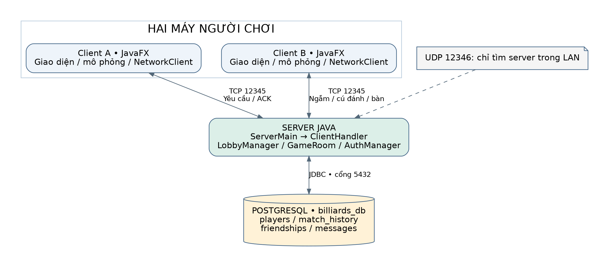
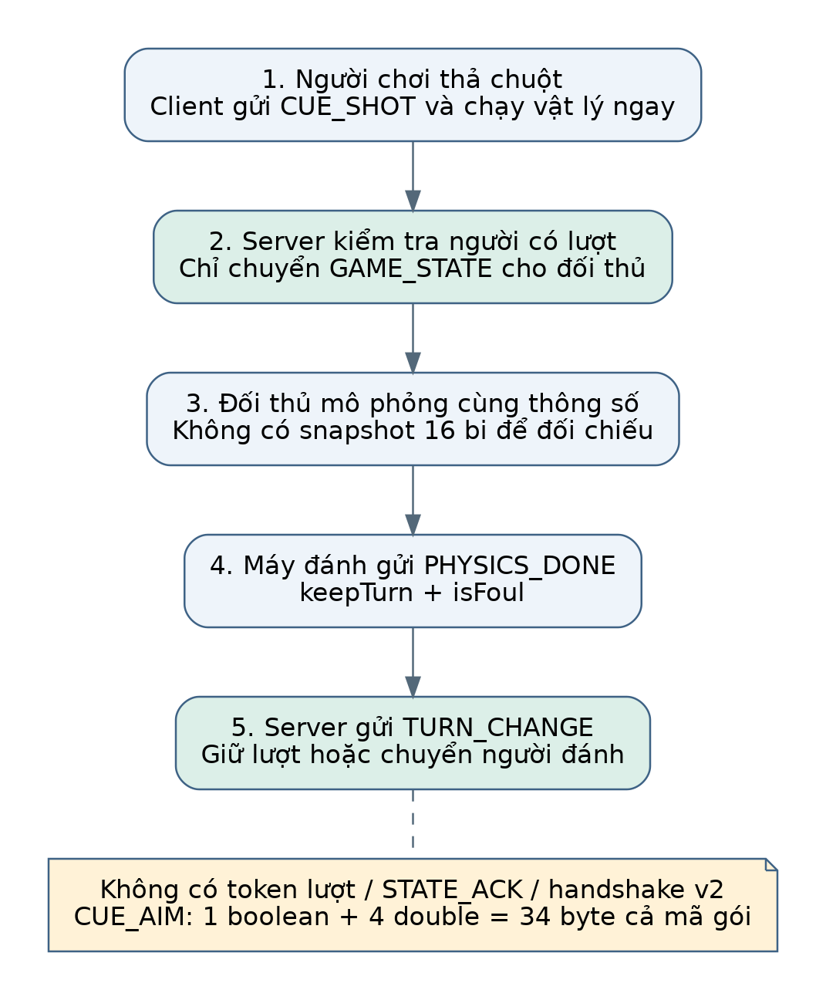
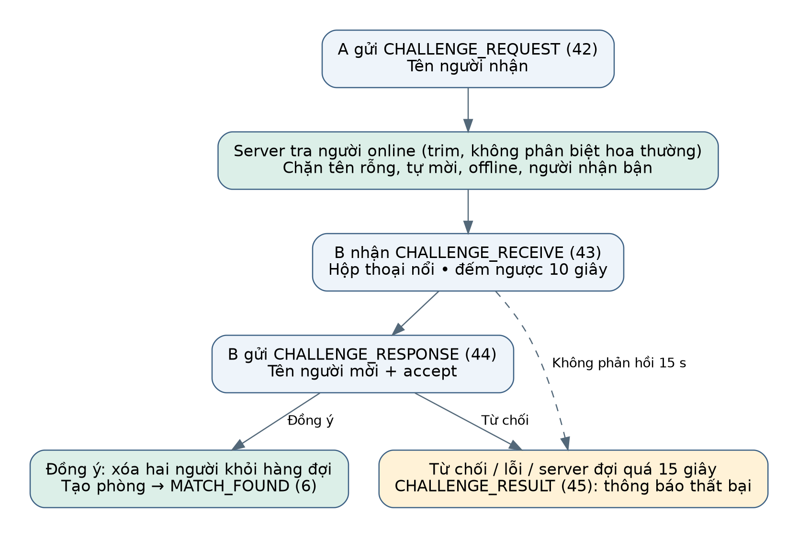
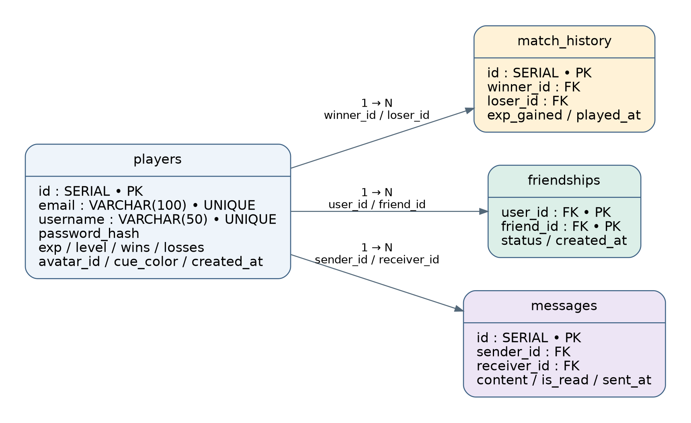

# BÁO CÁO ĐỒ ÁN HỌC PHẦN LẬP TRÌNH MẠNG

## XÂY DỰNG TRÒ CHƠI BI-A 8-BALL POOL HAI NGƯỜI CHƠI QUA MẠNG

Trường: [Bổ sung tên trường]

Khoa/Lớp: [Bổ sung khoa và lớp]

Giảng viên hướng dẫn: [Bổ sung họ tên]

Nhóm thực hiện: Nguyễn Xuân Lộc — Trung — Phạm Hoàng Minh — Lê Tiến Mạnh

Mã sinh viên: [Bổ sung theo danh sách nhóm]

Ngày cập nhật: 26/10/2026, múi giờ Việt Nam.

Phiên bản đối chiếu: LocMixi2-5/LTM, commit 00bf1ccaf8df2cdd54b79cb75ca188ae9c38627e.

## TÓM TẮT

Đồ án xây dựng trò chơi bi-a hai người theo kiến trúc client–server. Client JavaFX đảm nhiệm giao diện, thao tác ngắm gậy và mô phỏng bi; server Java Socket xác thực tài khoản, quản lý phiên, ghép trận, xử lý thách đấu và điều phối lượt. PostgreSQL lưu tài khoản, kinh nghiệm, lịch sử trận, quan hệ bạn bè và tin nhắn. TCP cổng 12345 vận chuyển nghiệp vụ; UDP cổng 12346 hỗ trợ tìm máy chủ trong mạng LAN.

Phiên bản hiện tại bổ sung xử lý thách đấu theo tên không phân biệt hoa thường, cải thiện hộp thoại lời mời và thông báo kết quả, đồng thời bỏ khung đối thủ trống trong chế độ luyện tập solo. Các cải tiến đăng ký bằng email, hiển thị chat và menu bạn bè cũng có trong mã nguồn. Báo cáo mô tả việc triển khai, kết quả kiểm tra đã thực hiện và giới hạn còn tồn tại.

Báo cáo giữ bốn phần theo bảng phân công nhóm: tổng hợp và giao thức mạng; server và cơ sở dữ liệu; client, giao diện và game engine; kiểm thử và đánh giá. Các hình minh họa gồm sơ đồ dựng từ mã nguồn và ảnh chụp trực tiếp các màn hình JavaFX. Ảnh dữ liệu mẫu được ghi rõ để không bị hiểu nhầm là minh chứng chạy hai máy Windows hoặc chơi hoàn chỉnh qua Internet.

## PHÂN CÔNG VÀ PHẠM VI BÁO CÁO

| Phần | Thành viên theo phân công | Trách nhiệm | Sản phẩm trình bày |
| --- | --- | --- | --- |
| 1 | Nguyễn Xuân Lộc | Tổng hợp code và báo cáo | Kiến trúc tổng thể, giao thức TCP, NetworkClient, tích hợp và nội dung thuyết trình |
| 2 | Trung | Server + DB | ServerMain, ClientHandler, GameRoom, LobbyManager, AuthManager, DatabaseManager và schema |
| 3 | Phạm Hoàng Minh | Client + UI | Điều hướng, các màn hình JavaFX, Ball, PhysicsEngine, GameScene |
| 4 | Lê Tiến Mạnh | Kiểm thử | Môi trường, kịch bản, kết quả, ảnh minh họa và đánh giá |

Nguồn phân công là bảng Google Sheets do nhóm cung cấp [1]. Tên “Trung” được giữ nguyên vì bảng chưa ghi đủ họ tên. Bảng này mô tả trách nhiệm được giao, không xác nhận tỷ lệ đóng góp hoặc tác giả của từng dòng mã. Thông tin trường, lớp, giảng viên và MSSV chưa có được để trống để nhóm bổ sung.

Kế hoạch ban đầu nhắc đến 21 loại packet và ConnectScene. Mã hiện tại định nghĩa 47 mã packet; chức năng cấu hình server nằm trong ServerConfigDialog. Báo cáo sử dụng tên lớp và hành vi đang có trong phiên bản đối chiếu, không sao chép nguyên các mô tả đã cũ trong tài liệu trước.

## PHẠM VI CẬP NHẬT NGÀY 26/10/2026

Lần kiểm tra này lấy nhánh main mới nhất tại commit 00bf1cc. Lịch sử main đã thay đổi so với nhánh chứa báo cáo trước: các thành phần đồng bộ v2, thư mục tests và reports của bản trước không còn trong cây nguồn hiện tại. Vì vậy báo cáo được biên soạn lại từ mã đang có; kết quả kiểm thử trên nhánh cũ không được sử dụng để kết luận cho phiên bản này.

| Nội dung | Hiện trạng tại 00bf1cc |
| --- | --- |
| Packet | 47 mã; chưa có HELLO xác nhận phiên bản, token lượt, BOARD_STATE hay STATE_ACK |
| Ngắm gậy | Một boolean và bốn double; 34 byte tính cả mã gói; gửi có điều tiết theo thay đổi tại client |
| Cú đánh | Client đánh mô phỏng ngay; server chuyển GAME_STATE cho đối thủ |
| Chuyển lượt | Máy đánh gửi PHYSICS_DONE; chưa có hàng rào xác nhận cùng bàn từ cả hai client |
| Thách đấu mới | Tra tên online có trim/không phân biệt hoa thường; kiểm tra tự mời, người nhận bận; thời hạn server 15 giây |
| Giao diện mới | Popup lời mời nổi trên cửa sổ chủ, đếm 10 giây; kết quả dùng toast; thao tác Timeline đưa về luồng JavaFX |
| Luyện tập solo | Ẩn và loại khỏi bố cục các thành phần đối thủ; bỏ dòng “Khung Trống (Solo)” |
| Kiểm chứng lần này | Biên dịch mới, thử TCP/server/PostgreSQL và kiểm tra JavaFX có dữ liệu điều khiển; không chạy bộ hồi quy v2 cũ |

Lần cập nhật chỉ bổ sung tài liệu, hình ảnh và mã kiểm tra phục vụ báo cáo. Không khôi phục mã đồng bộ cũ vào main và không thay đổi mã nghiệp vụ Java của người dùng.

# PHẦN 1. TỔNG HỢP HỆ THỐNG VÀ GIAO THỨC MẠNG

Thành viên phụ trách theo phân công: Nguyễn Xuân Lộc.

## 1.1. Bài toán, mục tiêu và phạm vi chức năng

Trò chơi nhiều người phải thống nhất dữ liệu tài khoản, đối thủ và quyền thao tác giữa những máy có tốc độ xử lý hoặc độ trễ khác nhau. Với bi-a, các dữ liệu chính gồm góc gậy, lực đánh, vị trí bi cái, độ xoáy và thời điểm chuyển lượt. Truyền thông số cú đánh giúp giảm lưu lượng, nhưng hai mô phỏng độc lập có thể khác tiến độ; vì vậy không được suy ra rằng TCP tự làm cho vị trí bi ở hai máy luôn giống nhau.

Hệ thống hướng đến quy trình đăng ký, đăng nhập, tìm trận hoặc thách đấu, chơi và nhận kết quả. Các chức năng bạn bè, chat, bảng xếp hạng, tùy chỉnh avatar/gậy và luyện tập hỗ trợ trải nghiệm ngoài ván đấu. Phạm vi học phần tập trung lập trình socket, thiết kế packet, quản lý đồng thời, lưu dữ liệu và xử lý tình huống lỗi.

Mô hình hiện tại đặt vật lý tại client. Server kiểm tra người có lượt, chuyển tiếp thao tác và cập nhật kết quả do luồng nghiệp vụ xác định; server không chạy một bản vật lý độc lập để đối chiếu mọi va chạm. Luyện tập solo là chế độ cục bộ, khác với phòng đối kháng hai người.

## 1.2. Kiến trúc tổng thể

Luồng nghiệp vụ thông thường đi từ Scene JavaFX đến NetworkClient, qua TCP tới ClientHandler, rồi tới bộ phận xác thực, ghép trận hoặc dữ liệu. Trong trận, GameRoom giữ hai người chơi và chỉ số người có lượt. DatabaseManager là lớp truy cập PostgreSQL thông qua JDBC.

| Tầng | Thành phần | Trách nhiệm |
| --- | --- | --- |
| Hiển thị và tương tác | JavaFX scenes, Canvas, AnimationTimer | Nhận thao tác, hiển thị hồ sơ/phòng/bàn chơi, mô phỏng bi |
| Mạng client | NetworkClient, Packet, PacketType | Kết nối, đóng gói, đọc payload, đo RTT và phát callback |
| Dịch vụ server | ServerMain, ClientHandler | Nhận socket, xử lý yêu cầu của phiên và gửi phản hồi |
| Nghiệp vụ | AuthManager, LobbyManager, GameRoom | Đăng nhập, ghép trận, thách đấu, quyền lượt và kết thúc |
| Lưu trữ | DatabaseManager, PostgreSQL | Tài khoản, EXP, trận đấu, bạn bè, chat |

Mỗi kết nối có một ClientHandler chạy trên luồng riêng. Phòng đấu và lời mời dùng bộ định thời; client có luồng lắng nghe và luồng ping. Cụm từ “một thread/client” chỉ mô tả luồng đọc yêu cầu tại server, không phải tổng số luồng của toàn hệ thống.

## 1.3. TCP, UDP và cấu trúc packet

TCP sử dụng cổng 12345. Gói ở tầng ứng dụng có dạng một byte PacketType, theo sau là các trường được ghi tuần tự. Các số nhiều byte dùng big-endian. Chuỗi UTF-8 được đặt sau một int 32-bit biểu diễn số byte; Packet.readString kiểm tra độ dài từ 0 đến 65.536 rồi đọc đủ số byte đó.

TCP bảo đảm thứ tự luồng byte nhưng không giữ ranh giới giữa các lần ghi. Một lần đọc không nhất thiết tương ứng một packet. Vì không có chiều dài tổng quát cho mọi packet, hai phía phải thống nhất chính xác số lượng và kiểu trường. Nếu một phía đọc thêm chuỗi không được gửi, dữ liệu của packet tiếp theo có thể bị lấy nhầm làm độ dài chuỗi.

UDP discovery dùng cổng 12346. Client gửi BILLIARDS_DISCOVER, server trả BILLIARDS_SERVER:12345. Cơ chế này giúp tìm máy chủ trong LAN; các thao tác gameplay vẫn đi qua TCP. Broadcast LAN không tự cung cấp khám phá server trên Internet.

Phiên bản hiện tại chưa trao đổi mã phiên bản khi mở socket. Một client có thể gửi đăng ký/đăng nhập trực tiếp. Bởi vậy phải dùng client và server có định dạng tương thích; không thể trộn các binary của nhánh v2 cũ với nhánh hiện tại rồi kỳ vọng tự thương lượng giao thức.

## 1.4. Danh mục 47 mã và payload quan trọng

| Nhóm mã | Vai trò |
| --- | --- |
| 1–4 | Đăng nhập, đăng ký và phản hồi |
| 5–9 | Tìm/hủy tìm trận, ghép đối thủ, sẵn sàng và khởi tạo |
| 10–14 | Cú đánh, trạng thái cú đánh, chuyển lượt, bi vào lỗ và kết quả |
| 15–19 | Bảng xếp hạng, ngắt kết nối, ping và lỗi |
| 20–23 | PHYSICS_DONE, CLAIM_WIN và thiết lập hồ sơ |
| 24–37 | Tìm người chơi, kết bạn, chấp nhận/từ chối và xóa bạn |
| 38–41 | Tin nhắn và lịch sử chat |
| 42–45 | Yêu cầu, tiếp nhận, phản hồi và kết quả thách đấu |
| 46–47 | Đặt bi cái và trạng thái ngắm gậy |

Đây là số mã định nghĩa trong enum, không phải khẳng định mọi mã đều được sử dụng trong mọi luồng. Các payload dưới đây được đối chiếu với phương thức đọc/ghi của hai phía, không dựa riêng vào comment rút gọn cạnh tên enum.

| Packet | Chiều chính | Payload |
| --- | --- | --- |
| GAME_START (9) | Server → hai client | int playerIndex, boolean isFirstTurn, long matchSeed |
| CUE_SHOT (10) | Người đánh → server | 6 double: angle, force, cueX, cueY, spinX, spinY |
| GAME_STATE (11) | Server → đối thủ | 6 double của cú đánh |
| TURN_CHANGE (12) | Server → hai client | boolean isYourTurn, boolean ballInHand, string reason |
| GAME_OVER (14) | Server → client | boolean youWin, int expGained |
| PING (18) | Client ↔ server | long timestamp; server trả lại timestamp |
| PHYSICS_DONE (20) | Máy đánh → server | boolean keepTurn, boolean isFoul |
| CLAIM_WIN (21) | Client → server | boolean isWin |
| CHALLENGE_REQUEST (42) | Người mời → server | string targetUsername |
| CHALLENGE_RECEIVE (43) | Server → người nhận | string challengerUsername |
| CHALLENGE_RESPONSE (44) | Người nhận → server | string challengerUsername, boolean accept |
| CHALLENGE_RESULT (45) | Server → client | boolean success, string message |
| CUE_BALL_PLACED (46) | Client → server → đối thủ | double cueX, double cueY |
| CUE_AIM (47) | Client → server → đối thủ | boolean isAiming, 4 double: angle, forceRatio, spinX, spinY |

CUE_AIM hiện có kích thước 1 + 1 + 4 × 8 = 34 byte ở tầng ứng dụng. Khoảng 30 mẫu/giây tương ứng khoảng 1.020 byte/giây trên mỗi chặng nếu thực sự gửi đủ số mẫu đó. Đây là phép tính lý thuyết, chưa tính TCP/IP và không phải số đo lưu lượng thực tế. CUE_SHOT có kích thước 49 byte gồm mã loại và sáu double.

## 1.5. NetworkClient, callback và đo độ trễ

NetworkClient mở Socket với thời hạn kết nối 2,5 giây, bật keepalive và TCP_NODELAY, rồi tạo BufferedInputStream/BufferedOutputStream. Một luồng lắng nghe đọc trọn payload theo PacketType trước khi chuyển cho callback của màn hình. Các màn hình dùng Platform.runLater để đưa cập nhật về JavaFX Application Thread.

Client gửi ping ngay khi kết nối và định kỳ mỗi hai giây. Server trả lại timestamp; client lấy chênh lệch thời gian để hiển thị RTT. Đây là cơ chế đo độ trễ hiện có, không phải cơ chế heartbeat 5 giây và read timeout 20 giây được mô tả trong báo cáo nhánh cũ. Mã kết nối hiện tại không đặt thời hạn đọc socket tương ứng.

Các phương thức gửi ghi và flush trực tiếp vào stream, phần lớn được synchronized. Không còn lớp hàng đợi ghi riêng QueuedOutputStream với FIFO giới hạn và một ô thay thế mẫu ngắm. Do đó thao tác ghi có thể chậm khi đường truyền hoặc bên nhận tắc; việc điều tiết ngắm tại GameScene không tự biến I/O thành bất đồng bộ.

## 1.6. Đồng bộ ngắm và chuyển lượt ở phiên bản hiện tại

GameScene chỉ gửi cập nhật ngắm nếu dữ liệu thay đổi đủ mức hoặc có sự kiện cần gửi ngay. Với luồng thông thường, khoảng cách hai lần gửi tối thiểu là 33 ms, ngưỡng đổi góc 0,008 rad và ngưỡng đổi lực 0,015. Chuyển trạng thái isAiming hoặc forceSend có thể vượt quy tắc 33 ms; vì vậy đây không phải giới hạn cứng 30 Hz cho mọi tình huống.

Phía quan sát nội suy góc theo khoảng quay ngắn nhất qua ±π, dùng hệ số 0,35 cho góc và 0,4 cho lực ở mỗi khung hình. Cách nội suy này phụ thuộc số khung hình thực tế, chưa chuẩn hóa theo thời gian trôi qua. Packet không có token lượt hoặc sequence, nên server không thể loại dữ liệu cũ dựa trên hai trường đó.

Khi thả chuột, máy đánh gửi CUE_SHOT và chạy vật lý ngay. Server kiểm tra đúng người có lượt, rồi chỉ gửi GAME_STATE cho đối thủ. Khi mô phỏng của máy đánh kết thúc, client gửi PHYSICS_DONE; server phát TURN_CHANGE để giữ lượt hoặc đổi người đánh. Hai client không trao đổi bản vị trí cuối của toàn bộ 16 bi để xác nhận trước lượt tiếp theo.

MatchSeed giúp hai client khởi tạo cách phân nhóm/thiết lập trận từ cùng đầu vào. Seed giống nhau không chứng minh các vị trí bi sẽ luôn giống nhau sau mọi cú đánh, nhất là khi nhịp cập nhật vật lý phụ thuộc khung hình.

## 1.7. Tích hợp và những điểm cần đối chiếu

Khi tổng hợp mã nguồn, cần kiểm tra cùng PacketType, thứ tự trường và ý nghĩa phản hồi ở cả hai phía. Sai khác thực tế được tìm thấy tại SETTINGS_RESPONSE: server gửi một boolean, trong khi NetworkClient.readPacketPayload đọc boolean rồi đọc tiếp string. Kiểm tra parser với payload server hợp lệ chỉ gồm boolean tạo EOFException; trên socket sống, bên đọc có thể chờ tiếp hoặc diễn giải nhầm byte của gói sau.

Đây là vấn đề định dạng, không phải lỗi do TCP đảo thứ tự. Báo cáo ghi nhận hiện trạng và không khẳng định mọi packet đang hoàn toàn đồng nhất. Việc biên dịch thành công cũng không đủ để phát hiện sai lệch giao thức kiểu này.

Sản phẩm của phần 1 gồm mô tả kiến trúc, bảng packet và bản tổng hợp hiện trạng. Nội dung thuyết trình nên đi từ bài toán, kiến trúc, cú đánh, thách đấu, giao diện tới kiểm thử; không trình bày cơ chế v2 đã không còn trong nhánh hiện tại như thành quả đang hoạt động.

# PHẦN 2. SERVER VÀ CƠ SỞ DỮ LIỆU

Thành viên phụ trách theo phân công: Trung.

## 2.1. Tổ chức các lớp server

| Lớp | Vai trò |
| --- | --- |
| ServerMain | Khởi tạo dịch vụ, lắng nghe TCP, chạy UDP discovery và quản lý onlinePlayers |
| ClientHandler | Đọc packet của từng kết nối, xác thực phiên, gọi nghiệp vụ, gửi phản hồi |
| LobbyManager | Hàng đợi ghép trận và tạo GameRoom |
| GameRoom | Hai người chơi, chỉ số lượt, sẵn sàng, chuyển tiếp cú đánh, kết quả và timer |
| AuthManager | Kiểm tra dữ liệu đăng ký, băm và xác minh mật khẩu |
| DatabaseManager | Kết nối JDBC, truy vấn và cập nhật PostgreSQL |

ServerMain tạo một luồng daemon chạy ClientHandler cho mỗi socket được chấp nhận. Các phương thức gửi của ClientHandler khóa trên stream out để tránh trộn byte từ nhiều nguồn ghi. LobbyManager dùng ConcurrentLinkedQueue và đồng bộ hóa thao tác thêm/xóa hàng đợi. Điều này hỗ trợ điều phối, nhưng chưa đủ để khẳng định mọi thao tác tạo phòng đồng thời đều có tính nguyên tử.

## 2.2. Đăng ký, đăng nhập và chuẩn hóa email

AuthManager kiểm tra email/tên tài khoản không trống, mật khẩu tối thiểu sáu ký tự. Mật khẩu được băm SHA-256 cùng salt ngẫu nhiên 16 byte; dữ liệu lưu có dạng base64(salt):base64(hash). Khi đăng nhập, server tính lại và so sánh với giá trị lưu. Không lưu mật khẩu thuần trong cột password_hash.

DatabaseManager trim email rồi chuyển thành chữ thường, trim username và tìm dữ liệu trùng bằng LOWER. Tra cứu đăng nhập dùng LOWER(username) hoặc LOWER(email), nên người dùng có thể đăng nhập bằng email hoặc tên tài khoản khác kiểu chữ. Các ràng buộc UNIQUE trên email và username vẫn tồn tại trong schema.

Kiểm tra định dạng email đầy đủ hiện nằm ở client, chưa được áp dụng tương đương tại AuthManager. Bài thử gửi trực tiếp một email không có @ qua TCP vẫn tạo tài khoản và đăng nhập được. SHA-256 với salt cũng chưa phải hàm băm mật khẩu thích nghi như Argon2/PBKDF2; TCP hiện chưa có TLS. Đây là giới hạn của triển khai, không phải xác nhận đã bảo vệ đầy đủ khi vận hành trên Internet.

## 2.3. Ghép trận ngẫu nhiên và sẵn sàng

FIND_MATCH đưa client vào hàng đợi nếu chưa có phòng và chưa có trong queue. Khi có hai người, LobbyManager lấy hai phần tử ra rồi createGame. Bản mới bổ sung removeFromQueue cho cả hai ngay trong createGame; luồng đồng ý thách đấu cũng thực hiện bước này. Mục đích là không để người đã ghép bằng thách đấu tiếp tục bị giữ trong hàng đợi tìm ngẫu nhiên.

GameRoom giữ currentTurnIndex, gameStarted, gameFinished và readyCount. Sau khi tạo phòng, server gửi MATCH_FOUND kèm tên, level, avatar và màu gậy đối thủ. Màn hình trước trận gửi PREGAME_READY; server tăng bộ đếm và bắt đầu khi readyCount đạt hai.

Hiện readyCount đếm số lần gọi, chưa dùng cờ riêng cho mỗi người. Bài thử gửi hai READY từ một client đã làm cả hai nhận GAME_START dù người còn lại chưa READY. Vì thế mô tả chính xác là “đạt hai thông điệp sẵn sàng”, không phải bảo đảm đã nhận xác nhận độc lập từ hai màn hình.

## 2.4. Thách đấu trực tiếp: thay đổi trong 00bf1cc

ClientHandler.getOnlinePlayer tìm theo tên đã trim; nếu không thấy khóa trực tiếp thì duyệt onlinePlayers và so sánh không phân biệt hoa thường. handleChallengeRequest từ chối tên rỗng, người nhận không online, tự thách đấu, người nhận đang có phòng hoặc đang có lời mời chờ.

Khi hợp lệ, server đặt currentChallenger ở người nhận và gửi CHALLENGE_RECEIVE. Người nhận trả lời bằng CHALLENGE_RESPONSE gồm tên người mời và cờ accept. Server kiểm tra tên tương ứng, người mời còn online và chưa vào phòng khác. Nếu đồng ý thì xóa hai người khỏi hàng đợi và tạo phòng; nếu từ chối thì gửi CHALLENGE_RESULT cho người mời.

Hộp thoại client tự từ chối sau 10 giây. Timer server đặt 15 giây để có khoảng đệm cho việc chuyển phản hồi qua mạng. Vì client thật có thể gửi từ chối ở mốc 10 giây, không nên diễn giải rằng mọi lời mời trên UI phải tồn tại đủ 15 giây. Bài kiểm tra mốc 15 giây dùng socket thử nghiệm chủ động không gửi phản hồi.

Khi người nhận ngắt kết nối trong lúc có lời mời, cleanup hủy timer và thông báo cho người mời. Khi người mời đã ngắt rồi người nhận mới đồng ý, server trả thông báo thất bại. Những tình huống này được kiểm tra riêng với server thật.

## 2.5. Giới hạn vòng đời lời mời

currentChallenger là một tên người chơi, chưa có invitation ID. handleChallengeResponse hủy challengeTimer trước khi kiểm tra phản hồi có khớp lời mời đang chờ hay không. Trong bài thử có kiểm soát, sau khi lời mời đã được thiết lập timer, một phản hồi mang sai tên làm timer bị hủy nhưng currentChallenger vẫn còn; người nhận tiếp tục bị báo bận sau hơn 15 giây.

Lần chạy đầu của bài kiểm tra phản hồi sai được gửi ngay khi vừa nhận CHALLENGE_RECEIVE, trước khi có thể chắc timer đã được tạo. Kết quả không tái hiện đúng điều kiện dự kiến. Lần chạy tiếp theo chờ 250 ms trước khi gửi phản hồi sai để kiểm tra trạng thái timer đã thiết lập; lỗi được tái hiện. Nhật ký cả hai lần được giữ lại, không ghi lần đầu là một bài kiểm tra đạt.

Đọc mã còn cho thấy createGame chưa khóa trọn chuỗi kiểm tra khả dụng–tạo phòng–gán tham chiếu, và luồng phản hồi kiểm tra phòng của người mời nhưng chưa kiểm tra lại đầy đủ phòng của người nhận ở cùng thời điểm. Những trường hợp đua tranh nhiều lời mời/phòng cần bài thử đồng thời riêng; báo cáo không gộp chúng vào các lỗi đã tái hiện.

## 2.6. Cú đánh, thời hạn lượt và kết thúc trận

GameRoom.processCueShot kiểm tra gameStarted, gameFinished và người đang có lượt, hủy timer lượt rồi chuyển cú đánh cho đối thủ. Chưa có phase riêng đánh dấu cú đánh đã được chấp nhận và đang chạy. Bài thử gửi cùng CUE_SHOT hai lần liên tiếp đã nhận hai GAME_STATE ở phía đối thủ.

Khi nhận PHYSICS_DONE từ người đang có lượt, server giữ lượt nếu keepTurn hoặc chuyển lượt nếu không. Chưa có token để phân biệt hai lượt liên tiếp của cùng người và chưa có snapshot đối chiếu vị trí. Các gói ngắm chỉ được kiểm tra người có lượt; góc NaN đã được chuyển tiếp trong bài thử trực tiếp.

Giao diện client đếm 60 giây và gửi PHYSICS_DONE(false, true) nếu quá giờ. Server còn có bộ định thời 61.500 ms, tự đổi lượt và cấp ball-in-hand nếu chưa đánh. Timer bị hủy khi có cú đánh; chưa có thời hạn riêng chờ kết quả vật lý tương đương mốc 45 giây của nhánh cũ. Báo cáo không gọi đây là máy trạng thái WAITING/AIMING/MOVING/SYNCING vì enum đó không tồn tại ở bản hiện tại.

CLAIM_WIN cho phép client gửi boolean thắng/thua. endGame dùng thông tin này để chọn người thắng, tăng EXP và gửi GAME_OVER. Ngắt kết nối trong phòng làm người còn lại thắng theo quy tắc hiện có. gameFinished chặn xử lý kết quả lặp trong cùng phòng, nhưng chưa xác minh kết quả bằng vật lý server.

## 2.7. Thiết kế cơ sở dữ liệu PostgreSQL

| Bảng | Khóa và trường chính | Vai trò |
| --- | --- | --- |
| players | id SERIAL PK; email UNIQUE; username UNIQUE; password_hash; exp, level, wins, losses; avatar_id, cue_color, created_at | Tài khoản, thống kê và tùy chỉnh |
| match_history | id PK; winner_id, loser_id FK; exp_gained; played_at | Kết quả trận |
| friendships | Khóa kép user_id, friend_id; hai FK; status; created_at | Lời mời và quan hệ bạn bè |
| messages | id PK; sender_id, receiver_id FK; content; is_read; sent_at | Tin nhắn và lịch sử |

Người chơi mới có mặc định exp=0, level=1, wins=0, losses=0. Trạng thái quan hệ được biểu diễn bằng chuỗi như PENDING, ACCEPTED, BLOCKED; schema chưa có CHECK giới hạn các giá trị này. Chỉ mục exp DESC hỗ trợ bảng xếp hạng; username có ràng buộc duy nhất và một chỉ mục khai báo riêng.

Cơ sở dữ liệu hiện giữ UNIQUE trên giá trị username gốc, chưa có UNIQUE trên LOWER(username). Việc tìm trùng không phân biệt hoa thường trước INSERT hỗ trợ kiểm tra tuần tự, nhưng không thay thế ràng buộc tương ứng trong mọi yêu cầu đồng thời. Tra cứu username OR email cũng có thể cần xử lý khi tên của tài khoản này trùng email tài khoản khác; đây là nhận xét từ cấu trúc mã/schema, chưa có bài thử riêng trong lần này.

## 2.8. JDBC, cập nhật EXP và tính toàn vẹn

DatabaseManager sử dụng PreparedStatement cho nhiều thao tác có tham số. Người thắng được cộng 100 EXP và tăng wins, người thua tăng losses; level = floor(exp / 200) + 1. Sau đó một dòng được thêm vào match_history. Việc cập nhật hồ sơ ở client dựa vào dữ liệu server, không tự cộng EXP chỉ từ hoạt ảnh chiến thắng.

recordMatchResult hiện thực hiện các câu UPDATE/INSERT liên tiếp nhưng chưa bọc toàn bộ trong transaction có rollback. Nếu lỗi xảy ra giữa các câu, dữ liệu tài khoản và lịch sử có thể chưa thống nhất. Cờ gameFinished giúp hạn chế lặp trong vòng đời phòng, không cung cấp bảo đảm exactly-once bền vững khi tiến trình hoặc database gặp sự cố.

DatabaseManager giữ một Connection chung, thông tin cấu hình nằm trong mã nguồn. Hướng hoàn thiện là dùng connection pool, cấu hình ngoài mã và transaction cho kết quả trận. Đây là đề xuất, không phải tính năng đã có.

Sản phẩm phần 2 là dịch vụ kết nối, xác thực, ghép phòng/thách đấu, điều phối lượt và lớp dữ liệu. Các chức năng được báo cáo đúng mức độ kiểm chứng ở phần 4.

# PHẦN 3. CLIENT, GIAO DIỆN VÀ GAME ENGINE

Thành viên phụ trách theo phân công: Phạm Hoàng Minh.

## 3.1. Điều hướng giao diện

ClientMain khởi tạo JavaFX, NetworkClient và SceneManager. SceneManager chuyển giữa các màn hình theo quy trình sử dụng. Phần nghiệp vụ mạng được tách khỏi lớp vẽ bàn, nhưng các Scene vẫn đăng ký callback của NetworkClient để nhận sự kiện tương ứng.

| Màn hình/lớp | Nội dung và thao tác |
| --- | --- |
| ServerConfigDialog | Cấu hình địa chỉ máy chủ, hỗ trợ kết nối |
| LoginScene / RegisterScene | Đăng nhập và đăng ký |
| LobbyScene | Hồ sơ, tìm trận, luyện tập, bạn bè, chat và thách đấu |
| MatchmakingScene | Chờ ghép cặp, hủy tìm |
| PreGameScene | Thông tin đối thủ, đếm ngược và sẵn sàng |
| GameScene | Bàn chơi, gậy, bi, lượt, lực, xoáy, ping/FPS |
| LeaderboardScene | Xếp hạng lấy từ server |
| ResultScene | Kết quả và EXP được thông báo |

Luồng chính là kết nối → đăng nhập → sảnh → tìm trận/thách đấu → trước trận → chơi → kết quả. Luyện tập đi từ sảnh vào GameScene ở chế độ cục bộ. Không nên dùng đường đi solo để kết luận luồng mạng hai người đã chạy đúng.

## 3.2. Form đăng ký bằng email

Form có email, tên đăng nhập, mật khẩu và xác nhận mật khẩu. Client kiểm tra điền đủ thông tin, tên dài 3–20 ký tự, không chứa dấu cách thường, mật khẩu ít nhất sáu ký tự và hai lần nhập trùng nhau. Email đi qua regex rồi được gửi bằng sendRegister(email, username, password).

Regex hiện giới hạn đuôi tên miền hai đến bảy chữ cái. Kiểm tra giao diện cho thấy player@example.technology bị từ chối. Cần phân biệt kiểm tra cú pháp với xác minh địa chỉ có thật: hệ thống chưa gửi thư xác nhận hoặc OTP. Kiểm tra dấu cách bằng contains(" ") cũng chưa có nghĩa đã loại mọi ký tự trắng Unicode.

## 3.3. Danh sách bạn bè, chat và cập nhật theo nền

LobbyScene tự yêu cầu danh sách bạn bè theo chu kỳ 3,5 giây khi panel tương ứng đang hiển thị. Dữ liệu giống lastFriendListData được bỏ qua để tránh dựng lại giao diện. Nếu menu đang mở, dữ liệu mới được giữ ở pendingFriendListData rồi áp dụng khi menu đóng.

Bản mới đưa startFriendAutoRefresh và stopFriendAutoRefresh về JavaFX Application Thread nếu được gọi từ luồng khác. Khi nhận MATCH_FOUND, thao tác dừng Timeline, đóng popup và chuyển cảnh nằm trong Platform.runLater. Bài kiểm tra gọi start/stop từ worker thread đã xác nhận Timeline được tạo/dừng ở nhịp xử lý JavaFX.

Chat hiển thị tin tự gửi ngay và tải lịch sử từ server. Dòng cuối lưu khóa người gửi–thời gian đến phút–nội dung để tránh thêm một dòng giống hệt. Khi lịch sử về, các dòng tự gửi được giữ tạm, giao diện dựng lại lịch sử rồi bổ sung dòng còn thiếu theo cách đối chiếu hiện có.

Cơ chế chưa có message ID/conversation ID. Hai tin giống nhau trong cùng phút có thể bị gộp; lịch sử từ cuộc trò chuyện cũ trả muộn có thể được áp dụng vào cuộc trò chuyện mới. Với danh sách bạn bè, chuỗi dữ liệu A → B → A trong lúc menu mở có thể khiến B cũ được áp dụng sau khi đóng. Những tình huống này đã được tái hiện tại tầng giao diện và được ghi riêng ở phần kiểm thử.

## 3.4. Hộp thoại lời mời và thông báo kết quả

Bản 00bf1cc tạo hộp thoại với owner là cửa sổ chính, modality APPLICATION_MODAL, kiểu trong suốt và alwaysOnTop. Sau show, hộp thoại được đưa lên trước, yêu cầu focus và đặt gần giữa cửa sổ chủ. Kích thước dự phòng được dùng nếu kích thước thực chưa xác định. Timeline đếm ngược được chạy sau bước hiển thị và định vị.

Hai nút Đồng ý/Từ chối gửi phản hồi với cờ responded nhằm tránh lặp hành động từ cùng hộp thoại. Hết đếm ngược, client gửi từ chối và đóng lời mời. Việc hộp thoại xuất hiện đúng trong Xvfb không thay cho kiểm tra focus trên mọi bản Windows hoặc nhiều màn hình.

CHALLENGE_RESULT hiện dùng showToast thay cho Alert.showAndWait. Thay đổi này áp dụng cho thông báo kết quả; bản thân hộp thoại nhận lời mời vẫn là modal. Nếu đồng ý được server chấp nhận, chuyển trận được điều khiển bởi MATCH_FOUND, không cần suy diễn rằng server luôn phát một toast “thành công” trước đó.

## 3.5. Ball, phân nhóm và vật lý

Ball lưu chỉ số, vị trí x/y, vận tốc vx/vy, spinX/spinY, cờ active và trạng thái rơi vào lỗ. Bi số 0 là bi cái, 8 là bi đen; màu/họa tiết các bi còn lại phục vụ nhận biết. Bàn có sáu lỗ. “8-ball” là tên biến thể có bi số 8, không phải bàn có tám lỗ.

Ở chế độ đối kháng hiện tại, GameScene lấy 14 bi mục tiêu khác bi 8, xáo bằng matchSeed rồi chia hai nhóm bảy bi. Nhóm được giao vì vậy có thể gồm cả số thuộc dải 1–7 và 9–15; không nên mô tả triển khai là tuân thủ hoàn toàn luật chia nhóm trơn/sọc chuẩn. Đây là lựa chọn luật chơi đang có trong mã.

PhysicsEngine tính chuyển động, ma sát, va chạm bi–bi, bi–băng và bi vào lỗ. Các tham số gồm ma sát 0,985, phục hồi băng 0,78 và phục hồi bi–bi 0,96. Mỗi update có 10 bước con để tăng độ chi tiết xử lý va chạm. Các hệ số này là tham số mô phỏng của đồ án, chưa được hiệu chuẩn từ bàn thực.

AnimationTimer gọi physics.update khi physicsRunning. Mã hiện tại chưa có bộ tích lũy thời gian cố định 1/60 giây và tám bước bù như nhánh trước. Do đó tần suất dựng hình có thể ảnh hưởng tốc độ tiến triển mô phỏng. Hiển thị 60 FPS trong ảnh không chứng minh mọi thiết bị hoặc mọi tình huống đều đạt 60 FPS ổn định.

## 3.6. Điều khiển và hiển thị gậy đối thủ

Người chơi chọn hướng từ vị trí chuột so với bi cái, kéo lực và chỉnh xoáy. Khi có quyền đặt bi, thao tác chuột dùng cho vị trí bi cái. Các giới hạn vị trí được áp dụng tại client; server hiện kiểm tra lượt trước khi chuyển tiếp vị trí, chưa có bản bàn chuẩn để đối chiếu đầy đủ.

CUE_AIM mang trạng thái hiển thị, góc, tỷ lệ lực và hai thành phần xoáy. Phía quan sát cập nhật mục tiêu nội suy; đường ngắm và gậy được dựng trên Canvas. Khi nhận GAME_STATE, thông số cú đánh được đưa vào pendingShot để vòng lặp áp dụng lúc phù hợp.

Trong lần kiểm tra này, luồng TCP thật đã chuyển tiếp 60 mẫu ngắm liên tiếp sang đối thủ; UI riêng đã giải mã payload và hiển thị gậy. Hai phép kiểm tra này không tương đương với bài thử hai GameScene qua DelayProxy tám giây trên nhánh v2 cũ. Báo cáo không dùng kết quả cũ để khẳng định sai số góc hoặc hội tụ 16 bi của bản hiện tại.

## 3.7. Thay đổi chế độ luyện tập solo

Khi isPractice=true, vsBadge và oppBox được đặt visible=false, managed=false; oppBallsBox cũng bị ẩn và loại khỏi bố cục. Khung nét đứt chứa nhãn “Khung Trống (Solo)” bị loại bỏ. Vì vậy giao diện không còn dành chỗ cho một đối thủ không tồn tại.

Solo áp dụng cú đánh tại máy cục bộ và có mục tiêu dọn bàn. Kiểm tra lần này xác nhận cờ practice, việc ẩn/loại bố cục và không tồn tại nhãn khung trống. Chưa có bài nghiệm thu chơi solo hoàn chỉnh tới khi dọn hết 15 bi; không suy rộng kiểm tra bố cục thành kiểm tra toàn bộ luật solo.

## 3.8. Đóng gói và giới hạn phiên bản sử dụng

Repository có hai JAR client/server cùng script biên dịch và launcher C# phục vụ đóng gói. Các công cụ portable EXE mới ở nhánh báo cáo trước không còn trong main hiện tại. Vì vậy các EXE phát hành từ nhánh v2 cũ không được mặc nhiên coi là binary của 00bf1cc.

Lần cập nhật báo cáo sử dụng mã Java mới biên dịch trong môi trường Linux. Không tạo EXE mới, không xác nhận chạy trực tiếp Windows và không sửa các binary người dùng đã đưa lên. Khi nghiệm thu trên máy người chơi cần kiểm tra rõ phiên bản client/server thay vì chỉ dựa vào tên file.

Sản phẩm phần 3 là các màn hình, mô hình bi, mô phỏng và xử lý giao tiếp tại client. Những thay đổi UI được minh họa bằng ảnh thật, còn mức độ đúng về nghiệp vụ mạng được đối chiếu trong phần 4.

# PHẦN 4. KIỂM THỬ, KẾT QUẢ VÀ ĐÁNH GIÁ

Thành viên phụ trách theo phân công: Lê Tiến Mạnh.

## 4.1. Phương pháp và môi trường

Các kiểm tra được thực hiện trên mã 00bf1cc ngày 26/10/2026. Server và client được biên dịch vào thư mục mới, không dùng lại output chứa các lớp v2 đã bị xóa. Tổng cộng biên dịch thành công 9 file Java server và 26 file Java client bằng JDK 21, đích tương thích Java 17.

| Thành phần | Điều kiện kiểm tra |
| --- | --- |
| Hệ điều hành | Linux trong workspace phát triển |
| JavaFX | 17.0.13, Xvfb display :99, màn hình 2048 × 900 |
| Cơ sở dữ liệu | PostgreSQL 17 cục bộ, database phát triển billiards_db |
| TCP/UDP | Server mới từ mã hiện tại; TCP 12345; cấu hình UDP trong mã 12346 |
| Kiểm tra giao thức | Socket Python trực tiếp tới server, không dùng HELLO v2 |
| Kiểm tra giao diện | Lớp JavaFX thật, transport giả lập, callback và dữ liệu có kiểm soát |
| Tài khoản | Định danh tạm riêng cho mỗi lần chạy; dọn bản ghi liên quan sau bài thử |

Nguồn kiểm tra và nhật ký nằm trong reports/evidence/00bf1cc. Không chạy tests/run.sh của nhánh cũ vì file và hợp đồng giao thức tương ứng không còn trong phiên bản này. Kiểm tra chỉ đọc mã được tách khỏi kiểm tra đã thực thi; ảnh dữ liệu mẫu được tách khỏi xác minh đầu cuối.

## 4.2. Quy trình kiểm tra và tính tái lập

Trước khi thử, xác định commit, đối chiếu file thay đổi và dựng lại cả hai phía. Server phát triển cũ được dừng đúng theo PID đã theo dõi, rồi khởi động server mới. Các phép thử đăng ký/đăng nhập tạo tài khoản tạm; sau khi đóng kết nối, script xóa lịch sử trận, quan hệ, tin nhắn và tài khoản chỉ thuộc lần chạy.

check_current.py kiểm tra packet và phản hồi server thật. ReportUiCheck.java biên dịch cùng client mới, dựng RegisterScene, LobbyScene và GameScene, gọi các tình huống có điều khiển và lưu ảnh. Phần transport giả lập không kết nối tài khoản thật hoặc gửi lời mời tới người khác.

Mã thoát 0 của các script mô tả hiện trạng có nghĩa các điều kiện đã được kiểm tra đúng như assertion, trong đó có cả assertion tái hiện lỗi. Vì vậy một dòng FINDING không được đổi thành “Đạt chức năng” chỉ vì script kết thúc bình thường.

## 4.3. Kết quả kiểm tra giao thức và server

| Mã | Tình huống | Kết quả thực tế |
| --- | --- | --- |
| S01 | Đăng ký và đăng nhập username khác kiểu chữ, không handshake | Thực hiện thành công |
| S02 | Thách đấu tên rỗng, chính mình hoặc người không online | Bị từ chối như kỳ vọng |
| S03 | Mời tên có khoảng trắng đầu/cuối và khác kiểu chữ; phản hồi từ chối tương ứng | Tìm đúng người và gửi kết quả từ chối |
| S04 | Người mời đang trong queue, sau đó được chấp nhận thách đấu | Tạo đúng phòng; cặp tiếp theo không bị ghép với người mời cũ |
| S05 | Một client gửi hai PREGAME_READY | Tái hiện mở trận khi người còn lại chưa READY |
| S06 | Gửi 60 mẫu góc liên tiếp qua TCP | Đối thủ nhận đúng mẫu, không phản hồi ngắm về người gửi |
| S07 | CUE_AIM chứa NaN | Tái hiện server chuyển tiếp góc không hữu hạn |
| S08 | Gửi cùng cú đánh hai lần trước PHYSICS_DONE | Tái hiện đối thủ nhận hai GAME_STATE |
| S09 | Máy đánh gửi PHYSICS_DONE(false, false) | Server đổi lượt; không có snapshot/ACK đi kèm |
| S10 | SETTINGS_UPDATE rồi PING | Server gửi SETTINGS_RESPONSE chỉ một boolean; PING tiếp theo đúng ranh giới |
| S11 | Không phản hồi lời mời | Server báo hết hạn sau khoảng 15,00 giây |
| S12 | Phản hồi sai tên sau khi timer lời mời đã thiết lập | Tái hiện timer bị hủy, người nhận vẫn bận sau 15 giây |
| S13 | Người nhận ngắt kết nối khi còn lời mời | Người mời nhận thông báo thất bại |
| S14 | Người mời ngắt kết nối trước lúc người nhận đồng ý | Người nhận nhận thông báo thất bại |
| S15 | Đăng ký bằng email sai định dạng qua TCP trực tiếp | Tái hiện tài khoản được tạo và đăng nhập bằng địa chỉ đó |

S06 gồm 60 mẫu gửi cách nhau khoảng 34 ms; đây là thử chuyển tiếp và định dạng, không phải đo trần thông lượng hoặc độ mượt qua Internet. S11 chủ động không dùng client UI tự từ chối sau 10 giây. S12 được tái hiện trong điều kiện timer đã được thiết lập; nhật ký lần đầu khác điều kiện được giữ riêng để tránh bỏ qua sai lệch trong quá trình kiểm tra.

## 4.4. Kết quả kiểm tra JavaFX và hình ảnh

| Mã | Tình huống | Kết quả thực tế |
| --- | --- | --- |
| U01 | Form gửi email rõ ràng, chặn chuỗi email sai ở client | Đúng trong bài kiểm tra transport giả lập |
| U02 | Nhập email với đuôi .technology | Bị chặn do regex giới hạn 7 chữ cái |
| U03 | Dữ liệu bạn bè giống nhau; cập nhật khi menu đang mở | Không dựng lại khi giống; menu giữ mở, cập nhật được hoãn |
| U04 | Dữ liệu bạn bè A → B → A lúc menu mở | Tái hiện áp dụng B cũ sau khi đóng |
| U05 | Hai tin cùng người gửi, cùng phút, cùng nội dung | Tái hiện chỉ còn một dòng hiển thị |
| U06 | Đổi cuộc trò chuyện rồi nhận lịch sử cũ đến muộn | Tái hiện lịch sử cũ vào khung mới |
| U07 | Gọi start/stop auto refresh ngoài JavaFX thread | Thao tác được chuyển về JavaFX, Timeline tạo/dừng được |
| U08 | Hiển thị hộp thoại lời mời | Popup xuất hiện, alwaysOnTop được bật, đóng được theo vòng đời UI |
| U09 | Nhận CHALLENGE_RESULT | Có toast, không dùng modal Alert cho kết quả này |
| U10 | Dựng GameScene luyện tập | Không còn nhãn khung trống; thành phần đối thủ bị ẩn và unmanaged |
| U11 | Đưa CUE_AIM hiện tại vào GameScene | Kích hoạt và hiển thị ngắm của đối thủ |
| U12 | Cho parser SETTINGS_RESPONSE đọc payload server chỉ có boolean | Tái hiện EOF vì parser còn đòi string |

Các ảnh được chụp trực tiếp từ JavaFX tại phiên bản kiểm tra, không vẽ lại để làm đẹp giao diện. Hình 3.1–3.7 sử dụng tài khoản và tin nhắn mẫu. Hình 3.6 không phải ảnh nghiệm thu hai client qua mạng; ping/FPS hiển thị trong ảnh không được dùng làm số liệu hiệu năng.

## 4.5. Phân tích các vấn đề quan trọng

Sai lệch SETTINGS_RESPONSE ảnh hưởng cách đọc toàn bộ luồng. Server đã được thử để xác nhận payload chỉ có boolean. Parser client lại đọc thêm string; khi dùng stream kết thúc ngay sau payload hợp lệ, kết quả là EOFException. Trên socket không đóng, hành vi có thể là chờ dữ liệu hoặc đọc nhầm packet kế tiếp. Việc này cần sửa ở hợp đồng đọc/ghi và thêm kiểm thử ranh giới packet.

Ở luồng sẵn sàng và cú đánh, hiện không có định danh lượt hay pha chấp nhận một lần. READY lặp có thể thay cho người thứ hai; CUE_SHOT lặp vẫn qua kiểm tra “đúng người có lượt”. Chỉ kiểm tra người gửi là chưa đủ để xác minh một thao tác thuộc đúng lần chuyển trạng thái.

Với thách đấu, việc hủy timer trước khi xác minh người phản hồi để lại trạng thái lời mời không hết hạn khi tên không khớp. Cách xử lý nên gắn định danh lời mời và chỉ hủy timer của lời mời hợp lệ. Đề xuất này chưa được triển khai trong mã nguồn của lần viết báo cáo.

Chat cần phân biệt bản tin trùng do truyền/xử lý với hai tin hợp lệ có nội dung giống nhau. Khóa người gửi–phút–nội dung không làm được điều đó. Tương tự, lịch sử cần thông tin cuộc trò chuyện hoặc mã yêu cầu để phản hồi cũ không cập nhật sai panel. Đối với bạn bè, dữ liệu chờ cần luôn đại diện cập nhật mới nhất kể cả khi nó quay về giá trị đang hiển thị.

## 4.6. Hạng mục chưa được kiểm chứng

| Hạng mục | Phạm vi còn thiếu |
| --- | --- |
| Hai máy Windows/EXE | Chưa chạy trực tiếp client và server Windows của phiên bản hiện tại |
| Ván đối kháng hoàn chỉnh | Chưa có biên bản chơi thủ công từ khai cuộc tới kết thúc trên hai UI thật |
| So khớp 16 bi | Chưa có cơ chế snapshot/ACK ở mã hiện tại; không kế thừa kết quả v2 cũ |
| Xoay gậy qua độ trễ/jitter | Chưa chạy bài hai GameScene qua DelayProxy của nhánh cũ trên phiên bản này |
| Timer lượt 60/61,5 giây | Đã đọc mã; chưa chờ hết thời hạn thật trong lần kiểm tra này |
| Nhiều lời mời đồng thời | Chưa stress test việc mời chéo, nhận mời khi đang được ghép phòng |
| Database lỗi giữa giao dịch | Chưa fault injection hoặc kiểm tra nhiều phòng ghi kết quả cùng lúc |
| Email và định danh đồng thời | Chưa thử race đăng ký khác kiểu chữ hoặc username trùng email của người khác |
| Luật chơi/solo đầy đủ | Chưa nghiệm thu mọi tình huống bi 8, phạm lỗi và dọn bàn |
| Tải và mạng thực tế | Chưa benchmark CPU/bộ nhớ, nhiều giờ chơi, Wi-Fi yếu hay Internet |

Các bài kiểm tra trước đây trên nhánh v2 không chứng minh các hạng mục này ở main hiện tại. Báo cáo giữ ranh giới đó để không trình bày những cơ chế đã bị loại khỏi nhánh như tính năng đang bảo vệ trận đấu.

## 4.7. Đánh giá kết quả và hướng phát triển

Những cải tiến mới có tác dụng quan sát được: lời mời tìm đúng tên dù khác kiểu chữ; những yêu cầu tự mời, rỗng hoặc offline bị chặn; lời mời không phản hồi có thời hạn server; nhận trận bằng thách đấu không để người mời bị giữ trong queue của tình huống đã thử. Giao diện đưa thao tác Timeline về đúng luồng, hiển thị lời mời phía trước và bỏ thành phần đối thủ trong solo.

Các phần đăng ký/email, chat và menu đã có triển khai nhưng vẫn có giới hạn cần xử lý. Bản gameplay hiện dựa trên mô phỏng client và PHYSICS_DONE, chưa có đối chiếu bàn chung trước lượt mới. Vì vậy không thể kết luận “đã xử lý tất cả lỗi bất đồng bộ” từ những bài kiểm tra hiện có.

Ưu tiên trước mắt là thống nhất payload SETTINGS_RESPONSE, kiểm tra dữ liệu số/email ở server, xử lý READY và cú đánh theo trạng thái nhận một lần, cùng vòng đời lời mời có định danh. Tiếp theo là định danh tin nhắn/cuộc trò chuyện, đồng bộ hóa tạo phòng và sửa cách giữ cập nhật bạn bè mới nhất.

Nếu yêu cầu độ nhất quán gameplay cao hơn, cần thiết kế bước thời gian cố định, định danh lượt, cơ chế chốt trạng thái và chính sách timeout rõ ràng. Việc bổ sung phải đi kèm đặc tả phiên bản và bài thử tương ứng, thay vì chỉ đổi format packet ở một phía. Khi dữ liệu trận được lưu, nên dùng transaction và connection pool; trước triển khai công cộng cần hoàn thiện xác thực và bảo vệ đường truyền.

Nghiệm thu tiếp theo nên chạy hai máy Windows với binary đồng bộ, chơi các ván đầy đủ và ghi nhận phiên bản, môi trường, thao tác, kết quả mong đợi/thực tế. Các chỉ số độ trễ, FPS, số packet và mức dùng tài nguyên chỉ được đưa vào báo cáo khi có phép đo tương ứng.

## 4.8. Kết luận theo bốn phần công việc

Phần tổng hợp xác định đúng kiến trúc và giao thức của main hiện tại. Phần server và dữ liệu giải thích cách xác thực, tạo phòng, thách đấu, điều phối lượt và lưu tài khoản/kết quả. Phần client trình bày các màn hình, mô phỏng, thay đổi popup/toast và giao diện luyện tập với ảnh chụp thật. Phần kiểm thử phân biệt hành vi đã xác minh, lỗi đã tái hiện và phạm vi chưa kiểm chứng.

Báo cáo này thay thế mô tả v2 không còn phù hợp với nhánh main tại 00bf1cc. Các cải tiến thách đấu và solo đã được kiểm tra theo phạm vi nêu trên; các hạn chế giao thức, đồng bộ và UI vẫn được ghi rõ để làm căn cứ hoàn thiện đồ án. Không có sửa đổi mã nguồn ứng dụng trong lần cập nhật tài liệu.

## TÀI LIỆU VÀ MÃ NGUỒN ĐỐI CHIẾU

[1] Bảng phân công nhóm: https://docs.google.com/spreadsheets/d/1-6mH6p7RWCQZz0WJjhmeotOyZ7pgXATkPjmgJvB3u9M/edit?usp=sharing . Tên và bốn nhóm nhiệm vụ lấy theo bảng đã cung cấp.

[2] Phiên bản mã nguồn: https://github.com/LocMixi2-5/LTM/tree/00bf1ccaf8df2cdd54b79cb75ca188ae9c38627e . Thay đổi gần nhất tập trung GameScene, LobbyScene, ClientHandler, LobbyManager và hai JAR.

[3] Giao thức: client/src/com/billiards/client/NetworkClient.java; hai package protocol/Packet.java và protocol/PacketType.java tại [2]. Có 47 mã; chưa có các packet v2 của báo cáo trước.

[4] Server: server/src/com/billiards/server/{ServerMain,ClientHandler,LobbyManager,GameRoom,AuthManager,DatabaseManager}.java; database/schema.sql tại [2].

[5] Client: client/src/com/billiards/client/scenes/{RegisterScene,LobbyScene,PreGameScene,GameScene,SceneManager}.java; game/{Ball,PhysicsEngine}.java tại [2].

[6] Minh chứng lần kiểm tra này: reports/evidence/00bf1cc/README.md, check_current.py, ReportUiCheck.java và các nhật ký .txt. Nguồn hình: reports/images/README.md. Mã kiểm tra được thêm cùng báo cáo, không có sẵn trong commit [2].

[7] Tài liệu nền tảng để tham khảo thêm: Java API https://docs.oracle.com/en/java/javase/17/docs/api/ ; JavaFX https://openjfx.io/ ; PostgreSQL https://www.postgresql.org/docs/ ; JDBC https://jdbc.postgresql.org/documentation/ .
