# BÁO CÁO PHÂN TÍCH VÀ THIẾT KẾ HỆ THỐNG

## TRÒ CHƠI BI-A HAI NGƯỜI QUA MẠNG — PHÂN CÔNG 4 PHÂN HỆ

Học phần: Lập trình mạng

Trường / Khoa / Lớp: [Bổ sung]

Giảng viên hướng dẫn: [Bổ sung]

Nhóm thực hiện: TV1 — TV2 — TV3 — TV4

Họ tên và MSSV tương ứng: [Nhóm bổ sung theo phân công mới]

Ngày cập nhật: 28/10/2026 — múi giờ Việt Nam.

Mã ứng dụng đối chiếu: 00bf1ccaf8df2cdd54b79cb75ca188ae9c38627e.

## TÓM TẮT

Báo cáo phân tích hệ thống game bi-a Java/JavaFX theo bốn phân hệ: kết nối và giao thức; xác thực và dữ liệu; gameplay và vật lý; giao diện và cá nhân hóa. Nội dung được tổ chức theo bảng phân công mới do người dùng cung cấp ngày 28/10/2026, gồm 31 use case và 14 biểu đồ UML. Mỗi use case có tác nhân, tiền điều kiện, luồng chính, ngoại lệ, hậu điều kiện và liên hệ mã nguồn.

Các biểu đồ mô tả hành vi hiện có ở phiên bản 00bf1cc, không giả định rằng các cơ chế đồng bộ v2 của nhánh trước đang hoạt động. Hệ thống hiện định nghĩa 47 mã packet, dùng TCP cổng 12345 cho nghiệp vụ và UDP cổng 12346 để khám phá máy chủ LAN. Vật lý chạy tại client; chuyển lượt dựa trên PHYSICS_DONE, chưa có snapshot 16 bi và ACK của hai máy.

Kết quả kiểm tra ngày 26/10/2026 được dùng làm minh chứng có ghi rõ phạm vi. Lần cập nhật ngày 28/10 tập trung thay cấu trúc báo cáo và bổ sung đặc tả UML; không sửa mã ứng dụng và không gán cho các biểu đồ ý nghĩa là chức năng đã vượt qua mọi bài nghiệm thu.

## PHÂN CÔNG MỚI VÀ QUY ƯỚC

| Thành viên | Phân hệ phụ trách | Use Cases | Số biểu đồ | Loại biểu đồ |
| --- | --- | --- | --- | --- |
| TV1 | Quản lý kết nối & Giao thức truyền tin | UC-C01 → UC-C07 (7 UC) | 3 | Use Case, Sequence, Activity |
| TV2 | Xác thực & Quản lý dữ liệu | UC-D01 → UC-D07 (7 UC) | 4 | Use Case, Activity ×2, Sequence |
| TV3 | Gameplay & Engine Vật lý | UC-G01 → UC-G08 (8 UC) | 3 | Use Case, Activity, Sequence |
| TV4 | Giao diện & Cá nhân hóa | UC-UI01 → UC-UI09 (9 UC) | 4 | Use Case, Activity, Sequence, Component |
| Tổng | 4 phân hệ | 31 UC | 14 | 4 Use Case, 5 Activity, 4 Sequence, 1 Component |

Báo cáo giữ nhãn TV1–TV4 đúng theo ảnh phân công mới. Ảnh không cung cấp ánh xạ họ tên, vì vậy không tự gán các tên trong bảng phân công cũ cho những trách nhiệm mới. Mã use case do báo cáo đặt theo đúng dải đã yêu cầu; chúng không phải tên hằng số có sẵn trong mã Java.

Use case biểu diễn mục tiêu/chức năng ở ranh giới phân hệ. Với một số xử lý nền, GameRoom hoặc GameScene được dùng làm tác nhân hệ thống đối với phân hệ đang xét. Các bước kỹ thuật của engine được mô hình hóa như use case chức năng theo phạm vi bài tập; không đồng nhất mọi bước nội bộ với một thao tác riêng mà người chơi trực tiếp bấm.

Một chức năng xuyên nhiều phân hệ có các góc nhìn khác nhau: TV1 chuyển gói và điều phối phiên; TV2 xác thực/ghi dữ liệu; TV3 quyết định/mô phỏng gameplay; TV4 hiển thị và nhận thao tác. Ví dụ UC-UI08 chọn và xem skin, còn UC-D03 kiểm tra quyền và lưu skin. Hai use case liên quan nhưng không thay thế nhau.

Mỗi biểu đồ Use Case liệt kê đủ use case của thành viên. Các Activity/Sequence đi sâu vào luồng đại diện được nêu ở chú thích; không có yêu cầu mỗi use case phải có một biểu đồ Sequence riêng. Tổng số biểu đồ trong tài liệu được giữ đúng 3/4/3/4.

## DANH MỤC 14 BIỂU ĐỒ

| Mã hình | Thành viên | Loại | Nội dung / phạm vi |
| --- | --- | --- | --- |
| 1.1 | TV1 | Use Case | Các use case thuộc phân hệ |
| 1.2 | TV1 | Sequence | Kết nối TCP và trao đổi PING |
| 1.3 | TV1 | Activity | Điều phối thách đấu trực tiếp |
| 2.1 | TV2 | Use Case | Các use case thuộc phân hệ |
| 2.2 | TV2 | Activity | Đăng ký và lưu tài khoản |
| 2.3 | TV2 | Activity | Ghi kết quả, EXP và lịch sử |
| 2.4 | TV2 | Sequence | Đăng nhập bằng username hoặc email |
| 3.1 | TV3 | Use Case | Các use case thuộc phân hệ |
| 3.2 | TV3 | Activity | Một cú đánh và xử lý cuối lượt |
| 3.3 | TV3 | Sequence | Truyền cú đánh và đổi lượt hiện tại |
| 4.1 | TV4 | Use Case | Các use case thuộc phân hệ |
| 4.2 | TV4 | Activity | Cá nhân hóa avatar, gậy và âm thanh |
| 4.3 | TV4 | Sequence | Popup thách đấu, toast và chuyển cảnh |
| 4.4 | TV4 | Component | Thành phần giao diện và cá nhân hóa |

# PHẦN 1. TV1 — QUẢN LÝ KẾT NỐI & GIAO THỨC TRUYỀN TIN

Thành viên phụ trách: **TV1**. Họ tên/MSSV: [Bổ sung]. Phạm vi: **7 use case**, **3 biểu đồ**.

## 1.1. Phạm vi và ranh giới trách nhiệm

TV1 phụ trách đường đi dữ liệu từ client đến server, khám phá máy chủ, định dạng packet, đo độ trễ, ghép trận và vòng đời kết nối. Các lớp chính là NetworkClient, Packet, PacketType, ServerMain, ClientHandler và LobbyManager. Điều kiện xác thực và quyết định ghi dữ liệu thuộc TV2; việc vẽ màn hình thuộc TV4.

Giao thức có một byte mã loại và các trường tuần tự big-endian. Chuỗi dùng int độ dài cùng UTF-8, giới hạn đọc 65.536 byte. TCP chỉ bảo toàn luồng byte và thứ tự, nên bên nhận phải đọc chính xác payload. Client hiện ghi/flush trực tiếp; chưa có hàng đợi ghi giới hạn riêng hoặc handshake xác nhận phiên bản.

CUE_AIM mang một boolean và bốn double, tổng 34 byte cả mã gói. CUE_SHOT mang sáu double, tổng 49 byte. PING có long timestamp, gửi ngay lúc kết nối rồi mỗi hai giây. Các con số này mô tả định dạng/lịch gửi trong mã, không phải kết quả đo băng thông Internet.

## 1.2. Danh mục use case

| Mã | Tên use case | Tác nhân chính |
| --- | --- | --- |
| UC-C01 | Thiết lập kết nối TCP | Người chơi |
| UC-C02 | Khám phá server trong LAN | Người chơi |
| UC-C03 | Gửi và nhận packet nhị phân | Người chơi thông qua chức năng ứng dụng |
| UC-C04 | Đo độ trễ RTT | Người chơi |
| UC-C05 | Ghép trận ngẫu nhiên | Người chơi và đối thủ |
| UC-C06 | Thách đấu trực tiếp | Người mời và người nhận |
| UC-C07 | Ngắt kết nối và giải phóng phiên | Người chơi, hoặc kết nối bị gián đoạn |

## 1.3. Đặc tả use case

### UC-C01 — Thiết lập kết nối TCP

**Tác nhân:** Người chơi.

**Tiền điều kiện:** Đã có địa chỉ/cổng server và mạng khả dụng.

**Luồng chính:**

1. Nhập hoặc nạp địa chỉ.
2. Mở socket với timeout kết nối 2,5 giây.
3. Tạo stream.
4. Khởi động luồng nhận và ping.
5. Lưu địa chỉ.

**Ngoại lệ/giới hạn:** Không kết nối được: báo lỗi; người chơi sửa cấu hình hoặc thử lại. Chưa có handshake phiên bản.

**Hậu điều kiện:** Có kết nối TCP để thực hiện yêu cầu nghiệp vụ.

**Mã nguồn liên quan:** NetworkClient.connect; ServerConfigDialog; ServerMain.main.

### UC-C02 — Khám phá server trong LAN

**Tác nhân:** Người chơi.

**Tiền điều kiện:** Client và server cùng vùng mạng hỗ trợ discovery.

**Luồng chính:**

1. Gửi BILLIARDS_DISCOVER qua UDP 12346.
2. Nhận BILLIARDS_SERVER:12345.
3. Sử dụng địa chỉ nhận để kết nối TCP.

**Ngoại lệ/giới hạn:** Không có phản hồi: người chơi nhập địa chỉ thủ công; discovery không bảo đảm tìm server qua Internet.

**Hậu điều kiện:** Xác định được địa chỉ server hoặc quay về nhập thủ công.

**Mã nguồn liên quan:** NetworkClient: UDP discovery; ServerMain.startUdpDiscoveryListener.

### UC-C03 — Gửi và nhận packet nhị phân

**Tác nhân:** Người chơi thông qua chức năng ứng dụng.

**Tiền điều kiện:** Socket đang mở; hai phía dùng định dạng tương thích.

**Luồng chính:**

1. Ghi byte PacketType và các trường.
2. Flush.
3. Phía nhận đọc trọn payload theo loại rồi phân phối tới handler/callback.

**Ngoại lệ/giới hạn:** Payload sai hoặc stream kết thúc có thể gây IOException; SETTINGS_RESPONSE hiện có lệch định dạng được ghi ở phụ lục kiểm chứng.

**Hậu điều kiện:** Yêu cầu được chuyển đến đúng bộ phận khi đọc thành công.

**Mã nguồn liên quan:** NetworkClient.readPacketPayload; Packet; PacketType; ClientHandler.handlePacket.

### UC-C04 — Đo độ trễ RTT

**Tác nhân:** Người chơi.

**Tiền điều kiện:** Socket đang hoạt động.

**Luồng chính:**

1. Client gửi PING kèm long timestamp ngay khi kết nối và định kỳ hai giây.
2. Server trả timestamp.
3. Client tính chênh lệch để hiển thị.

**Ngoại lệ/giới hạn:** Không nhận lại ping: không có số đo mới; đây chưa phải chính sách timeout đọc 20 giây.

**Hậu điều kiện:** Có giá trị RTT phục vụ hiển thị, không thay đổi luật chơi.

**Mã nguồn liên quan:** NetworkClient.sendPing/listenLoop; ClientHandler.handlePing.

### UC-C05 — Ghép trận ngẫu nhiên

**Tác nhân:** Người chơi và đối thủ.

**Tiền điều kiện:** Đã đăng nhập; chưa có phòng.

**Luồng chính:**

1. Gửi FIND_MATCH.
2. Đưa vào queue nếu chưa có.
3. Khi đủ hai người, tạo GameRoom và gửi MATCH_FOUND cho cả hai.

**Ngoại lệ/giới hạn:** CANCEL_FIND xóa khỏi queue; người đã có phòng hoặc đã nằm trong queue không được thêm lặp.

**Hậu điều kiện:** Ghép được phòng hai người hoặc tiếp tục chờ/hủy tìm.

**Mã nguồn liên quan:** LobbyManager.addToQueue/removeFromQueue/createGame; MatchmakingScene.

### UC-C06 — Thách đấu trực tiếp

**Tác nhân:** Người mời và người nhận.

**Tiền điều kiện:** Người mời đăng nhập; có tên người nhận online.

**Luồng chính:**

1. Gửi tên người nhận.
2. Server trim và tra không phân biệt hoa thường.
3. Phát lời mời.
4. Nhận accept.
5. Xóa queue và tạo phòng khi hợp lệ.

**Ngoại lệ/giới hạn:** Tên rỗng/tự mời/offline/bận hoặc từ chối/hết hạn đều thất bại; client đếm 10 giây, server chờ 15 giây.

**Hậu điều kiện:** Có MATCH_FOUND hoặc thông báo không tạo trận; trường hợp phản hồi sai tên còn lỗi vòng đời timer.

**Mã nguồn liên quan:** ClientHandler.handleChallengeRequest/handleChallengeResponse; LobbyManager.createGame.

### UC-C07 — Ngắt kết nối và giải phóng phiên

**Tác nhân:** Người chơi, hoặc kết nối bị gián đoạn.

**Tiền điều kiện:** Có socket hoặc phiên đang hoạt động.

**Luồng chính:**

1. Người chơi ngắt hoặc server phát hiện kết thúc stream.
2. Xóa online/queue.
3. Hủy timer lời mời.
4. Xử lý phòng và đóng socket.

**Ngoại lệ/giới hạn:** Ngắt trong phòng: người còn lại thắng theo quy tắc hiện có; không có phục hồi ván cũ sau reconnect.

**Hậu điều kiện:** Phiên được dọn theo logic cleanup; không khẳng định mọi lỗi mạng được phát hiện ngay.

**Mã nguồn liên quan:** NetworkClient.disconnect/listenLoop; ClientHandler.cleanup; GameRoom.handleDisconnect.

## 1.4. Biểu đồ UML của phân hệ

### Biểu đồ 1.1 — Use Case

Phạm vi: UC-C01, UC-C02, UC-C03, UC-C04, UC-C05, UC-C06, UC-C07.

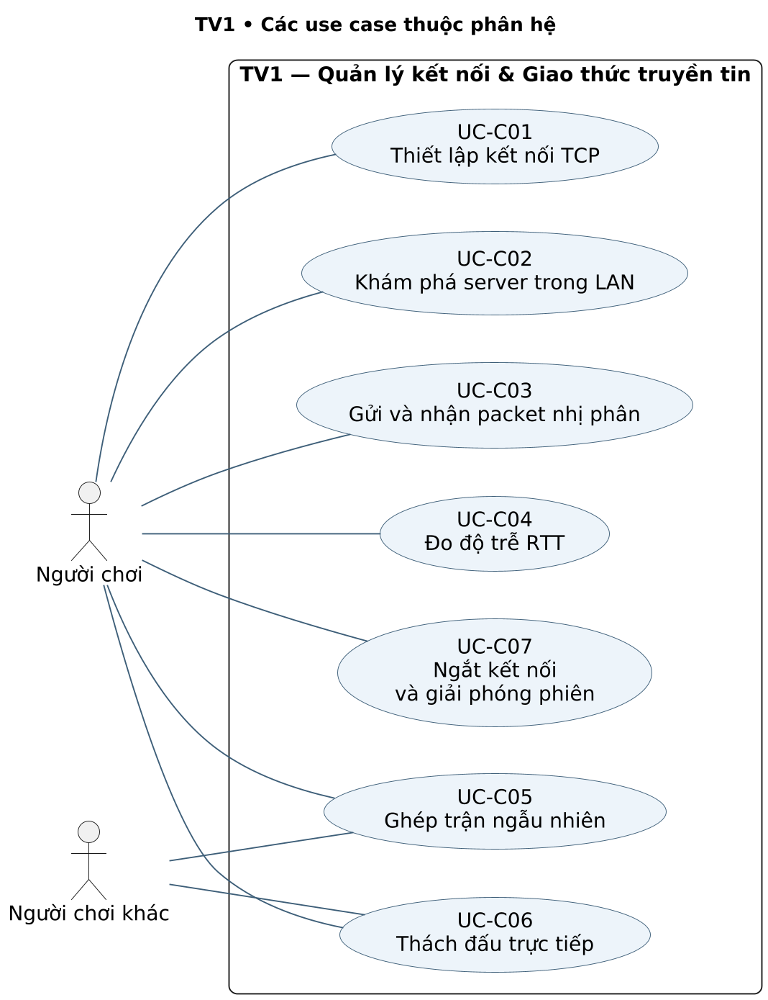

### Biểu đồ 1.2 — Sequence

Phạm vi: UC-C01, UC-C03, UC-C04.

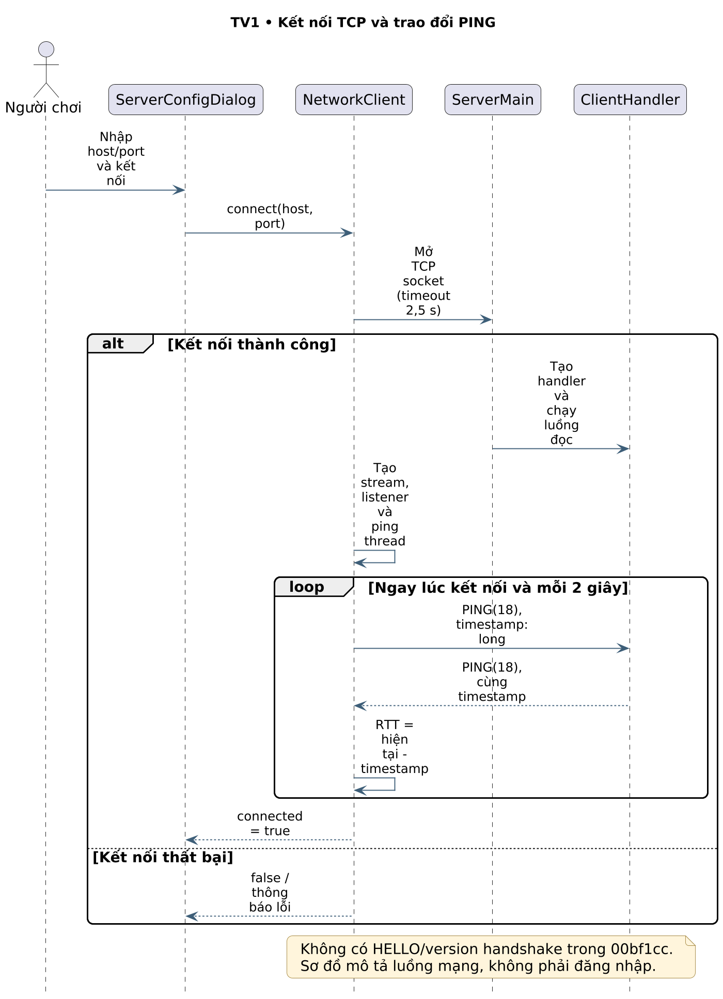

### Biểu đồ 1.3 — Activity

Phạm vi: UC-C06, UC-C07.

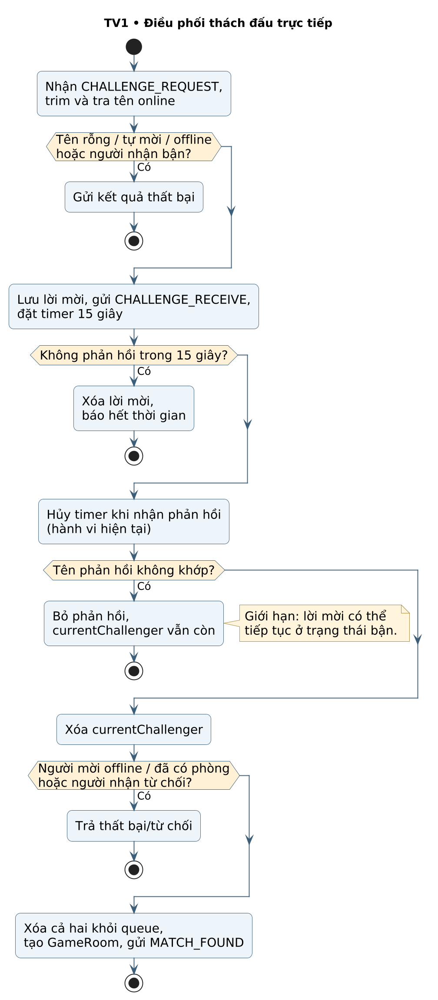

## 1.5. Liên hệ triển khai và giới hạn

Sơ đồ Sequence 1.2 tập trung thiết lập TCP và ping, còn Activity 1.3 tập trung lời mời thách đấu. Các use case khác vẫn được thể hiện trong Use Case 1.1 và đặc tả riêng. Timer lời mời server là 15 giây; hộp thoại client đếm 10 giây. Nhánh phản hồi sai tên trong Activity được giữ lại vì đó là hành vi hiện có, không mô tả như đã sửa.

Các mối liên hệ xuyên phân hệ: sau UC-C01, TV2 xử lý UC-D01/UC-D02; UC-C05/UC-C06 tạo ngữ cảnh để TV3 thực hiện UC-G01; UC-C03 vận chuyển packet cho tất cả các phân hệ. Việc ngắt kết nối UC-C07 có thể kích hoạt ghi kết quả UC-D04 theo quy tắc phòng hiện tại.

# PHẦN 2. TV2 — XÁC THỰC & QUẢN LÝ DỮ LIỆU

Thành viên phụ trách: **TV2**. Họ tên/MSSV: [Bổ sung]. Phạm vi: **7 use case**, **4 biểu đồ**.

## 2.1. Phạm vi và ranh giới trách nhiệm

TV2 phụ trách xác thực, kiểm tra quyền ghi hồ sơ và các thao tác dữ liệu bền vững qua JDBC. AuthManager băm mật khẩu SHA-256 cùng salt ngẫu nhiên 16 byte. DatabaseManager thao tác các bảng players, match_history, friendships và messages trong PostgreSQL. Dữ liệu GUI được hiển thị bởi TV4; TV2 cung cấp kết quả và trạng thái để GUI sử dụng.

Email được trim và chuyển thường; tra cứu đăng nhập dùng LOWER(username) hoặc LOWER(email). Mã hiện tại chưa kiểm tra định dạng email ở server tương đương client, chưa xác minh quyền sở hữu email bằng thư/OTP và chưa có TLS. Đây là mô tả giới hạn thực tế, không phải tính năng bảo mật đã triển khai.

EXP thắng trận là 100; level = floor(EXP/200)+1. DatabaseManager giữ một Connection chung và recordMatchResult chưa bao các câu SQL trong transaction hoàn chỉnh. Activity 2.3 thể hiện ghi tuần tự và ghi chú việc không tự rollback toàn bộ khi lỗi giữa chừng.

## 2.2. Danh mục use case

| Mã | Tên use case | Tác nhân chính |
| --- | --- | --- |
| UC-D01 | Đăng ký tài khoản | Người chơi mới |
| UC-D02 | Đăng nhập bằng tên hoặc email | Người chơi |
| UC-D03 | Lưu avatar và skin gậy | Người chơi đã đăng nhập |
| UC-D04 | Ghi kết quả và cập nhật EXP/level | GameRoom (tác nhân hệ thống) |
| UC-D05 | Truy vấn bảng xếp hạng | Người chơi |
| UC-D06 | Quản lý quan hệ bạn bè | Người chơi và người được mời kết bạn |
| UC-D07 | Lưu và truy vấn tin nhắn | Người gửi và người nhận |

## 2.3. Đặc tả use case

### UC-D01 — Đăng ký tài khoản

**Tác nhân:** Người chơi mới.

**Tiền điều kiện:** Kết nối server và PostgreSQL khả dụng.

**Luồng chính:**

1. Nhận email, username, mật khẩu.
2. Kiểm tra cơ bản.
3. Băm cùng salt.
4. Trim/chuyển thường email.
5. Kiểm tra trùng và INSERT players.

**Ngoại lệ/giới hạn:** Email/username trùng hoặc mật khẩu quá ngắn bị từ chối; server chưa kiểm tra định dạng email tương đương client.

**Hậu điều kiện:** Tạo tài khoản với mật khẩu băm hoặc trả mã lỗi.

**Mã nguồn liên quan:** AuthManager.register/hashPassword; DatabaseManager.register.

### UC-D02 — Đăng nhập bằng tên hoặc email

**Tác nhân:** Người chơi.

**Tiền điều kiện:** Tài khoản đã tồn tại; server kết nối DB.

**Luồng chính:**

1. Tra LOWER(username) hoặc LOWER(email).
2. Xác minh hash với salt.
3. Tạo thông tin phiên và trả hồ sơ.

**Ngoại lệ/giới hạn:** Sai mật khẩu/không tìm thấy: trả thất bại; định danh trùng chéo username–email chưa được giải quyết tường minh.

**Hậu điều kiện:** Có phiên xác thực khi thành công.

**Mã nguồn liên quan:** AuthManager.login/verifyPassword; DatabaseManager.getPlayerByUsername; ClientHandler.handleLogin.

### UC-D03 — Lưu avatar và skin gậy

**Tác nhân:** Người chơi đã đăng nhập.

**Tiền điều kiện:** Có phiên và lựa chọn tùy chỉnh.

**Luồng chính:**

1. Nhận avatarId, cueColor/skinId.
2. Kiểm tra điều kiện cấp độ bằng CueSkinConfig.
3. Cập nhật DB và thông tin phiên.
4. Trả boolean.

**Ngoại lệ/giới hạn:** Không đủ cấp hoặc lỗi DB: trả false; client đang đọc thừa string trong SETTINGS_RESPONSE nên phản hồi có thể không được xử lý đúng.

**Hậu điều kiện:** DB/phiên cập nhật khi thành công; không khẳng định UI đã xác nhận được.

**Mã nguồn liên quan:** ClientHandler.handleSettingsUpdate; CueSkinConfig; DatabaseManager.updateSettings.

### UC-D04 — Ghi kết quả và cập nhật EXP/level

**Tác nhân:** GameRoom (tác nhân hệ thống).

**Tiền điều kiện:** GameRoom đã chọn người thắng/thua.

**Luồng chính:**

1. Đặt gameFinished.
2. Cộng thắng và 100 EXP.
3. Tính level=floor(EXP/200)+1.
4. Tăng thua.
5. INSERT match_history.
6. Nạp lại hồ sơ.

**Ngoại lệ/giới hạn:** DB lỗi giữa các câu lệnh có thể để cập nhật dở dang vì chưa có transaction bao trọn.

**Hậu điều kiện:** Kết quả được ghi theo các câu lệnh thành công; cờ phòng hạn chế lặp trong phiên.

**Mã nguồn liên quan:** GameRoom.endGame/handleDisconnect; DatabaseManager.recordMatchResult.

### UC-D05 — Truy vấn bảng xếp hạng

**Tác nhân:** Người chơi.

**Tiền điều kiện:** Có dữ liệu players và kết nối DB.

**Luồng chính:**

1. Nhận LEADERBOARD_REQUEST.
2. Lấy người chơi theo exp giảm dần với giới hạn.
3. Đóng gói chuỗi và trả client.

**Ngoại lệ/giới hạn:** Lỗi DB hoặc chưa có dữ liệu: xử lý kết quả trống theo mã hiện tại; chưa kiểm thử tải lớn.

**Hậu điều kiện:** Client nhận dữ liệu xếp hạng để dựng giao diện.

**Mã nguồn liên quan:** DatabaseManager.getLeaderboard; ClientHandler.handleLeaderboard.

### UC-D06 — Quản lý quan hệ bạn bè

**Tác nhân:** Người chơi và người được mời kết bạn.

**Tiền điều kiện:** Tài khoản hợp lệ; dữ liệu người nhận tồn tại.

**Luồng chính:**

1. Tìm người chơi, tạo lời mời.
2. Chấp nhận/từ chối.
3. Đọc danh sách.
4. Xóa quan hệ theo yêu cầu.

**Ngoại lệ/giới hạn:** Người nhận không tồn tại hoặc quan hệ không phù hợp: trả trạng thái thất bại; status chưa có CHECK enum trong schema.

**Hậu điều kiện:** Bảng friendships phản ánh thao tác được chấp nhận.

**Mã nguồn liên quan:** DatabaseManager: friendship methods; ClientHandler: friend handlers; schema.sql.

### UC-D07 — Lưu và truy vấn tin nhắn

**Tác nhân:** Người gửi và người nhận.

**Tiền điều kiện:** Hai tài khoản được xác định theo quy tắc hiện tại.

**Luồng chính:**

1. Lưu tin vào messages.
2. Chuyển thông báo tới client.
3. Truy vấn lịch sử giới hạn và trả chuỗi dữ liệu.

**Ngoại lệ/giới hạn:** Lịch sử truyền chưa có conversation ID/message ID phục vụ UI; không suy ra mọi phản hồi muộn được phân biệt.

**Hậu điều kiện:** Tin nhắn được lưu hoặc lịch sử được trả theo khả năng DB.

**Mã nguồn liên quan:** DatabaseManager.getChatHistory và thao tác messages; ClientHandler.handleChatMessage/handleChatHistory.

## 2.4. Biểu đồ UML của phân hệ

### Biểu đồ 2.1 — Use Case

Phạm vi: UC-D01, UC-D02, UC-D03, UC-D04, UC-D05, UC-D06, UC-D07.

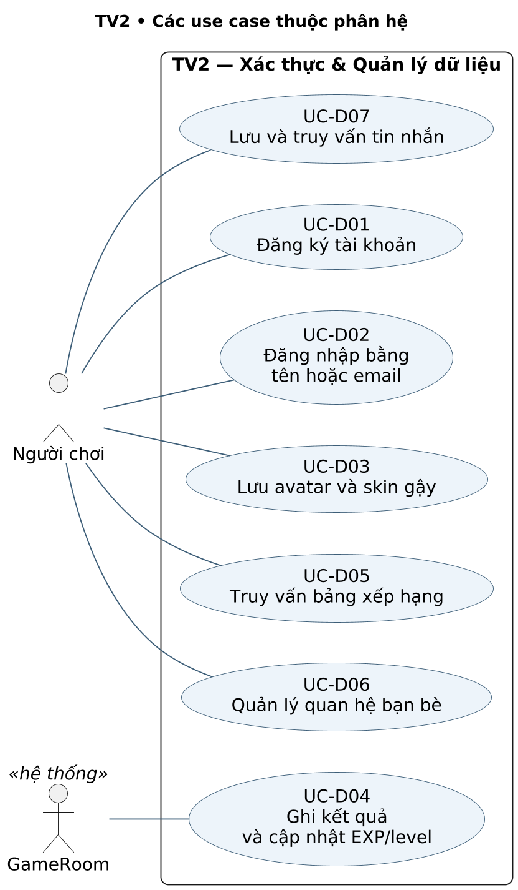

### Biểu đồ 2.2 — Activity

Phạm vi: UC-D01.

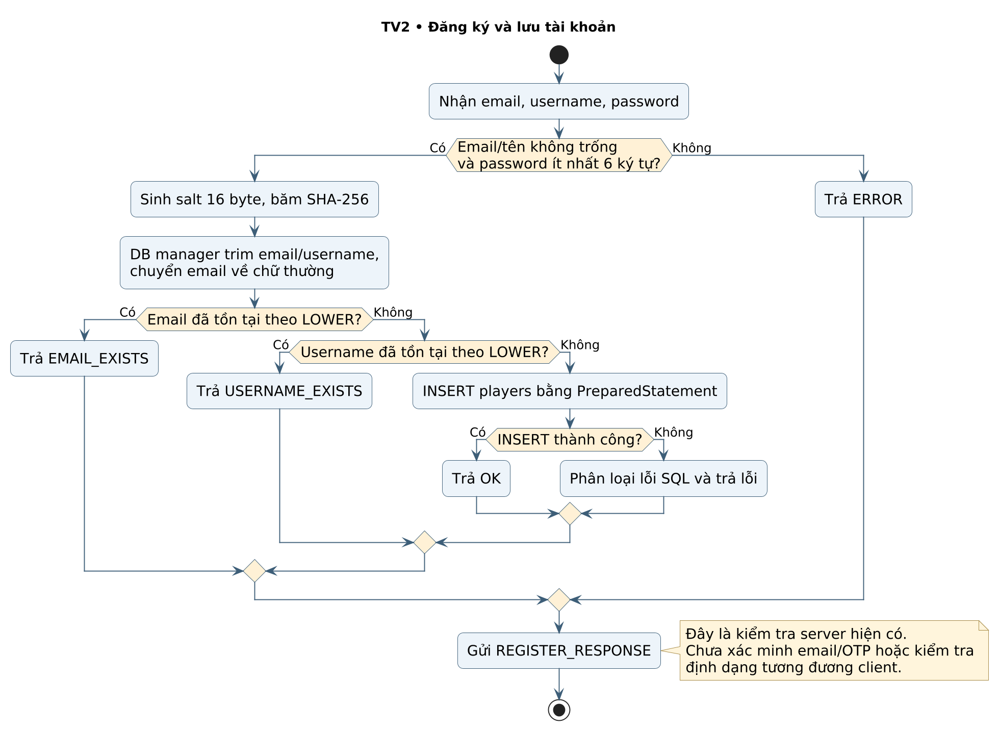

### Biểu đồ 2.3 — Activity

Phạm vi: UC-D04.

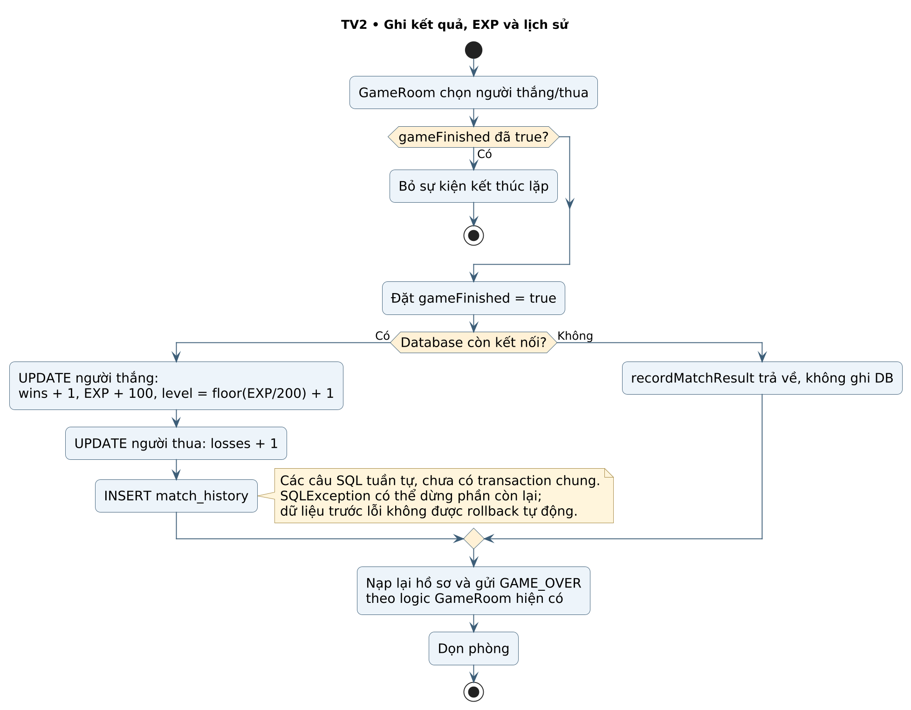

### Biểu đồ 2.4 — Sequence

Phạm vi: UC-D02.

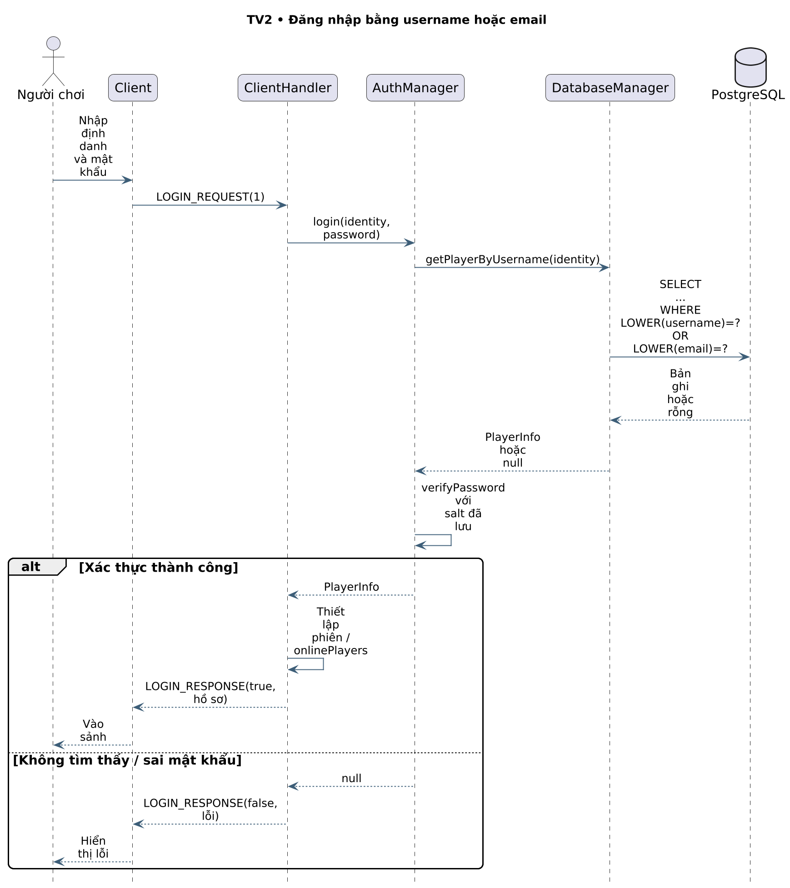

## 2.5. Liên hệ triển khai và giới hạn

Bốn biểu đồ của TV2 gồm Use Case tổng thể, Activity đăng ký, Activity ghi kết quả và Sequence đăng nhập. Không thêm ERD thành biểu đồ thứ năm; cấu trúc lưu trữ được tóm tắt bằng bảng dưới đây để giữ đúng định mức.

| Bảng | Trường/ràng buộc chính | Use case sử dụng |
| --- | --- | --- |
| players | id PK; email/username UNIQUE; password_hash; exp, level, wins, losses; avatar_id, cue_color | UC-D01–UC-D05 |
| match_history | id PK; winner_id và loser_id FK; exp_gained; played_at | UC-D04 |
| friendships | Khóa kép user_id/friend_id; status; created_at | UC-D06 |
| messages | id PK; sender_id/receiver_id FK; content; is_read; sent_at | UC-D07 |

UNIQUE trên username gốc chưa thay cho UNIQUE trên LOWER(username) khi có yêu cầu đồng thời. Việc lấy username hoặc email trong một truy vấn còn cần kiểm tra trùng chéo định danh. Hai điểm này là nhận xét từ mã/schema; không được đánh dấu như đã có bài thử đồng thời đầy đủ.

# PHẦN 3. TV3 — GAMEPLAY & ENGINE VẬT LÝ

Thành viên phụ trách: **TV3**. Họ tên/MSSV: [Bổ sung]. Phạm vi: **8 use case**, **3 biểu đồ**.

## 3.1. Phạm vi và ranh giới trách nhiệm

TV3 phụ trách bàn chơi, bi, ngắm/lực/xoáy, cú đánh, va chạm, xử lý lỗ và luật lượt. Ball biểu diễn x/y, vx/vy, spin và các trạng thái active/inPocket/isSinking. PhysicsEngine có sáu lỗ, xử lý 10 bước con trong mỗi update. Các hệ số hiện có gồm ma sát 0,985, phục hồi băng 0,78, phục hồi bi–bi 0,96.

GameScene gọi update theo AnimationTimer khi physicsRunning. Chưa có bộ tích lũy thời gian cố định 1/60 giây như nhánh v2 cũ. Máy đánh mô phỏng ngay sau gửi CUE_SHOT; server chỉ chuyển thông số cho đối thủ. Người đánh báo PHYSICS_DONE hoặc CLAIM_WIN theo logic client; server chưa kiểm chứng va chạm bằng một mô phỏng riêng.

MatchSeed dùng xáo 14 bi mục tiêu khác bi 8 và chia hai nhóm bảy bi. Đây là luật phân nhóm của dự án; không thể mô tả là luôn chia nhóm trơn/sọc chuẩn. Cùng seed không chứng minh mọi bi sau cú đánh sẽ khớp ở mọi tốc độ khung hình.

## 3.2. Danh mục use case

| Mã | Tên use case | Tác nhân chính |
| --- | --- | --- |
| UC-G01 | Khởi tạo bàn và phân nhóm bi | Hai người chơi |
| UC-G02 | Đặt bi cái | Người đang có lượt |
| UC-G03 | Ngắm và kéo lực gậy | Người đang có lượt và người quan sát |
| UC-G04 | Chỉnh xoáy và thực hiện cú đánh | Người đang có lượt |
| UC-G05 | Mô phỏng chuyển động và va chạm | GameScene (tác nhân hệ thống) |
| UC-G06 | Xử lý bi vào lỗ và kết quả lượt | GameScene (tác nhân hệ thống) |
| UC-G07 | Điều phối lượt và hết thời gian | Hai người chơi; GameRoom timer |
| UC-G08 | Luyện tập solo | Người chơi |

## 3.3. Đặc tả use case

### UC-G01 — Khởi tạo bàn và phân nhóm bi

**Tác nhân:** Hai người chơi.

**Tiền điều kiện:** Client nhận GAME_START với chỉ số người chơi và seed.

**Luồng chính:**

1. Tạo 16 bi.
2. Xáo 14 bi mục tiêu khác bi 8 theo matchSeed.
3. Chia hai nhóm bảy bi.
4. Thiết lập người có lượt.

**Ngoại lệ/giới hạn:** READY hiện đếm số packet, nên một người có thể gửi lặp để mở trận; cùng seed chưa bảo đảm mô phỏng luôn đồng nhất.

**Hậu điều kiện:** Có bàn và nhóm mục tiêu; luật phân nhóm là biến thể của dự án.

**Mã nguồn liên quan:** GameRoom.playerReady/startGame; GameScene constructors.

### UC-G02 — Đặt bi cái

**Tác nhân:** Người đang có lượt.

**Tiền điều kiện:** Client cho phép khai cuộc hoặc ball-in-hand.

**Luồng chính:**

1. Kéo/chọn vị trí.
2. Client giới hạn vùng đặt.
3. Gửi CUE_BALL_PLACED.
4. Server kiểm tra người có lượt rồi chuyển tọa độ.

**Ngoại lệ/giới hạn:** Không có quyền tại UI thì không đặt; server chưa có snapshot chuẩn để đối chiếu mọi vị trí.

**Hậu điều kiện:** Client nhận cập nhật vị trí bi cái.

**Mã nguồn liên quan:** GameScene.repositionCueBall và thao tác chuột; GameRoom.processCueBallPlaced.

### UC-G03 — Ngắm và kéo lực gậy

**Tác nhân:** Người đang có lượt và người quan sát.

**Tiền điều kiện:** Bi chưa chạy; UI cho phép ngắm.

**Luồng chính:**

1. Tính góc theo chuột và tỷ lệ kéo.
2. Gửi CUE_AIM có điều tiết.
3. Đối thủ nội suy góc/lực để hiển thị.

**Ngoại lệ/giới hạn:** Không đúng lượt: server bỏ qua; dữ liệu NaN hiện vẫn được chuyển tiếp nếu gửi trực tiếp.

**Hậu điều kiện:** Người quan sát thấy trạng thái ngắm; chưa có token/sequence.

**Mã nguồn liên quan:** GameScene.sendAimUpdateThrottled/startGameLoop; GameRoom.processCueAim.

### UC-G04 — Chỉnh xoáy và thực hiện cú đánh

**Tác nhân:** Người đang có lượt.

**Tiền điều kiện:** Có hướng/lực hợp lệ ở client và bi cái hoạt động.

**Luồng chính:**

1. Chỉnh spinX/spinY.
2. Thả chuột.
3. Gửi sáu double CUE_SHOT.
4. Chạy vật lý tại máy đánh.
5. Server chuyển GAME_STATE cho đối thủ.

**Ngoại lệ/giới hạn:** Cú kéo quá ngắn không tạo cú đánh; server chưa chặn cú đánh trùng trong cùng giai đoạn.

**Hậu điều kiện:** Hai phía có thông số cú đánh; không có xác nhận server trước mô phỏng máy đánh.

**Mã nguồn liên quan:** GameScene.onMouseReleased/applyCueShot; NetworkClient.sendCueShot; GameRoom.processCueShot.

### UC-G05 — Mô phỏng chuyển động và va chạm

**Tác nhân:** GameScene (tác nhân hệ thống).

**Tiền điều kiện:** physicsRunning và danh sách bi đã khởi tạo.

**Luồng chính:**

1. Mỗi khung hình gọi PhysicsEngine.update.
2. Thực hiện 10 bước con, di chuyển, ma sát, va chạm băng và bi–bi.

**Ngoại lệ/giới hạn:** Tốc độ khung hình khác nhau có thể thay đổi tiến độ; hiện không có tích lũy bước thời gian cố định.

**Hậu điều kiện:** Vị trí/vận tốc và hiệu ứng va chạm được cập nhật.

**Mã nguồn liên quan:** PhysicsEngine.update/resolveWallCollision/resolveBallCollision; Ball.

### UC-G06 — Xử lý bi vào lỗ và kết quả lượt

**Tác nhân:** GameScene (tác nhân hệ thống).

**Tiền điều kiện:** Bi đang được mô phỏng hoặc vừa dừng.

**Luồng chính:**

1. Kiểm tra sáu lỗ.
2. Chạy hoạt ảnh chìm.
3. Xác định active.
4. Đánh giá phạm lỗi/giữ lượt và điều kiện bi 8 theo luật triển khai.

**Ngoại lệ/giới hạn:** Client có thể phát CLAIM_WIN; server chưa kiểm chứng kết luận bằng mô phỏng vật lý riêng.

**Hậu điều kiện:** Có trạng thái bi và thông tin gửi PHYSICS_DONE hoặc CLAIM_WIN.

**Mã nguồn liên quan:** PhysicsEngine.checkPockets; Ball.startSinking; GameScene: kết thúc vật lý; GameRoom.endGame.

### UC-G07 — Điều phối lượt và hết thời gian

**Tác nhân:** Hai người chơi; GameRoom timer.

**Tiền điều kiện:** Trận đã bắt đầu và chưa kết thúc.

**Luồng chính:**

1. Máy đánh gửi PHYSICS_DONE.
2. Server giữ/đổi lượt.
3. Client đếm 60 giây.
4. Timer server 61,5 giây xử lý chưa đánh.

**Ngoại lệ/giới hạn:** Timer bị hủy khi có cú đánh; chưa có timeout riêng chờ bản bàn và chưa có ACK hai client.

**Hậu điều kiện:** Có quyền lượt mới hoặc giữ lượt theo thông tin nhận.

**Mã nguồn liên quan:** GameRoom.onPhysicsDone/resetTurnTimer; GameScene.startGameLoop.

### UC-G08 — Luyện tập solo

**Tác nhân:** Người chơi.

**Tiền điều kiện:** Mở chế độ luyện tập từ sảnh.

**Luồng chính:**

1. Tạo GameScene isPractice.
2. Đặt/ngắm/đánh và mô phỏng cục bộ.
3. Hướng tới dọn bàn.
4. Không tạo đối thủ mạng.

**Ngoại lệ/giới hạn:** Chưa nghiệm thu mọi trường hợp dọn hết bàn; bố cục đối thủ bị ẩn và unmanaged.

**Hậu điều kiện:** Người chơi luyện tập trong phiên cục bộ.

**Mã nguồn liên quan:** SceneManager.showPractice; GameScene practice constructor.

## 3.4. Biểu đồ UML của phân hệ

### Biểu đồ 3.1 — Use Case

Phạm vi: UC-G01, UC-G02, UC-G03, UC-G04, UC-G05, UC-G06, UC-G07, UC-G08.

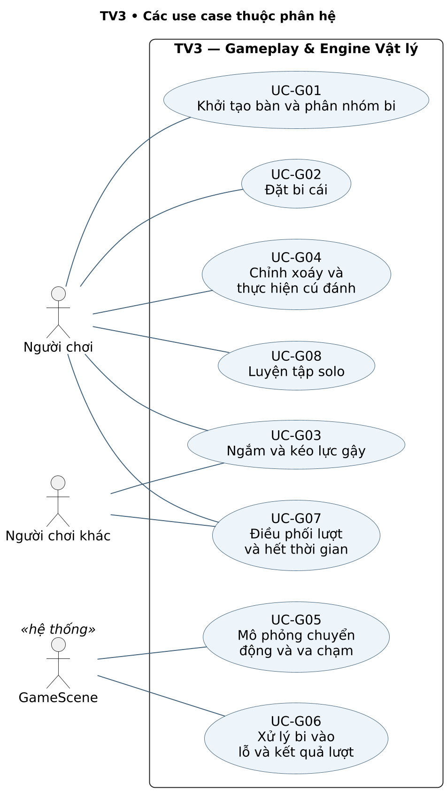

### Biểu đồ 3.2 — Activity

Phạm vi: UC-G02, UC-G03, UC-G04, UC-G05, UC-G06, UC-G07.

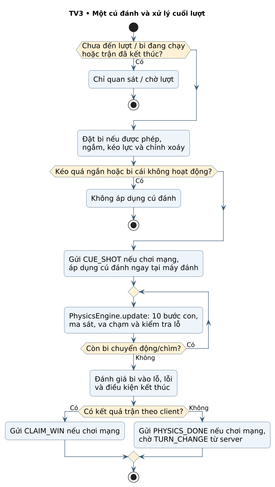

### Biểu đồ 3.3 — Sequence

Phạm vi: UC-G03, UC-G04, UC-G07.

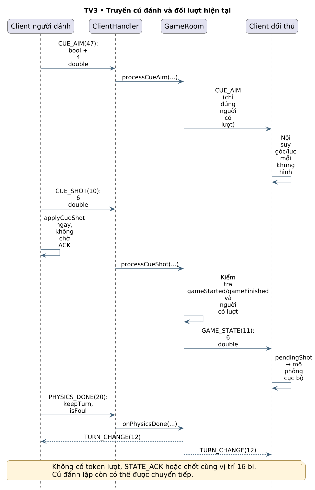

## 3.5. Liên hệ triển khai và giới hạn

Activity 3.2 mô tả đường đi từ quyền lượt tới mô phỏng và xử lý cuối cú đánh. Sequence 3.3 thể hiện rõ việc người đánh không chờ ACK từ server, server chỉ phát GAME_STATE cho đối thủ và không chốt snapshot cuối lượt.

Giới hạn đã tái hiện ở kiểm tra trước: hai READY của một client có thể đủ mở trận; gói CUE_SHOT lặp được chuyển tiếp; góc NaN có thể được relay. Đó là nội dung cần hoàn thiện, không được lược bỏ để biến sơ đồ thành một thiết kế lý tưởng khác với mã hiện có. Solo UC-G08 là chế độ cục bộ và không cần đối thủ mạng.

# PHẦN 4. TV4 — GIAO DIỆN & CÁ NHÂN HÓA

Thành viên phụ trách: **TV4**. Họ tên/MSSV: [Bổ sung]. Phạm vi: **9 use case**, **4 biểu đồ**.

## 4.1. Phạm vi và ranh giới trách nhiệm

TV4 phụ trách tương tác, điều hướng, trình bày trạng thái và cá nhân hóa. Các lớp tiêu biểu gồm SceneManager, LoginScene, RegisterScene, LobbyScene, PreGameScene, GameScene, ResultScene, LeaderboardScene, SettingsDialog, AvatarManager, CueSkinManager và SoundManager. Giao diện tiêu thụ dữ liệu nghiệp vụ, không tự thay thế xác thực server hoặc cơ chế ghi bền vững.

Lời mời thách đấu dùng popup có owner, modality và alwaysOnTop; thao tác Timeline được đưa về FX Application Thread. Kết quả lời mời dùng toast thay cho Alert chặn màn hình. Solo ẩn vsBadge, oppBox và oppBallsBox, đồng thời loại chúng khỏi bố cục bằng managed=false.

Cá nhân hóa có hai đường xử lý: avatar/skin gửi SETTINGS_UPDATE tới server; âm thanh BGM/SFX/mute áp dụng cục bộ và lưu Preferences. VFX của gậy được điều khiển bằng cờ cục bộ. Không mô tả âm thanh hoặc VFX như packet gameplay mới nếu mã không gửi chúng.

## 4.2. Danh mục use case

| Mã | Tên use case | Tác nhân chính |
| --- | --- | --- |
| UC-UI01 | Điều hướng màn hình | Người chơi |
| UC-UI02 | Hiển thị và kiểm tra form tài khoản | Người chơi |
| UC-UI03 | Hiển thị sảnh và danh sách bạn bè | Người chơi |
| UC-UI04 | Hiển thị hội thoại chat | Người chơi |
| UC-UI05 | Hiển thị lời mời và màn hình trước trận | Người nhận lời mời hoặc người vừa ghép trận |
| UC-UI06 | Hiển thị bàn chơi và HUD | Người chơi |
| UC-UI07 | Hiển thị kết quả và bảng xếp hạng | Người chơi |
| UC-UI08 | Chọn avatar và skin gậy | Người chơi |
| UC-UI09 | Điều chỉnh âm thanh và hiệu ứng | Người chơi |

## 4.3. Đặc tả use case

### UC-UI01 — Điều hướng màn hình

**Tác nhân:** Người chơi.

**Tiền điều kiện:** Ứng dụng JavaFX đã khởi tạo.

**Luồng chính:**

1. SceneManager đổi Scene theo đăng nhập, sảnh, tìm trận, trước trận, game và kết quả.

**Ngoại lệ/giới hạn:** Callback đến muộn hoặc thay Scene cần quản lý vòng đời; chưa khẳng định mọi luồng chuyển cảnh đã kiểm thử.

**Hậu điều kiện:** Người dùng ở màn hình phù hợp với thao tác/sự kiện.

**Mã nguồn liên quan:** ClientMain; SceneManager.

### UC-UI02 — Hiển thị và kiểm tra form tài khoản

**Tác nhân:** Người chơi.

**Tiền điều kiện:** Đang ở LoginScene hoặc RegisterScene.

**Luồng chính:**

1. Nhập trường.
2. Kiểm tra đủ dữ liệu, email, tên, mật khẩu xác nhận.
3. Hiển thị lỗi hoặc gọi NetworkClient.

**Ngoại lệ/giới hạn:** Regex email hiện chặn đuôi miền dài hơn 7 chữ cái; kiểm tra UI không thay kiểm tra server.

**Hậu điều kiện:** Có thông báo hoặc yêu cầu đăng nhập/đăng ký được gửi.

**Mã nguồn liên quan:** LoginScene; RegisterScene.doRegister.

### UC-UI03 — Hiển thị sảnh và danh sách bạn bè

**Tác nhân:** Người chơi.

**Tiền điều kiện:** Đã đăng nhập và mở LobbyScene.

**Luồng chính:**

1. Hiển thị hồ sơ.
2. Refresh bạn bè 3,5 giây.
3. Không dựng lại dữ liệu giống.
4. Mở menu Nhắn tin/Thách đấu/Xóa bạn.

**Ngoại lệ/giới hạn:** Đang mở menu: hoãn cập nhật; chuỗi A→B→A còn có thể áp dụng B cũ khi đóng.

**Hậu điều kiện:** Sảnh/menu cập nhật theo callback; hạn chế hiện tại được ghi nhận.

**Mã nguồn liên quan:** LobbyScene.updateFriendList/createFriendItem/startFriendAutoRefresh.

### UC-UI04 — Hiển thị hội thoại chat

**Tác nhân:** Người chơi.

**Tiền điều kiện:** Chọn một người để xem chat.

**Luồng chính:**

1. Mở panel, yêu cầu lịch sử.
2. Hiển thị tin tự gửi và nhận.
3. Cuộn xuống.
4. Đối chiếu dòng khi lịch sử tới.

**Ngoại lệ/giới hạn:** Hai tin giống nhau cùng phút có thể bị gộp; lịch sử trả muộn có thể vào sai cuộc trò chuyện.

**Hậu điều kiện:** Có hội thoại hiển thị, chưa bảo đảm nhận diện mọi tin bằng ID.

**Mã nguồn liên quan:** LobbyScene.showChatView/appendChatMessage/setupNetworkCallback.

### UC-UI05 — Hiển thị lời mời và màn hình trước trận

**Tác nhân:** Người nhận lời mời hoặc người vừa ghép trận.

**Tiền điều kiện:** Có CHALLENGE_RECEIVE hoặc MATCH_FOUND.

**Luồng chính:**

1. Hiện popup nổi và đếm 10 giây.
2. Gửi lựa chọn.
3. Dùng toast cho kết quả.
4. Khi MATCH_FOUND thì dừng refresh và chuyển PreGameScene.

**Ngoại lệ/giới hạn:** Đếm hết tự từ chối; callback UI được chuyển về FX thread; server còn thời hạn riêng 15 giây.

**Hậu điều kiện:** Popup đóng hoặc chuyển màn hình trước trận.

**Mã nguồn liên quan:** LobbyScene.showChallengeReceivedDialog/showToast; PreGameScene.

### UC-UI06 — Hiển thị bàn chơi và HUD

**Tác nhân:** Người chơi.

**Tiền điều kiện:** Có GameScene đối kháng hoặc luyện tập.

**Luồng chính:**

1. Vẽ bàn/bi/gậy, lượt, lực, xoáy, thời gian và ping/FPS.
2. Solo ẩn thông tin đối thủ và bỏ khung trống.

**Ngoại lệ/giới hạn:** Số FPS/ping trên dữ liệu giả lập không phải benchmark; không tự quyết định luật từ thông tin hiển thị.

**Hậu điều kiện:** Khung hình thể hiện trạng thái hiện có của client.

**Mã nguồn liên quan:** GameScene.build/startGameLoop; Canvas; AvatarManager.

### UC-UI07 — Hiển thị kết quả và bảng xếp hạng

**Tác nhân:** Người chơi.

**Tiền điều kiện:** Có phản hồi GAME_OVER hoặc dữ liệu leaderboard.

**Luồng chính:**

1. Dựng kết quả thắng/thua/EXP.
2. Hiển thị các dòng xếp hạng do server trả.
3. Cho quay về màn hình tiếp theo.

**Ngoại lệ/giới hạn:** Không có dữ liệu hoặc lỗi mạng cần thông báo; chưa có nghiệm thu toàn bộ UI bảng xếp hạng trong lần kiểm tra trước.

**Hậu điều kiện:** Người dùng xem kết quả/xếp hạng từ dữ liệu server.

**Mã nguồn liên quan:** ResultScene; LeaderboardScene; SceneManager.

### UC-UI08 — Chọn avatar và skin gậy

**Tác nhân:** Người chơi.

**Tiền điều kiện:** Mở SettingsDialog và có hồ sơ hiện tại.

**Luồng chính:**

1. Chọn avatar/skin.
2. Xem preview và yêu cầu cấp độ.
3. Lưu bằng SETTINGS_UPDATE.
4. Chuyển việc ghi bền vững cho TV2.

**Ngoại lệ/giới hạn:** Skin khóa bị hạn chế; server kiểm tra lại cấp; lỗi parser SETTINGS_RESPONSE có thể cản xác nhận thành công.

**Hậu điều kiện:** Lựa chọn được gửi; trạng thái lưu thành công cần phản hồi đúng.

**Mã nguồn liên quan:** SettingsDialog; AvatarManager; CueSkinManager; NetworkClient.sendSettingsUpdate.

### UC-UI09 — Điều chỉnh âm thanh và hiệu ứng

**Tác nhân:** Người chơi.

**Tiền điều kiện:** Đang mở tab âm thanh/cài đặt.

**Luồng chính:**

1. Đổi BGM/SFX/mute.
2. Thử âm thanh.
3. Bật/tắt VFX gậy.
4. SoundManager áp dụng và lưu các tùy chọn âm thanh vào Preferences.

**Ngoại lệ/giới hạn:** Thiếu tài nguyên hoặc thiết bị âm thanh ảnh hưởng kết quả; VFX là cờ cục bộ, không khẳng định được lưu như âm thanh.

**Hậu điều kiện:** Âm thanh/hiệu ứng thay đổi cục bộ, không tạo packet gameplay.

**Mã nguồn liên quan:** SettingsDialog.buildAudioTab; SoundManager; CueSkinManager.setVfxEnabled.

## 4.4. Biểu đồ UML của phân hệ

### Biểu đồ 4.1 — Use Case

Phạm vi: UC-UI01, UC-UI02, UC-UI03, UC-UI04, UC-UI05, UC-UI06, UC-UI07, UC-UI08, UC-UI09.

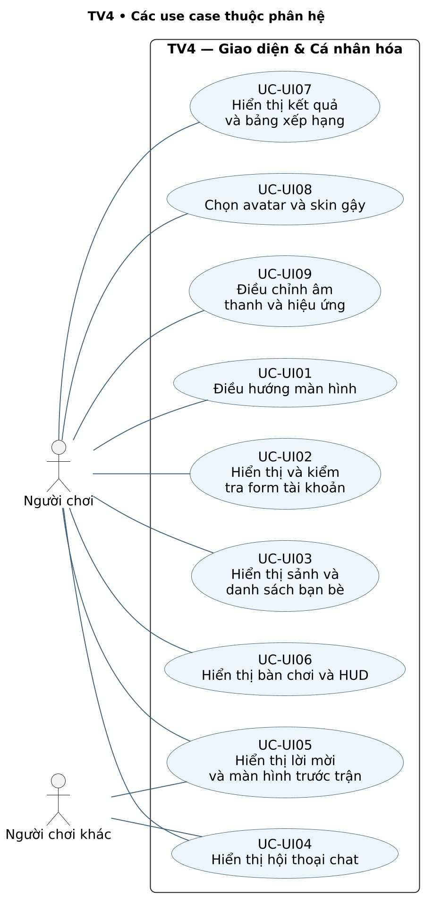

### Biểu đồ 4.2 — Activity

Phạm vi: UC-UI08, UC-UI09.

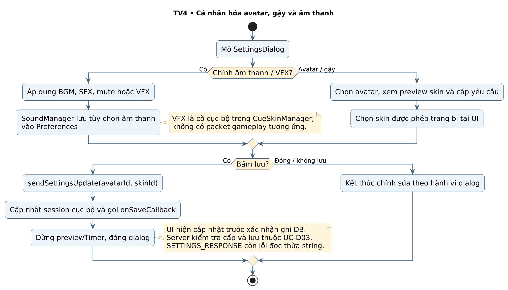

### Biểu đồ 4.3 — Sequence

Phạm vi: UC-UI01, UC-UI03, UC-UI05.

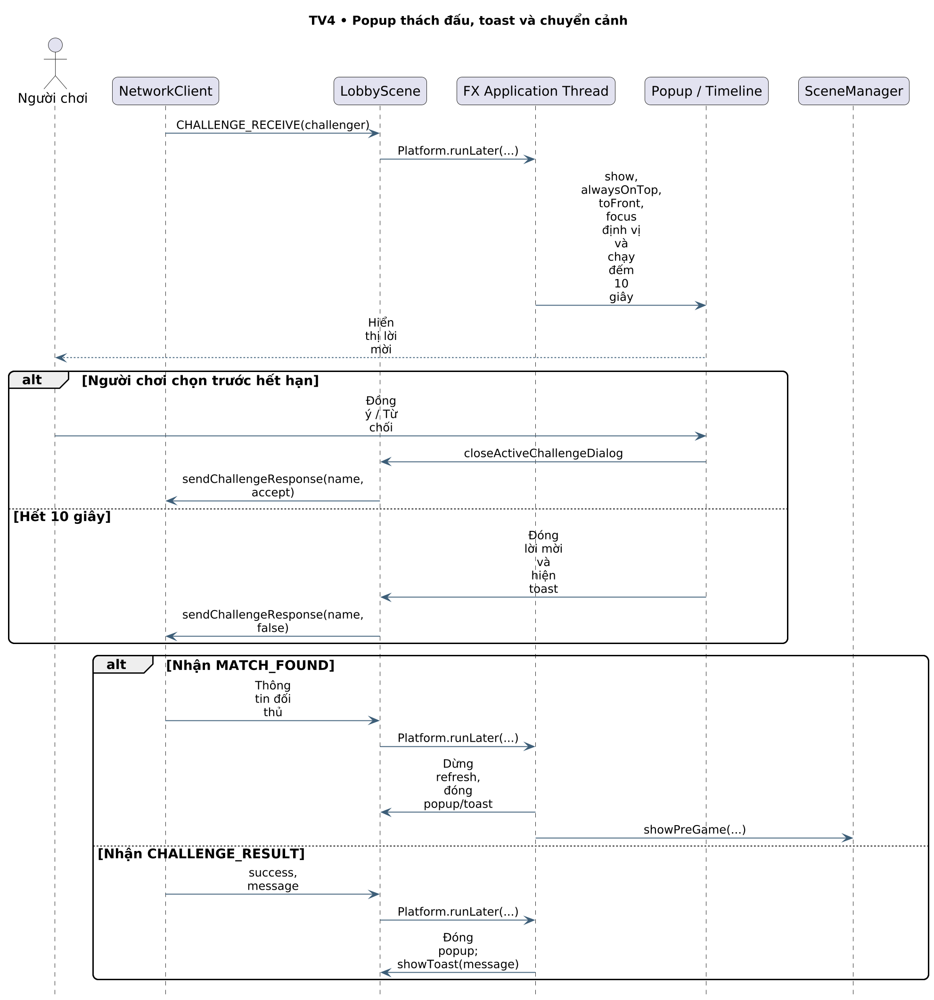

### Biểu đồ 4.4 — Component

Phạm vi: UC-UI01, UC-UI02, UC-UI03, UC-UI04, UC-UI05, UC-UI06, UC-UI07, UC-UI08, UC-UI09.

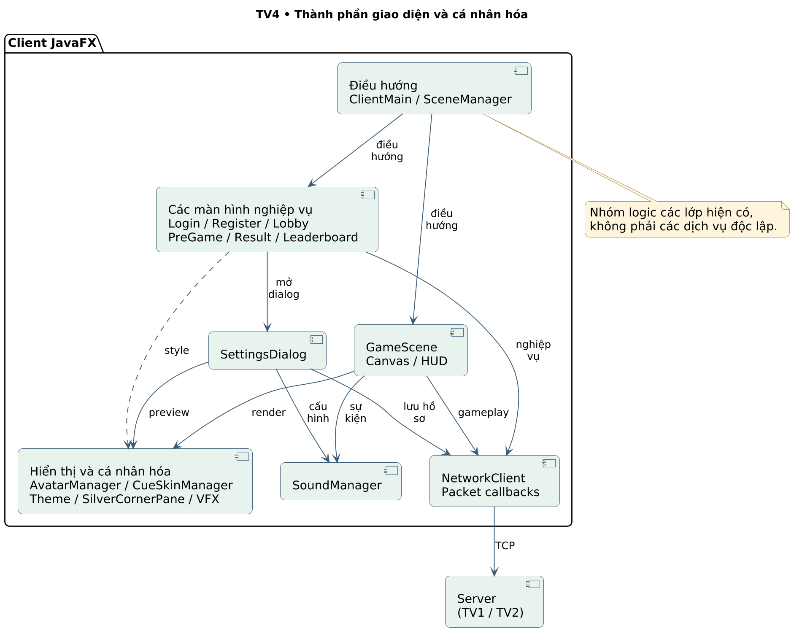

## 4.5. Liên hệ triển khai và giới hạn

Component 4.4 là cách nhóm logic các lớp đang có; các hộp không đại diện microservice hoặc tiến trình triển khai riêng. NetworkClient là cầu nối với TV1; các thao tác lưu hồ sơ qua server thuộc TV2; GameScene đồng thời trình bày HUD và sử dụng logic TV3.

Activity 4.2 phản ánh saveSettings hiện cập nhật session/callback cục bộ rồi đóng dialog, không đợi xác nhận DB. Phản hồi SETTINGS_RESPONSE hiện có lỗi đọc thừa string ở client. Vì vậy hậu điều kiện “đã hiển thị lựa chọn” không đồng nghĩa “đã lưu thành công và được xác nhận”. Sequence 4.3 tập trung popup, phản hồi, toast và chuyển cảnh trước trận.

## TỔNG HỢP ĐỐI CHIẾU VÀ KIỂM CHỨNG

### Phân biệt yêu cầu tài liệu và tính năng đã kiểm thử

Ngày 28/10/2026, main vẫn chứa mã ứng dụng tại 00bf1cc; các commit sau đó là cập nhật báo cáo. Lần này kiểm tra cấu trúc tài liệu: đủ 31 mã UC độc lập, không thiếu hoặc lặp trong danh mục, đủ 14 sơ đồ theo đúng loại của từng TV, các ảnh nhúng tồn tại và tài liệu Word/PDF đọc được. Không chạy lại gameplay chỉ để xác nhận việc thay bố cục báo cáo.

Các kết quả thực thi dưới đây được kế thừa có ghi ngày từ bộ kiểm tra 26/10/2026 trong reports/evidence/00bf1cc. Chúng không chứng minh toàn bộ 31 use case đã nghiệm thu. Mã thoát 0 của script mô tả hiện trạng cũng có thể đi cùng FINDING, vì script chủ động xác nhận việc tái hiện lỗi.

| Nhóm UC | Minh chứng đã có ngày 26/10 | Giới hạn áp dụng |
| --- | --- | --- |
| UC-C03, UC-C06, UC-C07 | TCP server thật: chấp nhận/từ chối lời mời, tìm tên khác kiểu chữ, timeout 15 giây, ngắt kết nối | Chưa stress test mời đồng thời hoặc mạng Internet |
| UC-D01, UC-D02 | Đăng ký và đăng nhập với tài khoản tạm; email sai định dạng vẫn được server nhận | Chưa thử mọi ràng buộc hoặc race đăng ký |
| UC-G01, UC-G03, UC-G04, UC-G07 | 60 mẫu ngắm relay; đổi lượt bằng PHYSICS_DONE; tái hiện READY/cú đánh lặp và NaN | Không phải bài hai UI qua jitter; không chứng minh khớp 16 bi |
| UC-UI02–UC-UI06 | JavaFX thật với transport giả lập: form, menu, chat, popup/toast, solo | Không thay cho kiểm tra đầu cuối hoặc Windows |
| UC-D03, UC-UI08 | Parser client đọc payload SETTINGS_RESPONSE chỉ boolean gây EOF | Chưa xác nhận toàn bộ quy trình lưu hồ sơ thành công |
| UC-D04–UC-D07, UC-G05–UC-G06, UC-UI07, UC-UI09 | Đã đối chiếu mã và mô tả chức năng | Chưa có nghiệm thu đầy đủ cho mọi luồng trong phạm vi báo cáo này |

### Các giới hạn cần ghi nhận

SETTINGS_RESPONSE có sự khác nhau giữa server gửi một boolean và client đọc boolean kèm string. READY dùng bộ đếm số packet thay vì hai cờ riêng. GameRoom chưa loại cú đánh lặp theo token/phase. Góc ngắm không hữu hạn có thể được chuyển tiếp. Các điểm này cần kiểm tra hợp đồng giao thức và tính hợp lệ dữ liệu tại server.

Lời mời thách đấu hủy timer trước khi kiểm tra tên phản hồi; tình huống sai tên sau khi timer đã thiết lập có thể để người nhận bận kéo dài. Chat thiếu message/conversation ID nên có thể gộp tin hợp lệ giống nhau hoặc áp dụng lịch sử cũ vào cuộc trò chuyện mới. Refresh bạn bè còn tình huống A→B→A nhưng áp dụng B khi menu đóng.

Cơ sở dữ liệu chưa có transaction bao trọn ghi kết quả và chưa dùng connection pool. Vật lý theo AnimationTimer chưa có bước thời gian cố định; chưa chốt bàn bằng snapshot/ACK. Các sơ đồ giữ nguyên các giới hạn này dưới dạng nhánh hoặc ghi chú, không ngầm coi chúng đã được sửa.

### Phạm vi nghiệm thu còn thiếu

Cần kiểm tra hai máy Windows với binary tương thích; chơi một ván hoàn chỉnh; thử các tình huống bi 8/phạm lỗi/solo; kiểm tra toàn bộ skin, âm thanh và bảng xếp hạng; gây lỗi database có kiểm soát; thử tải nhiều phòng và lời mời đồng thời. Khi có số liệu mới, ghi rõ phiên bản, môi trường, thao tác, kết quả mong đợi và kết quả thực tế. Không lấy FPS/ping trên ảnh dữ liệu mẫu làm benchmark.

### Kết luận

Báo cáo đáp ứng phân công mới: TV1 có 7 UC và 3 biểu đồ; TV2 có 7 UC và 4 biểu đồ; TV3 có 8 UC và 3 biểu đồ; TV4 có 9 UC và 4 biểu đồ. Phần kiểm thử được đưa thành mục đối chiếu chung, không còn chiếm phần việc TV4. Các diagram Use Case, Activity, Sequence và Component được cung cấp kèm mã nguồn PlantUML để nhóm có thể chỉnh sửa.

Nội dung phản ánh mã hiện tại của dự án và phân biệt triển khai với kiểm chứng. Các đề xuất hoàn thiện được ghi như việc còn làm, không dùng để mô tả sai khả năng đang có của ứng dụng.

## TÀI LIỆU VÀ NGUỒN ĐỐI CHIẾU

[1] Bảng phân công trong ảnh người dùng cung cấp ngày 28/10/2026: TV1 7 UC/3 biểu đồ; TV2 7 UC/4 biểu đồ; TV3 8 UC/3 biểu đồ; TV4 9 UC/4 biểu đồ. Bảng này thay thế cách chia phần công việc trong báo cáo trước.

[2] Mã nguồn ứng dụng: https://github.com/LocMixi2-5/LTM/tree/00bf1ccaf8df2cdd54b79cb75ca188ae9c38627e . Lần lấy main ngày 28/10 không có thay đổi Java sau phiên bản này.

[3] Client: client/src/com/billiards/client/NetworkClient.java; scenes/{SceneManager,ServerConfigDialog,LoginScene,RegisterScene,LobbyScene,PreGameScene,GameScene,SettingsDialog,ResultScene,LeaderboardScene}.java; game/{Ball,PhysicsEngine,CueSkinManager}.java; AvatarManager.java; audio/SoundManager.java.

[4] Server: server/src/com/billiards/server/{ServerMain,ClientHandler,GameRoom,LobbyManager,AuthManager,DatabaseManager}.java; protocol/{Packet,PacketType,CueSkinConfig}.java; database/schema.sql.

[5] Danh mục và đặc tả: reports/uml_spec.json. Ánh xạ 14 biểu đồ: reports/uml_manifest.json. Nguồn hình: reports/uml/*.puml, bản PNG và SVG tương ứng. PlantUML 1.2025.2 dùng để kết xuất UML.

[6] Minh chứng thực thi kế thừa: reports/evidence/00bf1cc/README.md và các nhật ký/script cùng thư mục. Các ảnh chụp UI ngày 26/10 vẫn được giữ để tham khảo, không tính vào 14 biểu đồ UML của bản phân công mới.
