# BÁO CÁO TỔNG HỢP ĐỒ ÁN

## XÂY DỰNG TRÒ CHƠI BI-A HAI NGƯỜI QUA MẠNG

Học phần: Lập trình mạng

Trường / Khoa / Lớp: [Bổ sung]

Giảng viên hướng dẫn: [Bổ sung]

Nhóm thực hiện: [Tên nhóm]

Danh sách thành viên và MSSV: [Bổ sung]

Ngày cập nhật: 29/10/2026 — múi giờ Việt Nam.

Phiên bản mã ứng dụng đối chiếu: 00bf1cc.

## TÓM TẮT

Đồ án xây dựng trò chơi bi-a hai người qua mạng bằng Java, JavaFX, TCP/UDP Socket và PostgreSQL. Ứng dụng cung cấp một hành trình sử dụng từ kết nối, đăng ký và đăng nhập tới tìm đối thủ, thi đấu, xem kết quả và tiếp tục tương tác trong sảnh. Các chức năng bạn bè, chat, luyện tập và cá nhân hóa bổ sung cho trải nghiệm đó.

Báo cáo trình bày hệ thống theo mạch từ bài toán đến giải pháp: cơ sở công nghệ, kiến trúc, quy trình hoạt động, triển khai và đánh giá. Trong từng luồng, thao tác người chơi được liên hệ với truyền thông, xử lý nghiệp vụ, lưu trữ và phản hồi giao diện. Các đặc tả và biểu đồ chi tiết được tập hợp ở phụ lục để hỗ trợ tra cứu.

Mã nguồn đối chiếu là 00bf1cc, vẫn là phiên bản mã ứng dụng trên main khi kiểm tra ngày 29/10/2026. Minh chứng thực thi từ ngày 26/10/2026 cho thấy ứng dụng biên dịch được và nhiều luồng hoạt động trong phạm vi đã thử, đồng thời xác định một số lỗi cần hoàn thiện. Báo cáo phân biệt kết quả đã quan sát với kế hoạch nghiệm thu, đặc biệt đối với đồng bộ hai client và vận hành EXE trên Windows.

Từ khóa: lập trình mạng; JavaFX; TCP Socket; PostgreSQL; trò chơi nhiều người.

## DANH MỤC HÌNH

| Hình | Nội dung | Vị trí |
| --- | --- | --- |
| 5.1 | Form đăng ký | Chương 5 |
| 5.2 | Sảnh và menu bạn bè | Chương 5 |
| 5.3 | Hội thoại chat | Chương 5 |
| 5.4 | Popup thách đấu | Chương 5 |
| 5.5 | Toast phản hồi lời mời | Chương 5 |
| 5.6 | Bàn luyện tập solo | Chương 5 |
| 5.7 | Bàn chơi và hướng gậy | Chương 5 |
| B.1 | Chức năng quản lý kết nối & giao thức truyền tin (Use Case) | Phụ lục B |
| B.2 | Kết nối TCP và trao đổi PING (Sequence) | Phụ lục B |
| B.3 | Điều phối thách đấu trực tiếp (Activity) | Phụ lục B |
| B.4 | Chức năng xác thực & quản lý dữ liệu (Use Case) | Phụ lục B |
| B.5 | Đăng ký và lưu tài khoản (Activity) | Phụ lục B |
| B.6 | Ghi kết quả, EXP và lịch sử (Activity) | Phụ lục B |
| B.7 | Đăng nhập bằng username hoặc email (Sequence) | Phụ lục B |
| B.8 | Chức năng gameplay & engine vật lý (Use Case) | Phụ lục B |
| B.9 | Một cú đánh và xử lý cuối lượt (Activity) | Phụ lục B |
| B.10 | Truyền cú đánh và đổi lượt hiện tại (Sequence) | Phụ lục B |
| B.11 | Chức năng giao diện & cá nhân hóa (Use Case) | Phụ lục B |
| B.12 | Cá nhân hóa avatar, gậy và âm thanh (Activity) | Phụ lục B |
| B.13 | Popup thách đấu, toast và chuyển cảnh (Sequence) | Phụ lục B |
| B.14 | Thành phần giao diện và cá nhân hóa (Component) | Phụ lục B |

# CHƯƠNG 1. GIỚI THIỆU ĐỀ TÀI

## 1.1. Bối cảnh và lý do lựa chọn

Trò chơi nhiều người qua mạng là một bài toán tiêu biểu của lập trình mạng: các máy cần trao đổi dữ liệu, duy trì phiên và phản ánh thao tác của nhau trong khi người dùng vẫn tương tác liên tục với giao diện. Với trò chơi bi-a, yêu cầu này thể hiện qua việc tìm đối thủ, quan sát hướng gậy, thực hiện cú đánh và xác định lượt tiếp theo. Trải nghiệm của người chơi phụ thuộc vào sự phối hợp của toàn bộ hệ thống, từ kết nối đến xử lý trận đấu và lưu kết quả.

Xuất phát từ bài toán đó, nhóm xây dựng ứng dụng bi-a hai người bằng Java và JavaFX, sử dụng Socket để truyền thông và PostgreSQL để lưu trữ. Đề tài cho phép vận dụng kiến thức môn Lập trình mạng vào một sản phẩm có quy trình sử dụng hoàn chỉnh, đồng thời làm rõ những khó khăn khi phối hợp trạng thái giữa các máy.

## 1.2. Mục tiêu và phạm vi

Ứng dụng hướng tới việc người chơi có thể tạo tài khoản, đăng nhập, tìm đối thủ, thi đấu, xem kết quả và tiếp tục tương tác trong sảnh. Bên cạnh trận đấu trực tuyến, hệ thống có luyện tập solo, bạn bè, chat, bảng xếp hạng và tùy chỉnh avatar, gậy, âm thanh. Các chức năng này cùng phục vụ một hành trình sử dụng, thay vì tồn tại như những phần mềm độc lập.

Về kỹ thuật, mục tiêu là kết nối được giao diện, truyền thông, xử lý trò chơi và cơ sở dữ liệu trong kiến trúc client–server. Hệ thống cần thống nhất cách diễn giải thông điệp, xác định trạng thái phiên và trả phản hồi phù hợp với thao tác của người dùng. Tài liệu trình bày cách triển khai hiện tại, kết quả kiểm tra và những điểm còn cần hoàn thiện.

Mỗi trận trực tuyến có hai người. Client đảm nhiệm hiển thị và mô phỏng bi; server quản lý kết nối, sảnh, phòng đấu và điều phối lượt; PostgreSQL lưu dữ liệu bền vững. Luật chơi được mô tả theo phiên bản dự án đang có, chưa khẳng định đáp ứng toàn bộ luật thi đấu bi-a chuẩn quốc tế. Thanh toán, giải đấu và chế độ khán giả nằm ngoài phạm vi sản phẩm hiện tại.

## 1.3. Yêu cầu đặt ra

| Nhu cầu sử dụng | Yêu cầu đối với hệ thống |
| --- | --- |
| Vào trò chơi và sử dụng tài khoản | Tìm hoặc nhập địa chỉ server, kết nối, đăng ký và đăng nhập |
| Tìm người chơi cùng | Hiển thị sảnh, ghép trận hoặc gửi lời mời trực tiếp |
| Chơi một trận bi-a | Khởi tạo bàn, nhận thao tác ngắm/đánh, mô phỏng và điều phối lượt |
| Theo dõi kết quả | Hiển thị người thắng/thua, lưu lịch sử và cập nhật chỉ số |
| Duy trì tương tác | Quản lý bạn bè, trao đổi tin nhắn và xem xếp hạng |
| Điều chỉnh trải nghiệm | Chọn avatar/gậy, âm thanh và hiệu ứng; có chế độ solo |

Ngoài chức năng, giao diện cần phản hồi rõ khi kết nối hoặc thao tác thất bại. Các thông điệp phải có định dạng nhất quán giữa hai đầu; dữ liệu dùng chung cần được quản lý khi nhiều phiên cùng hoạt động. Đây là mục tiêu chất lượng của đồ án, không phải cam kết rằng mọi tình huống đã vượt qua kiểm thử. Những giới hạn đã phát hiện được đánh giá ở Chương 6.

## 1.4. Cách tiếp cận và bố cục báo cáo

Nhóm tiếp cận bài toán theo dòng dữ liệu: thao tác bắt đầu ở giao diện, được chuyển thành yêu cầu mạng, xử lý theo trạng thái phiên và trả kết quả về màn hình; các thông tin cần lưu được ghi vào cơ sở dữ liệu. Cách tiếp cận này giúp giải thích đồng thời trải nghiệm của người chơi và vai trò của các thành phần kỹ thuật.

Báo cáo đi từ nền tảng công nghệ đến kiến trúc, sau đó theo dõi một phiên sử dụng từ kết nối tới kết thúc trận. Phần triển khai minh họa sản phẩm bằng ảnh giao diện; phần đánh giá đối chiếu với minh chứng thực thi. Đặc tả chức năng và các biểu đồ UML được đặt ở phụ lục để tra cứu khi cần làm rõ một luồng xử lý cụ thể.

# CHƯƠNG 2. CƠ SỞ LÝ THUYẾT VÀ CÔNG NGHỆ

## 2.1. Mô hình client–server và truyền thông Socket

Trong mô hình client–server, client chủ động kết nối và gửi yêu cầu, còn server lắng nghe, quản lý phiên và trả phản hồi. Dự án sử dụng TCP cho nghiệp vụ cần trao đổi có thứ tự như xác thực, lời mời và thông tin trận đấu. ServerMain tiếp nhận socket, còn ClientHandler xử lý dữ liệu của từng kết nối. Người đã kết nối có thể ở sảnh mà chưa tham gia phòng đấu; vì vậy vòng đời kết nối và vòng đời trận được phân biệt.

TCP cung cấp một luồng byte có thứ tự, không cung cấp ranh giới thông điệp ứng dụng [7]. Một thông điệp có thể tới qua nhiều lần đọc; nhiều thông điệp cũng có thể nằm liền nhau trong bộ đệm. Phía nhận phải đọc đủ các trường theo quy ước thay vì giả định một lần đọc tương ứng một yêu cầu hoàn chỉnh.

Độ tin cậy của TCP không tự bảo đảm trạng thái trò chơi nhất quán. Nếu ứng dụng gửi lại lệnh đánh hoặc áp dụng lệnh vào sai lượt, thông điệp vẫn có thể được truyền chính xác nhưng kết quả nghiệp vụ sai. Tương tự, hai máy nhận cùng thông số cú đánh chưa chắc kết thúc mô phỏng tại cùng tọa độ. Tính nhất quán vì thế cần được bảo vệ ở tầng ứng dụng.

UDP được sử dụng cho khám phá server trong LAN. Client có thể phát truy vấn tìm kiếm trước khi biết địa chỉ máy chủ; sau khi nhận phản hồi, các nghiệp vụ tiếp tục trên TCP. Nếu cấu hình mạng không cho phép broadcast, người chơi cần nhập địa chỉ server trực tiếp.

## 2.2. Giao thức nhị phân

Thông điệp của dự án bắt đầu bằng một byte mã loại, sau đó là các trường dữ liệu theo thứ tự đã định. Các số nhiều byte dùng big-endian; chuỗi gồm độ dài kiểu int và nội dung UTF-8. Cách biểu diễn này gọn và phù hợp với các lớp đọc/ghi dữ liệu của Java, nhưng đòi hỏi phía gửi và phía nhận thống nhất chính xác kiểu và số trường.

Một thay đổi payload phải được cập nhật ở cả hai đầu. Chẳng hạn, nếu server chỉ gửi trạng thái boolean mà client còn chờ một chuỗi, quá trình đọc sẽ không còn khớp với hợp đồng. Đây là dạng lỗi khác với mất gói ở tầng mạng; nó cần được kiểm tra bằng cách đối chiếu bộ ghi và bộ đọc.

## 2.3. JavaFX và xử lý đồng thời

JavaFX cung cấp các thành phần giao diện, Canvas và cơ chế cập nhật theo khung hình. Ứng dụng có luồng nhận mạng riêng để việc chờ dữ liệu không chặn thao tác người dùng. Những thay đổi node và thao tác giao diện phải được chuyển về JavaFX Application Thread, thường thông qua Platform.runLater [8].

Ở server, nhiều kết nối có thể cùng truy cập sảnh, danh sách người chơi và phòng đấu. Các thao tác liên quan trạng thái dùng chung cần có điều kiện kiểm tra và cơ chế bảo vệ phù hợp. Đồng bộ hóa một phương thức chỉ bảo vệ phạm vi thao tác đó; không tự biến nhiều cập nhật ở các đối tượng khác nhau thành một giao dịch thống nhất.

## 2.4. Mô phỏng vật lý và nội suy hiển thị

Bi được biểu diễn bằng vị trí, vận tốc, trạng thái hoạt động và tham số xoáy. Engine cập nhật chuyển động, giảm vận tốc do ma sát, kiểm tra va chạm giữa các bi, phản xạ với băng và phát hiện bi vào lỗ. Chia một lần cập nhật thành các bước con giúp giảm quãng dịch chuyển giữa hai lần kiểm tra va chạm.

Hướng gậy nhận qua mạng được nội suy để hình vẽ chuyển dần tới trạng thái mới. Nội suy giúp giảm cảm giác giật khi các mẫu tới cách nhau, nhưng không thay thế việc kiểm tra quyền đánh hoặc hiệu chỉnh vị trí bi cuối lượt. AnimationTimer cũng không bảo đảm mỗi callback cách nhau đúng một khoảng thời gian cố định; yếu tố này cần được xét khi đánh giá mô phỏng trên hai máy khác nhau.

## 2.5. Lưu trữ bằng PostgreSQL và JDBC

PostgreSQL lưu tài khoản, lịch sử trận, quan hệ bạn bè và tin nhắn. JDBC cung cấp kết nối và cơ chế thực thi truy vấn từ Java. PreparedStatement tách dữ liệu đầu vào khỏi cấu trúc SQL; các điều kiện nghiệp vụ như quyền sử dụng skin hoặc điều kiện ghi kết quả vẫn cần được kiểm tra trong ứng dụng [9–10].

Các cập nhật phụ thuộc nhau nên được xem xét trong cùng giao dịch. Ví dụ, ghi lịch sử và cộng điểm sau trận cần tránh tình trạng chỉ một phần được lưu khi xảy ra lỗi. Khóa chính, khóa ngoại và ràng buộc duy nhất bảo vệ một phần tính toàn vẹn; chúng phải phù hợp với quy tắc tra cứu và xử lý ở ứng dụng.

Mật khẩu hiện được băm bằng SHA-256 cùng salt ngẫu nhiên. Salt giúp các mật khẩu giống nhau không luôn có cùng giá trị lưu, nhưng thuật toán băm nhanh vẫn có giới hạn khi chống dò mật khẩu. TLS và thuật toán chuyên dụng cho mật khẩu là hướng hoàn thiện, chưa phải tính năng đã có trong phiên bản được báo cáo.

# CHƯƠNG 3. KIẾN TRÚC VÀ THIẾT KẾ HỆ THỐNG

## 3.1. Kiến trúc tổng thể

Hệ thống gồm ứng dụng JavaFX, máy chủ Java Socket và PostgreSQL. Trên client, màn hình nhận thao tác, NetworkClient trao đổi dữ liệu và engine mô phỏng bàn chơi. Trên server, yêu cầu được xử lý theo phiên người dùng, trạng thái sảnh và phòng đấu; dữ liệu cần lưu đi qua lớp truy cập cơ sở dữ liệu. Client không kết nối trực tiếp tới PostgreSQL.

| Thành phần | Vai trò trong hệ thống |
| --- | --- |
| ClientMain, SceneManager và các màn hình | Khởi chạy, điều hướng và phản hồi cho người dùng |
| NetworkClient và các lớp protocol | Kết nối, tuần tự hóa, đọc thông điệp và phân phối callback |
| GameScene, Ball và PhysicsEngine | Nhận thao tác trên bàn, biểu diễn bi và mô phỏng cú đánh |
| ServerMain và ClientHandler | Tiếp nhận kết nối, quản lý phiên và điều phối yêu cầu |
| LobbyManager và GameRoom | Ghép cặp, tạo phòng, xác định quyền lượt và kết thúc trận |
| AuthManager và DatabaseManager | Xác thực, truy vấn và cập nhật dữ liệu |
| PostgreSQL | Lưu hồ sơ, kết quả, bạn bè và tin nhắn |

Các thành phần cùng tham gia một nghiệp vụ. Khi đăng nhập, màn hình thu nhận thông tin, kết nối chuyển yêu cầu, server kiểm tra dữ liệu rồi trả hồ sơ để giao diện vào sảnh. Khi đánh bi, GameScene đồng thời làm việc với engine và kết nối mạng. Do đó, đường đi của thao tác là cơ sở để hiểu sự phối hợp của hệ thống.

## 3.2. Thiết kế dữ liệu

players là bảng trung tâm, chứa định danh, email, username, mật khẩu băm, EXP, level, thống kê thắng/thua và tùy chọn cá nhân. Các bảng còn lại tham chiếu tới người chơi để lưu kết quả trận, quan hệ bạn bè và hội thoại.

| Bảng | Dữ liệu chính | Liên kết |
| --- | --- | --- |
| players | Tài khoản, chỉ số và avatar/gậy | Khóa chính id; email và username có UNIQUE |
| match_history | Người thắng/thua, EXP thưởng và thời gian | Hai khóa ngoại tới players |
| friendships | Cặp người dùng và trạng thái quan hệ | Khóa kép user_id/friend_id; tham chiếu players |
| messages | Người gửi/nhận, nội dung, trạng thái đọc và thời gian | Khóa ngoại tới players |

Schema bảo vệ các liên kết cơ bản nhưng chưa bao quát mọi quy tắc nghiệp vụ. Trạng thái bạn bè đang là varchar không có CHECK giới hạn tập giá trị; ràng buộc UNIQUE của username gốc chưa tương đương với duy nhất không phân biệt hoa/thường. Những điểm này cần được đối chiếu với cách tra cứu của ứng dụng khi xử lý yêu cầu đồng thời.

## 3.3. Thiết kế truyền thông và vòng đời phiên

Máy chủ dùng TCP 12345 cho nghiệp vụ và UDP 12346 cho khám phá trong LAN. Giao thức hiện có 47 mã loại. Một số thông điệp quan trọng trong phiên chơi được tóm tắt dưới đây; đặc tả chi tiết được giữ ở tài liệu kỹ thuật đi kèm.

| Thông điệp | Ý nghĩa |
| --- | --- |
| PING | Trao đổi timestamp để đo thời gian khứ hồi |
| CUE_AIM | Cập nhật trạng thái ngắm, góc, lực tương đối và xoáy |
| CUE_SHOT / GAME_STATE | Gửi thông số cú đánh và chuyển sang đối thủ |
| PHYSICS_DONE / TURN_CHANGE | Báo mô phỏng kết thúc và thông báo quyền lượt tiếp theo |
| SETTINGS_UPDATE / SETTINGS_RESPONSE | Yêu cầu lưu tùy chọn và phản hồi trạng thái |

Một phiên có thể diễn tiến từ kết nối, xác thực và vào sảnh tới chờ đối thủ, vào phòng, sẵn sàng, thi đấu và kết thúc. Server cần quyết định thông điệp nào được chấp nhận ở từng thời điểm. Phiên bản hiện tại chưa có một máy trạng thái thống nhất bảo vệ mọi chuyển tiếp; các trường hợp lệnh lặp và phản hồi muộn vẫn là điểm cần hoàn thiện.

## 3.4. Tổ chức giao diện và tài nguyên

SceneManager điều hướng giữa các màn hình tài khoản, sảnh, trước trận, bàn chơi và kết quả. GameScene kết hợp Canvas với phần thông tin người chơi, lượt và trạng thái. SettingsDialog, AvatarManager, CueSkinManager và SoundManager cung cấp lựa chọn cá nhân và phản hồi nghe/nhìn.

Hồ sơ avatar/gậy cần đi qua server để kiểm tra quyền và lưu dữ liệu. Ngược lại, các mức âm lượng và mute áp dụng tại máy người chơi. Sự khác biệt này quyết định khi nào giao diện có thể cập nhật ngay và khi nào cần xác nhận từ hệ thống lưu trữ. Sơ đồ thành phần ở Phụ lục B thể hiện các phụ thuộc giữa những lớp đang triển khai.

# CHƯƠNG 4. QUY TRÌNH HOẠT ĐỘNG CỦA ỨNG DỤNG

## 4.1. Từ khởi động đến tài khoản người chơi

Khi mở ứng dụng, người chơi chọn server hoặc sử dụng địa chỉ đã lưu. Nếu cùng LAN, client có thể gửi truy vấn khám phá để tìm máy chủ. Khi đã xác định địa chỉ, client mở TCP socket, tạo luồng đọc dữ liệu và bắt đầu trao đổi PING. Kết nối thành công tạo đường truyền cho nghiệp vụ; người chơi vẫn cần xác thực để sử dụng tài khoản.

Người chưa có tài khoản nhập thông tin ở màn hình đăng ký. Giao diện kiểm tra đầu vào và gửi yêu cầu; server kiểm tra điều kiện, băm mật khẩu và lưu tài khoản nếu hợp lệ. Với tài khoản đã có, server tìm theo username hoặc email, đối chiếu mật khẩu rồi trả trạng thái và hồ sơ. Giao diện dựa trên phản hồi để vào sảnh hoặc hiển thị lỗi.

Như vậy, trải nghiệm đăng nhập là một luồng liên tục giữa màn hình, kết nối và dữ liệu. Kiểm tra tại client giúp người dùng sửa lỗi nhập nhanh, còn server vẫn phải chịu trách nhiệm kiểm tra yêu cầu nhận được. Hiện quy tắc email ở hai đầu chưa hoàn toàn thống nhất; giới hạn này được ghi trong phần đánh giá.

## 4.2. Tương tác trong sảnh và tìm đối thủ

Sau đăng nhập, sảnh là nơi người chơi xem thông tin, tìm bạn, mở hội thoại hoặc chọn cách vào trận. Danh sách bạn bè và tin nhắn cần kết hợp dữ liệu lưu trong DB với trạng thái phiên đang online. Giao diện nhận dữ liệu qua callback và cập nhật trên luồng JavaFX.

Khi tìm trận ngẫu nhiên, server đưa người chơi vào hàng chờ và ghép với đối tượng phù hợp. Với thách đấu trực tiếp, server kiểm tra người nhận, trạng thái bận và tính hợp lệ của lời mời trước khi chuyển tới client đối phương. Người nhận thấy popup, chọn chấp nhận hoặc từ chối; nếu không phản hồi, lời mời có thể hết hạn.

Khi lời mời được chấp nhận và điều kiện vẫn còn hợp lệ, server loại người chơi liên quan khỏi hàng chờ, tạo phòng và thông báo cho hai client. Giao diện chuyển tới bước trước trận. Nếu đối tác rời hoặc yêu cầu không còn hợp lệ, kết quả thất bại cần được phản ánh để người chơi quay lại hoạt động trong sảnh.

Quá trình này cho thấy một thay đổi ở kết nối ảnh hưởng trực tiếp tới trải nghiệm màn hình. Để tránh trạng thái bận kéo dài, timer, người mời và kết quả phản hồi phải được xử lý nhất quán. Phiên bản đang báo cáo còn lỗi ở nhánh phản hồi sai tên, nên phần kiểm thử không coi mọi trường hợp thách đấu đã hoàn tất nghiệm thu.

## 4.3. Khởi tạo bàn và bắt đầu trận

Sau khi tạo phòng, hai client nhận thông tin trận và đối thủ. Dữ liệu seed hỗ trợ khởi tạo cách sắp xếp/phân nhóm bi. Mã hiện tại xáo 14 bi mục tiêu khác bi 8 rồi chia thành hai nhóm bảy bi; đây là quy tắc của dự án, không nên hiểu là luôn chia trơn/sọc theo luật chuẩn.

Màn hình trước trận thu nhận trạng thái sẵn sàng. Khi trận bắt đầu, bàn hiển thị người chơi, bi mục tiêu và quyền lượt. Các thao tác đặt bi cái, ngắm hoặc đánh chỉ nên được áp dụng khi trạng thái cho phép. Tuy nhiên, bộ đếm READY hiện chưa phân biệt đầy đủ việc một người gửi lặp; trường hợp này cần sửa để bảo đảm điều kiện bắt đầu thực sự đến từ hai phía.

## 4.4. Ngắm gậy, chọn lực và thực hiện cú đánh

Ở lượt của mình, người chơi điều chỉnh hướng gậy, kéo lực và chọn điểm chạm trên bi cái. Giao diện hiển thị các lựa chọn đó, đồng thời client gửi mẫu ngắm để đối thủ quan sát. Client đối phương nội suy hướng và lực đã nhận nhằm làm chuyển động hiển thị liên tục hơn giữa các mẫu.

Các mẫu ngắm được gửi theo ngưỡng thời gian và mức thay đổi, giúp giảm việc gửi thông tin gần như không đổi. Một số đường gửi cưỡng bức có thể bỏ qua ngưỡng thông thường; vì vậy không mô tả đây là một giới hạn tần số cứng trong mọi trường hợp. Độ mượt thực tế còn phụ thuộc thời điểm nhận mẫu và tốc độ vẽ ở máy đối thủ.

Khi thả gậy với điều kiện hợp lệ, máy đánh gửi thông số cú đánh và áp dụng mô phỏng ngay tại chỗ. Server kiểm tra quyền lượt rồi chuyển thông số tới đối thủ. Máy đối thủ đưa cú đánh vào quá trình mô phỏng của mình. Cách làm này phản hồi nhanh cho người thao tác nhưng chưa có bước xác nhận rằng hai máy đã bắt đầu từ một trạng thái bàn hoàn toàn giống nhau.

## 4.5. Mô phỏng, chuyển lượt và kết thúc trận

Trong khi bi chuyển động, PhysicsEngine cập nhật vị trí, ma sát, va chạm và kiểm tra lỗ. Phiên bản hiện tại chia mỗi update thành 10 bước con, với các hệ số ma sát và phục hồi phục vụ mô hình trò chơi. Đây không phải bộ tham số thực nghiệm bảo đảm mô phỏng vật lý chính xác tuyệt đối.

Sau khi các bi dừng, client đánh giá bi vào lỗ, lỗi và điều kiện kết thúc. Nếu trận tiếp tục, thông báo PHYSICS_DONE cho biết khả năng giữ lượt và trạng thái phạm lỗi; server xử lý rồi phát TURN_CHANGE. Khi có kết quả theo logic hiện tại, server xử lý kết thúc và cập nhật dữ liệu người chơi. Màn hình kết quả là phần thể hiện cuối cùng của chuỗi xử lý này.

Điểm quan trọng là server hiện chưa tự mô phỏng va chạm để kiểm chứng toàn bộ bàn. Hai client cũng chưa chốt snapshot vị trí 16 bi kèm xác nhận. Vì vậy, chuyển lượt thành công chỉ chứng minh bước điều phối đã diễn ra, chưa đủ chứng minh hai bàn luôn hội tụ. Đánh giá tính nhất quán cần quan sát cả trạng thái cuối cú đánh, không chỉ gói đổi lượt.

Kết quả trận liên quan đồng thời lịch sử, điểm kinh nghiệm và thống kê thắng/thua. Mã hiện tại thưởng 100 EXP cho người thắng, level được tính bằng floor(EXP/200)+1. Các bước ghi này chưa được bao trọn trong một transaction, nên cần hoàn thiện để tránh kết quả lưu một phần nếu lỗi phát sinh giữa chừng.

## 4.6. Luyện tập và cá nhân hóa trải nghiệm

Ở chế độ solo, người chơi sử dụng bàn và engine cục bộ mà không cần đối thủ. Giao diện ẩn khung đối thủ và loại phần đó khỏi bố cục. Chế độ này cho phép làm quen với ngắm, lực và xoáy, nhưng không thay thế thử nghiệm tương tác giữa hai client qua mạng.

Avatar và skin gậy được chọn trong SettingsDialog. Server kiểm tra điều kiện level trước khi lưu lựa chọn vào hồ sơ; các tùy chọn âm thanh được SoundManager áp dụng cục bộ và lưu bằng Preferences. VFX được điều khiển bằng cờ tại client. Như vậy, cá nhân hóa kết hợp phần dữ liệu tài khoản và phần trải nghiệm riêng trên mỗi máy.

Giao diện hiện cập nhật lựa chọn và đóng hộp thoại trước khi có xác nhận lưu hoàn chỉnh. Cùng với sai lệch định dạng SETTINGS_RESPONSE, điều này cho thấy cần phân biệt việc đã nhìn thấy thay đổi với việc đã lưu thành công. Sau khi hoàn thiện luồng phản hồi, hệ thống cần kiểm tra lại khả năng giữ tùy chọn qua lần đăng nhập tiếp theo.

## 4.7. Sự liên kết của toàn bộ quy trình

Từ kết nối đến kết thúc trận, cùng một thao tác thường đi qua nhiều thành phần. Hướng gậy là ví dụ rõ: thao tác chuột trở thành dữ liệu ngắm, được truyền tới đối thủ và chuyển thành hình vẽ; cú đánh tiếp theo sử dụng các thông số đó để mô phỏng và tạo kết quả lượt. Tính đúng đắn của từng bước chỉ có ý nghĩa khi chúng phối hợp đúng trong toàn bộ phiên chơi.

Phần triển khai dưới đây minh họa quy trình bằng môi trường chạy và các màn hình thực tế. Phần đánh giá sau đó kiểm tra lại các mắt xích đã hoạt động, nêu lỗi còn tồn tại và xác định phạm vi nghiệm thu tiếp theo.

# CHƯƠNG 5. TRIỂN KHAI VÀ MINH HỌA SẢN PHẨM

## 5.1. Môi trường và cấu trúc bàn giao

| Hạng mục | Cấu hình được mã/script sử dụng | Ghi chú triển khai |
| --- | --- | --- |
| Java | Các script Windows trỏ JDK 17 | Máy build cần javac, jar và jpackage khi đóng gói EXE |
| JavaFX | SDK Windows x64 17.0.13 theo đường dẫn script | Đặt tại client/lib/javafx-sdk-17.0.13; có cả JAR và DLL |
| PostgreSQL | Database billiards_db, JDBC ở localhost:5432 theo mã mặc định | Tạo schema trước khi dùng tài khoản và dữ liệu |
| JDBC driver | server/lib/postgresql-42.7.3.jar | Phải có trong classpath của server |
| Mạng ứng dụng | TCP 12345; UDP discovery 12346 | Hai client phải truy cập được địa chỉ server |
| Đóng gói một EXE | jpackage, tar.exe và csc.exe theo script | Tạo trên Windows; chưa được nghiệm thu trong môi trường báo cáo |

Thư mục client chứa giao diện, engine, protocol, assets và script build; server chứa phần kết nối, nghiệp vụ, dữ liệu và protocol; database chứa schema; reports chứa tài liệu và minh chứng. Các thư mục out/dist, SDK lớn và file EXE bị loại khỏi Git theo .gitignore hiện tại. Vì vậy, tải mã nguồn ZIP từ GitHub không đồng nghĩa đã tải được một bản EXE mới.

## 5.2. Chuẩn bị database và server

Với một môi trường phát triển mới, cài PostgreSQL và chạy schema bằng psql từ thư mục gốc dự án:

```text
psql -U postgres -f database/schema.sql
```

Script có CREATE DATABASE và lệnh riêng của psql là `\c`. Nếu database đã tồn tại, cần chọn đúng database và thực hiện phần tạo bảng phù hợp; không xóa dữ liệu đang dùng để lặp lại bước khởi tạo. Nếu dùng pgAdmin, tạo/chọn database trước và chạy phần SQL tạo bảng, không dán nguyên lệnh `\c` vào Query Tool.

Kiểm tra DB_URL, DB_USER và DB_PASSWORD trong DatabaseManager.java để khớp cấu hình cục bộ, sau đó biên dịch lại server nếu đã đổi giá trị. Phiên bản này đặt cấu hình trong mã; báo cáo không giả định có hỗ trợ biến môi trường hoặc tệp cấu hình ngoài. Cần có thông báo kết nối PostgreSQL thành công; việc tiến trình server vẫn chạy không có nghĩa đăng ký hay lưu dữ liệu sẽ hoạt động khi DB lỗi.

Mở Command Prompt tại thư mục server, chạy `compile.bat`, sau đó `run_server.bat`. Các script này dùng thư mục làm việc hiện tại và trỏ JDK tại `C:\Program Files\Java\jdk-17`. Người triển khai cần điều chỉnh đường dẫn nếu JDK nằm ở nơi khác. Giữ cửa sổ server để theo dõi lỗi trong quá trình thử nghiệm.

## 5.3. Biên dịch và đóng gói client EXE

Máy phát triển cần đặt JavaFX Windows SDK đúng thư mục mà script yêu cầu. Từ thư mục client, có thể chạy `compile.bat` rồi `run_client.bat` để chẩn đoán trước khi đóng gói. Script chạy ưu tiên BilliardsClient.jar nếu file này tồn tại, nên phải build lại JAR khi cần kiểm tra mã mới; chỉ thay file .java không cập nhật binary đã có.

Đối với người dùng cuối ưu tiên EXE, quy trình đóng gói có sẵn trong mã là:

1. Chạy `client\build_single_exe.bat` trên Windows có các công cụ yêu cầu.
2. Script gọi make_exe.bat, biên dịch client, dùng jpackage tạo app-image có runtime, sao chép JavaFX DLL và assets rồi tạo ZIP.
3. Trình biên dịch C# nhúng ZIP vào launcher, tạo `client\dist\8BallPool_Game.exe` và sao chép ra thư mục gốc.
4. Chuyển EXE được tạo thành công sang máy kiểm tra sạch, chạy và xác minh kết nối, âm thanh, tài nguyên và phiên bản nội dung.

Launcher giải nén dữ liệu vào `%LOCALAPPDATA%\BilliardsClubGame` rồi khởi chạy BilliardsClient.exe trong đó. Đường app-image cũng có thể dùng trực tiếp, nhưng cần giữ nguyên thư mục runtime, app và assets cùng launcher. Các bước trên là hướng dẫn từ script hiện có; lần viết báo cáo này không tạo hay phát hành EXE và chưa xác minh gói trên Windows sạch.

## 5.4. Quy trình sử dụng chung của hai người chơi

Hai máy mở cùng phiên bản client và chọn server. Khi thử hai client trên cùng một máy, có thể dùng localhost; khi thử hai máy khác nhau, client phải nhập IP LAN của máy chạy server. localhost ở máy thứ hai sẽ trỏ về chính máy đó. Nếu khám phá tự động không thấy server, kiểm tra IP, kết nối mạng và quyền truy cập cổng trước khi kết luận lỗi giao diện.

Người chơi đăng ký tài khoản, đăng nhập bằng tên hoặc email rồi vào sảnh. Tại sảnh có thể tìm bạn, gửi lời mời kết bạn, chat, tìm trận hoặc thách đấu trực tiếp. Khi người nhận chấp nhận và server tạo phòng, hai bên chuyển sang phần trước trận và thao tác sẵn sàng. Chỉ một người có lượt đánh; người còn lại quan sát.

Trên bàn chơi, người có lượt ngắm gậy, kéo lực và thả để đánh khi điều kiện cho phép. Bộ chọn điểm chạm trên bi cái điều chỉnh xoáy; chuột phải hoặc nhấp đúp trên vùng chọn có đường xử lý đặt lại tâm. Khi có quyền đặt bi cái, chọn vị trí theo giới hạn bàn. Sau cú đánh, chờ bi dừng và phản hồi chuyển lượt. Luyện tập solo dùng mô phỏng cục bộ, không cần đối thủ.

Avatar và skin được chỉnh qua SettingsDialog; skin còn phụ thuộc level được server kiểm tra. BGM, SFX và mute là tùy chọn cục bộ. Do lỗi parser SETTINGS_RESPONSE còn tồn tại, thao tác hiển thị thay đổi ngay tại client chưa đủ để kết luận hồ sơ đã được lưu và phản hồi hoàn tất; cần xác minh lại ở DB hoặc phiên đăng nhập sau trong đợt nghiệm thu.

## 5.5. Minh họa giao diện sản phẩm

Bảy hình dưới đây là ảnh JavaFX thực từ mã 00bf1cc, chụp ngày 26/10/2026 trên Linux/Xvfb. Tài khoản và nội dung là dữ liệu mẫu, transport dùng fixture để điều khiển callback. Chúng minh họa bố cục và phản hồi giao diện; không phải ảnh hai máy Windows thi đấu đầu cuối. Chỉ số ping/FPS trong ảnh không được dùng làm kết quả benchmark. Các ảnh được đánh số theo chương; sơ đồ kỹ thuật được tập hợp tại Phụ lục B.

### Minh họa 5.1. Form đăng ký

Form nhận thông tin tài khoản và phản hồi kiểm tra đầu vào. Kiểm tra client hỗ trợ trải nghiệm nhập liệu nhưng không thay thế quy tắc xác thực đầu vào ở server.

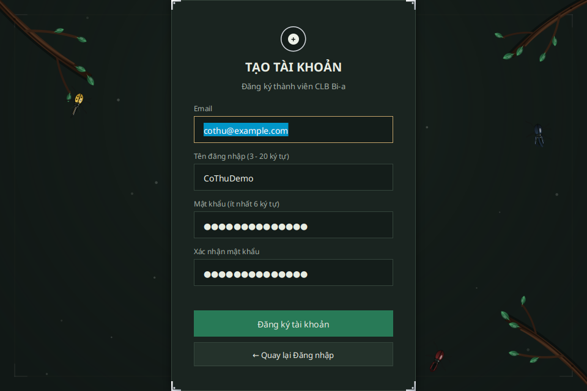

### Minh họa 5.2. Sảnh và menu bạn bè

Menu bạn bè cung cấp ngữ cảnh thao tác trong sảnh. Kịch bản kiểm tra có xác nhận menu được giữ khi refresh và cũng ghi nhận tình huống áp dụng dữ liệu chờ đã cũ.

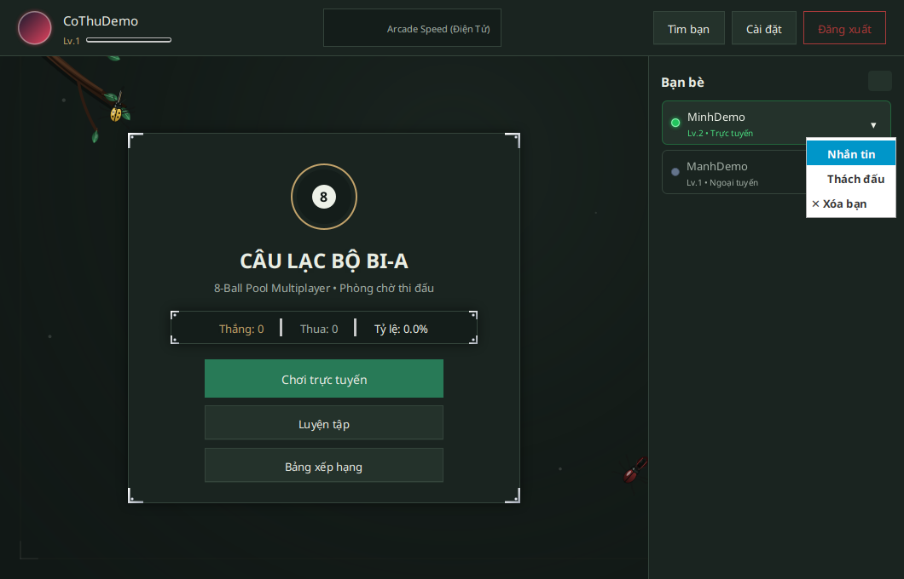

### Minh họa 5.3. Hội thoại chat

Giao diện hội thoại biểu diễn lịch sử và tin nhắn. Ảnh thể hiện cách trình bày, không chứng minh việc nhận lịch sử bất đồng bộ đã đúng cho mọi lần chuyển bạn chat.

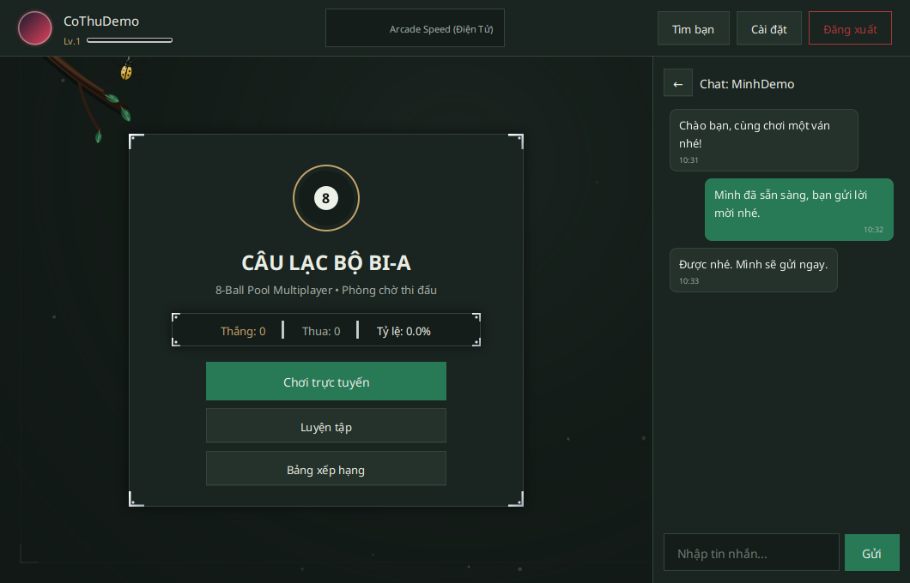

### Minh họa 5.4. Lời mời thách đấu

Popup lời mời nằm trên cửa sổ chủ và có bộ đếm. Server và client có mốc timeout khác nhau, lần lượt 15 và 10 giây trong mã đối chiếu.

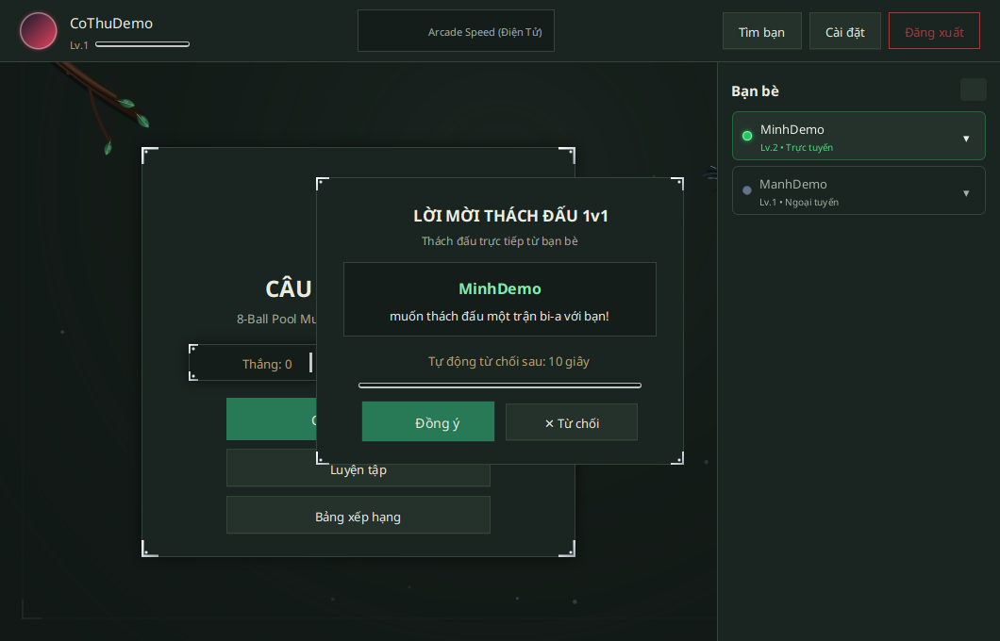

### Minh họa 5.5. Phản hồi bằng toast

Kết quả lời mời dùng thông báo toast, giúp hiển thị phản hồi mà không mở thêm Alert chặn giao diện. Thông báo giúp người chơi biết kết quả và tiếp tục thao tác trong sảnh.

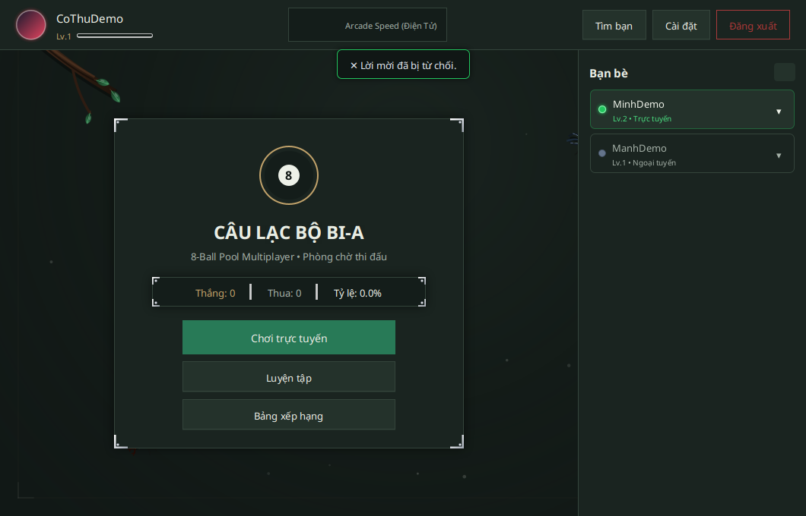

### Minh họa 5.6. Chế độ luyện tập

Solo ẩn và loại khung đối thủ khỏi bố cục. Ảnh minh họa việc loại khoảng trống; chưa thay cho nghiệm thu toàn bộ quy tắc vật lý và kết thúc bài luyện tập.

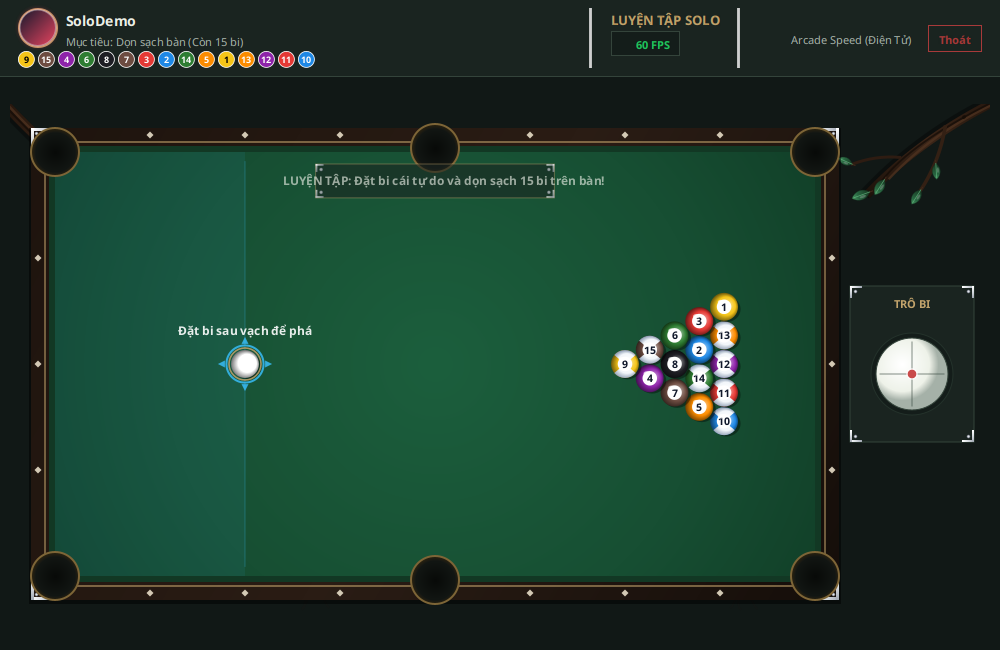

### Minh họa 5.7. Bàn chơi và hiển thị hướng gậy

GameScene tiếp nhận mẫu CUE_AIM từ callback có kiểm soát và hiển thị trạng thái tương ứng. Để nghiệm thu ngắm liên tục, vẫn cần hai client thật với mạng có độ trễ và thay đổi lượt, không chỉ callback đơn lẻ.

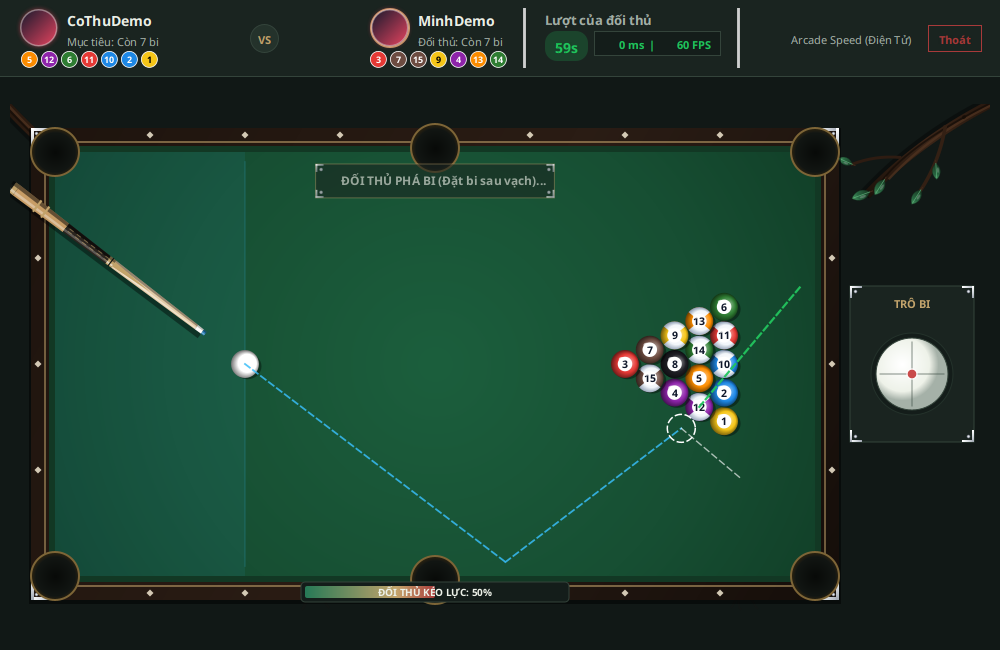

## 5.6. Các sự cố triển khai thường gặp

| Hiện tượng | Nội dung cần kiểm tra | Kết quả cần có trước khi tiếp tục |
| --- | --- | --- |
| Windows hỏi ứng dụng để mở JAR | Người dùng đang mở file .jar, chưa chạy bản EXE đã đóng gói | Dùng EXE từ bước build thành công hoặc script Java để chẩn đoán |
| Tải GitHub nhưng không thấy EXE mới | .gitignore loại *.exe và dist; source ZIP không phải gói phát hành | Có gói phát hành riêng hoặc build trên Windows |
| Không tìm thấy JavaFX/JVM | SDK, kiến trúc x64, runtime và DLL đi kèm | App mở trên máy kiểm tra với đủ tài nguyên |
| Không kết nối được server | Server đang chạy, IP đúng, TCP 12345 truy cập được | Có kết nối trước khi thử đăng nhập |
| Đăng ký/đăng nhập lỗi | Database, JDBC classpath, cấu hình và bảng dữ liệu | Server kết nối DB và có phản hồi xác thực |
| Mã mới nhưng hành vi cũ | JAR/EXE chưa được build lại hoặc đang chạy gói khác | Ghi nhận phiên bản binary đang thử |

# CHƯƠNG 6. KIỂM THỬ VÀ ĐÁNH GIÁ

## 6.1. Phương pháp và môi trường kiểm chứng

Bộ minh chứng được lưu tại reports/evidence/00bf1cc, thực thi ngày 26/10/2026 trên môi trường Linux. Biên dịch dùng JDK 21 với --release 17, gồm 9 file Java server và 26 file Java client; cả hai thành công. Kiểm tra giao thức dùng server thực và PostgreSQL phát triển cục bộ. Kiểm tra giao diện dùng các lớp JavaFX thật, Xvfb và transport giả lập.

Bản báo cáo ngày 29/10/2026 kế thừa các log này theo đúng phiên bản và phạm vi. Các lần biên tập tài liệu không được tính là lần kiểm thử ứng dụng mới. Mã thoát 0 của script mô tả hiện trạng chỉ có nghĩa các assertion đã hoàn tất; một assertion có thể cố ý xác nhận việc tái hiện lỗi.

Lần chạy giao thức đầu tiên dừng ở tình huống phản hồi sai tên vì chưa bảo đảm timer đã được tạo. Lần sau thêm khoảng chờ 250 ms và tái hiện trạng thái bận còn lưu. Cả log lần đầu và lần hoàn tất đều được giữ; không gộp chúng thành một lần chạy hoàn hảo.

## 6.2. Kết quả thực thi đã có

| Mã | Trường hợp kiểm tra | Quan sát thực tế | Đánh giá |
| --- | --- | --- | --- |
| KT01 | Biên dịch client/server | 9 file server, 26 file client biên dịch thành công | Đạt bước build trong môi trường đã nêu |
| KT02 | Đăng ký và đăng nhập | Tài khoản tạm đăng ký và đăng nhập tên khác hoa/thường | Đạt luồng đã thử |
| KT03 | Lời mời không hợp lệ | Từ chối tên rỗng, tự mời và offline | Đạt các trường hợp đã thử |
| KT04 | Chấp nhận/từ chối lời mời | Tra tên trim/khác hoa thường, tạo phòng, loại người mời khỏi hàng chờ | Đạt luồng đã thử |
| KT05 | Ngắm liên tục | 60 mẫu 34 byte được chuyển cho đối thủ, không echo về người gửi | Đạt relay; chưa kết luận độ mượt hai UI |
| KT06 | Kết thúc mô phỏng | PHYSICS_DONE chuyển lượt | Đạt chuyển lượt; không có chốt snapshot |
| KT07 | Hết hạn/mất kết nối | Hết hạn khoảng 15 giây; phản hồi thất bại khi đối tác rời | Đạt các nhánh được kích hoạt |
| KT08 | Form và refresh | Callback chạy đúng luồng ở các trường hợp đã thử | Có hành vi đúng, còn lỗi riêng bên dưới |
| KT09 | Popup/toast | Popup trên owner, đóng theo vòng đời; kết quả dùng toast | Đạt trong fixture JavaFX |
| KT10 | Solo và nhận mẫu ngắm | Không còn khung đối thủ trống; đọc mẫu ngắm hiện hành | Đạt kiểm tra UI có kiểm soát |

## 6.3. Lỗi và giới hạn cần hoàn thiện

| Mã | Hiện tượng | Tác động | Hướng hoàn thiện |
| --- | --- | --- | --- |
| L01 | Hai READY từ cùng người có thể mở trận | Trận bắt đầu trước khi đối thủ thực sự sẵn sàng | Ghi nhận trạng thái sẵn sàng riêng cho từng người |
| L02 | Góc NaN được relay; cú đánh lặp tiếp tục được chuyển | Trạng thái bất hợp lệ hoặc áp dụng cú đánh nhiều lần | Kiểm tra tham số và nhận diện lệnh đã xử lý |
| L03 | Phản hồi sai tên hủy timer nhưng còn currentChallenger | Lời mời có thể giữ trạng thái bận quá hạn | Chỉ kết thúc timer khi phản hồi phù hợp với lời mời |
| L04 | SETTINGS_RESPONSE server chỉ có boolean, client đọc thêm string | Luồng đọc không khớp; có thể chờ hoặc lỗi | Thống nhất payload giữa bộ ghi và bộ đọc |
| L05 | Email sai định dạng được server nhận; UI từ chối TLD dài hợp lệ | Quy tắc hai đầu không thống nhất | Dùng quy tắc kiểm tra nhất quán ở hai đầu |
| L06 | Hai tin giống nhau trong cùng phút bị gộp; lịch sử cũ vào cuộc chat mới | Mất biểu diễn tin hoặc sai hội thoại | Gắn định danh tin và hội thoại vào yêu cầu/phản hồi |
| L07 | Refresh A→B→A khi menu mở áp dụng B lúc đóng | Danh sách hiển thị dữ liệu cũ | Áp dụng bản cập nhật mới nhất khi đóng menu |

Các dòng trên là hiện tượng đã ghi trong log. Ngoài ra, đọc mã cho thấy ghi kết quả chưa có transaction toàn vẹn, DB dùng Connection chung, mô phỏng chưa có bước thời gian cố định và chưa có snapshot/ACK hai phía. Những nhận xét từ mã cần được tách khỏi khẳng định đã gây lỗi ở mọi điều kiện thực tế.

## 6.4. Kế hoạch nghiệm thu tích hợp còn lại

| Mã | Kịch bản cần chạy | Tiêu chí quan sát mong đợi | Trạng thái |
| --- | --- | --- | --- |
| NT01 | Hai máy Windows dùng EXE cùng bản | Mở được, đủ tài nguyên, kết nối và đăng nhập thành công | Chưa thực thi trong bộ minh chứng |
| NT02 | Ngắm liên tục, đổi góc qua biên ±π, kéo lực và chỉnh xoáy qua nhiều lượt | Hướng gậy đúng người có lượt; không kẹt hình ngắm sau đánh hoặc đổi lượt | Chưa nghiệm thu hai UI qua mạng |
| NT03 | Chơi trọn ván với phạm lỗi, hết giờ, bi cái và bi 8 vào lỗ | Quyền lượt, kết quả và dữ liệu sau trận thống nhất với luật công bố | Chưa có ván đầy đủ trong bộ minh chứng |
| NT04 | Thêm độ trễ/jitter, ngắt mạng giữa ngắm/đánh/lời mời | Có phản hồi và dọn phiên; không áp dụng lệnh của trạng thái cũ | Cần chạy sau khi sửa lỗi trạng thái |
| NT05 | Gây lỗi DB giữa ghi kết quả, đăng ký đồng thời | Không ghi kết quả một phần; định danh tài khoản nhất quán | Chưa kiểm thử giao dịch/đồng thời đầy đủ |
| NT06 | Lưu và đăng nhập lại với avatar/skin; thử âm thanh/mute | Quyền theo level đúng; tùy chọn tồn tại theo thiết kế | Chưa nghiệm thu toàn bộ tùy chọn |
| NT07 | Nhiều phòng, lời mời chéo và chuyển chat nhanh | Phòng độc lập; phản hồi thuộc đúng đối tượng; đo tải có cấu hình rõ | Chưa có stress test/benchmark |

Mỗi lần chạy cần lưu phiên bản mã và binary, hệ điều hành, cấu hình mạng, dữ liệu đầu vào, bước thao tác, kết quả mong đợi và thực tế. Với NT02–NT04, nên ghi cả thời điểm gửi/nhận và ảnh hai phía để phân biệt chậm hiển thị với sai trạng thái. Các tiêu chí này là kế hoạch kiểm tra, không được ghi là đã đạt chỉ vì tài liệu hoặc sơ đồ đã hoàn thành.

## 6.5. Đánh giá kết quả của nhóm

Dự án đã liên kết được các nhóm chức năng từ kết nối, tài khoản và sảnh đến bàn chơi, kết quả và cá nhân hóa trong một kiến trúc client–server. Các kiểm tra đã có cung cấp bằng chứng cho việc biên dịch, nhiều nhánh thách đấu, relay mẫu ngắm và một số phản hồi JavaFX. Các lỗi còn lại cho thấy chất lượng cần được đánh giá trên toàn bộ đường đi của một thao tác, từ yêu cầu mạng đến dữ liệu và phản hồi giao diện.

Mức hoàn thiện còn giới hạn ở tính nhất quán trong các tình huống lặp, muộn hoặc sai trạng thái và ở phạm vi kiểm chứng trên Windows. Vì vậy, kết quả hiện tại phù hợp để trình bày sản phẩm đồ án cùng phân tích kỹ thuật và hướng hoàn thiện; chưa đủ cơ sở tuyên bố không còn lỗi bất đồng bộ hoặc bảo đảm hiệu năng trong mọi điều kiện mạng.

# CHƯƠNG 7. KẾT LUẬN VÀ HƯỚNG PHÁT TRIỂN

## 7.1. Kết luận

Đồ án xây dựng ứng dụng bi-a hai người qua mạng bằng Java/JavaFX, Socket và PostgreSQL, kết hợp nghiệp vụ tài khoản, tương tác xã hội, thi đấu và cá nhân hóa. Báo cáo tổng hợp toàn bộ phạm vi của nhóm, từ mục tiêu, kiến thức nền và kiến trúc đến đặc tả, triển khai, minh họa sản phẩm và đánh giá.

Các chức năng tài khoản, sảnh, truyền thông, mô phỏng và hiển thị đã được kết nối thành một quy trình sử dụng chung. Giá trị của sản phẩm nằm ở sự phối hợp đó: người chơi có thể đi từ việc xác thực tới tìm đối thủ, thao tác trên bàn và xem kết quả trong cùng ứng dụng. Báo cáo mô tả quy trình này cùng các giới hạn hiện tại để làm cơ sở đánh giá và tiếp tục phát triển.

Bài học kỹ thuật chính là giao thức cần được kiểm chứng đồng thời ở hai đầu, thao tác UI cần tuân thủ luồng JavaFX, và vận chuyển tin cậy chưa đủ để bảo đảm trạng thái trò chơi nhất quán. Các lỗi được ghi lại cung cấp đầu việc cụ thể cho giai đoạn hoàn thiện, thay vì suy luận chất lượng chỉ từ giao diện hoặc việc biên dịch thành công.

## 7.2. Hướng phát triển theo mức ưu tiên

Ưu tiên trước hết là sửa những sai lệch đã tái hiện: thống nhất SETTINGS_RESPONSE; chống READY và cú đánh lặp; kiểm tra giá trị hữu hạn/phạm vi tham số; bảo vệ vòng đời lời mời; gắn phản hồi chat với đúng hội thoại và thống nhất kiểm tra email. Sau mỗi thay đổi cần tái lập trường hợp lỗi rồi chạy lại luồng bình thường liên quan.

Bước tiếp theo là củng cố trạng thái trận bằng mã trận/lượt, thứ tự lệnh và quy tắc chấp nhận thông điệp. Có thể lựa chọn server mô phỏng có thẩm quyền hoặc kết hợp bước thời gian cố định ở client với cơ chế chốt/hiệu chỉnh bàn. Thiết kế được chọn cần được đánh giá bằng hai client thật, đo sai lệch vị trí và kiểm tra mất kết nối, không chỉ bổ sung tên packet vào tài liệu.

Về dữ liệu, cần transaction cho kết quả trận, quản lý kết nối phù hợp tải đồng thời và ràng buộc định danh nhất quán với cách tra cứu. Về triển khai, cần cấu hình ngoài mã, gói Windows có mã phiên bản rõ, kiểm tra trên máy sạch và quy trình phát hành riêng với source ZIP. TLS và thuật toán băm mật khẩu chuyên dụng cũng cần được xem xét trước khi mở rộng sử dụng.

Sau khi nền tảng ổn định, nhóm có thể bổ sung tái kết nối, lịch sử trận chi tiết hoặc tính năng quan sát. Những chức năng này là định hướng tương lai và nằm ngoài phạm vi chức năng hiện tại.

# PHỤ LỤC A. ĐẶC TẢ CHỨC NĂNG

Phụ lục tập hợp 31 đặc tả để đối chiếu khi cần kiểm tra một chức năng cụ thể. Các mã được giữ ổn định để tra cứu với sơ đồ; nội dung chính của báo cáo diễn giải các chức năng trong quy trình sử dụng ở Chương 4. Những nhóm dưới đây là nhóm chức năng của cùng hệ thống.

## Quản lý kết nối & Giao thức truyền tin

### UC-C01 — Thiết lập kết nối TCP

**Tác nhân:** Người chơi.

**Điều kiện bắt đầu:** Đã có địa chỉ/cổng server và mạng khả dụng.

**Diễn tiến:** Nhập hoặc nạp địa chỉ. Mở socket với timeout kết nối 2,5 giây. Tạo stream. Khởi động luồng nhận và ping. Lưu địa chỉ.

**Ngoại lệ và giới hạn:** Không kết nối được: báo lỗi; người chơi sửa cấu hình hoặc thử lại. Chưa có handshake phiên bản.

**Kết quả:** Có kết nối TCP để thực hiện yêu cầu nghiệp vụ.

**Liên hệ mã nguồn:** NetworkClient.connect; ServerConfigDialog; ServerMain.main.

### UC-C02 — Khám phá server trong LAN

**Tác nhân:** Người chơi.

**Điều kiện bắt đầu:** Client và server cùng vùng mạng hỗ trợ discovery.

**Diễn tiến:** Gửi BILLIARDS_DISCOVER qua UDP 12346. Nhận BILLIARDS_SERVER:12345. Sử dụng địa chỉ nhận để kết nối TCP.

**Ngoại lệ và giới hạn:** Không có phản hồi: người chơi nhập địa chỉ thủ công; discovery không bảo đảm tìm server qua Internet.

**Kết quả:** Xác định được địa chỉ server hoặc quay về nhập thủ công.

**Liên hệ mã nguồn:** NetworkClient: UDP discovery; ServerMain.startUdpDiscoveryListener.

### UC-C03 — Gửi và nhận packet nhị phân

**Tác nhân:** Người chơi thông qua chức năng ứng dụng.

**Điều kiện bắt đầu:** Socket đang mở; hai phía dùng định dạng tương thích.

**Diễn tiến:** Ghi byte PacketType và các trường. Flush. Phía nhận đọc trọn payload theo loại rồi phân phối tới handler/callback.

**Ngoại lệ và giới hạn:** Payload sai hoặc stream kết thúc có thể gây IOException; SETTINGS_RESPONSE hiện có lệch định dạng được ghi ở phụ lục kiểm chứng.

**Kết quả:** Yêu cầu được chuyển đến đúng bộ phận khi đọc thành công.

**Liên hệ mã nguồn:** NetworkClient.readPacketPayload; Packet; PacketType; ClientHandler.handlePacket.

### UC-C04 — Đo độ trễ RTT

**Tác nhân:** Người chơi.

**Điều kiện bắt đầu:** Socket đang hoạt động.

**Diễn tiến:** Client gửi PING kèm long timestamp ngay khi kết nối và định kỳ hai giây. Server trả timestamp. Client tính chênh lệch để hiển thị.

**Ngoại lệ và giới hạn:** Không nhận lại ping: không có số đo mới; đây chưa phải chính sách timeout đọc 20 giây.

**Kết quả:** Có giá trị RTT phục vụ hiển thị, không thay đổi luật chơi.

**Liên hệ mã nguồn:** NetworkClient.sendPing/listenLoop; ClientHandler.handlePing.

### UC-C05 — Ghép trận ngẫu nhiên

**Tác nhân:** Người chơi và đối thủ.

**Điều kiện bắt đầu:** Đã đăng nhập; chưa có phòng.

**Diễn tiến:** Gửi FIND_MATCH. Đưa vào queue nếu chưa có. Khi đủ hai người, tạo GameRoom và gửi MATCH_FOUND cho cả hai.

**Ngoại lệ và giới hạn:** CANCEL_FIND xóa khỏi queue; người đã có phòng hoặc đã nằm trong queue không được thêm lặp.

**Kết quả:** Ghép được phòng hai người hoặc tiếp tục chờ/hủy tìm.

**Liên hệ mã nguồn:** LobbyManager.addToQueue/removeFromQueue/createGame; MatchmakingScene.

### UC-C06 — Thách đấu trực tiếp

**Tác nhân:** Người mời và người nhận.

**Điều kiện bắt đầu:** Người mời đăng nhập; có tên người nhận online.

**Diễn tiến:** Gửi tên người nhận. Server trim và tra không phân biệt hoa thường. Phát lời mời. Nhận accept. Xóa queue và tạo phòng khi hợp lệ.

**Ngoại lệ và giới hạn:** Tên rỗng/tự mời/offline/bận hoặc từ chối/hết hạn đều thất bại; client đếm 10 giây, server chờ 15 giây.

**Kết quả:** Có MATCH_FOUND hoặc thông báo không tạo trận; trường hợp phản hồi sai tên còn lỗi vòng đời timer.

**Liên hệ mã nguồn:** ClientHandler.handleChallengeRequest/handleChallengeResponse; LobbyManager.createGame.

### UC-C07 — Ngắt kết nối và giải phóng phiên

**Tác nhân:** Người chơi, hoặc kết nối bị gián đoạn.

**Điều kiện bắt đầu:** Có socket hoặc phiên đang hoạt động.

**Diễn tiến:** Người chơi ngắt hoặc server phát hiện kết thúc stream. Xóa online/queue. Hủy timer lời mời. Xử lý phòng và đóng socket.

**Ngoại lệ và giới hạn:** Ngắt trong phòng: người còn lại thắng theo quy tắc hiện có; không có phục hồi ván cũ sau reconnect.

**Kết quả:** Phiên được dọn theo logic cleanup; không khẳng định mọi lỗi mạng được phát hiện ngay.

**Liên hệ mã nguồn:** NetworkClient.disconnect/listenLoop; ClientHandler.cleanup; GameRoom.handleDisconnect.

## Xác thực & Quản lý dữ liệu

### UC-D01 — Đăng ký tài khoản

**Tác nhân:** Người chơi mới.

**Điều kiện bắt đầu:** Kết nối server và PostgreSQL khả dụng.

**Diễn tiến:** Nhận email, username, mật khẩu. Kiểm tra cơ bản. Băm cùng salt. Trim/chuyển thường email. Kiểm tra trùng và INSERT players.

**Ngoại lệ và giới hạn:** Email/username trùng hoặc mật khẩu quá ngắn bị từ chối; server chưa kiểm tra định dạng email tương đương client.

**Kết quả:** Tạo tài khoản với mật khẩu băm hoặc trả mã lỗi.

**Liên hệ mã nguồn:** AuthManager.register/hashPassword; DatabaseManager.register.

### UC-D02 — Đăng nhập bằng tên hoặc email

**Tác nhân:** Người chơi.

**Điều kiện bắt đầu:** Tài khoản đã tồn tại; server kết nối DB.

**Diễn tiến:** Tra LOWER(username) hoặc LOWER(email). Xác minh hash với salt. Tạo thông tin phiên và trả hồ sơ.

**Ngoại lệ và giới hạn:** Sai mật khẩu/không tìm thấy: trả thất bại; định danh trùng chéo username–email chưa được giải quyết tường minh.

**Kết quả:** Có phiên xác thực khi thành công.

**Liên hệ mã nguồn:** AuthManager.login/verifyPassword; DatabaseManager.getPlayerByUsername; ClientHandler.handleLogin.

### UC-D03 — Lưu avatar và skin gậy

**Tác nhân:** Người chơi đã đăng nhập.

**Điều kiện bắt đầu:** Có phiên và lựa chọn tùy chỉnh.

**Diễn tiến:** Nhận avatarId, cueColor/skinId. Kiểm tra điều kiện cấp độ bằng CueSkinConfig. Cập nhật DB và thông tin phiên. Trả boolean.

**Ngoại lệ và giới hạn:** Không đủ cấp hoặc lỗi DB: trả false; client đang đọc thừa string trong SETTINGS_RESPONSE nên phản hồi có thể không được xử lý đúng.

**Kết quả:** DB/phiên cập nhật khi thành công; không khẳng định UI đã xác nhận được.

**Liên hệ mã nguồn:** ClientHandler.handleSettingsUpdate; CueSkinConfig; DatabaseManager.updateSettings.

### UC-D04 — Ghi kết quả và cập nhật EXP/level

**Tác nhân:** GameRoom (tác nhân hệ thống).

**Điều kiện bắt đầu:** GameRoom đã chọn người thắng/thua.

**Diễn tiến:** Đặt gameFinished. Cộng thắng và 100 EXP. Tính level=floor(EXP/200)+1. Tăng thua. INSERT match_history. Nạp lại hồ sơ.

**Ngoại lệ và giới hạn:** DB lỗi giữa các câu lệnh có thể để cập nhật dở dang vì chưa có transaction bao trọn.

**Kết quả:** Kết quả được ghi theo các câu lệnh thành công; cờ phòng hạn chế lặp trong phiên.

**Liên hệ mã nguồn:** GameRoom.endGame/handleDisconnect; DatabaseManager.recordMatchResult.

### UC-D05 — Truy vấn bảng xếp hạng

**Tác nhân:** Người chơi.

**Điều kiện bắt đầu:** Có dữ liệu players và kết nối DB.

**Diễn tiến:** Nhận LEADERBOARD_REQUEST. Lấy người chơi theo exp giảm dần với giới hạn. Đóng gói chuỗi và trả client.

**Ngoại lệ và giới hạn:** Lỗi DB hoặc chưa có dữ liệu: xử lý kết quả trống theo mã hiện tại; chưa kiểm thử tải lớn.

**Kết quả:** Client nhận dữ liệu xếp hạng để dựng giao diện.

**Liên hệ mã nguồn:** DatabaseManager.getLeaderboard; ClientHandler.handleLeaderboard.

### UC-D06 — Quản lý quan hệ bạn bè

**Tác nhân:** Người chơi và người được mời kết bạn.

**Điều kiện bắt đầu:** Tài khoản hợp lệ; dữ liệu người nhận tồn tại.

**Diễn tiến:** Tìm người chơi, tạo lời mời. Chấp nhận/từ chối. Đọc danh sách. Xóa quan hệ theo yêu cầu.

**Ngoại lệ và giới hạn:** Người nhận không tồn tại hoặc quan hệ không phù hợp: trả trạng thái thất bại; status chưa có CHECK enum trong schema.

**Kết quả:** Bảng friendships phản ánh thao tác được chấp nhận.

**Liên hệ mã nguồn:** DatabaseManager: friendship methods; ClientHandler: friend handlers; schema.sql.

### UC-D07 — Lưu và truy vấn tin nhắn

**Tác nhân:** Người gửi và người nhận.

**Điều kiện bắt đầu:** Hai tài khoản được xác định theo quy tắc hiện tại.

**Diễn tiến:** Lưu tin vào messages. Chuyển thông báo tới client. Truy vấn lịch sử giới hạn và trả chuỗi dữ liệu.

**Ngoại lệ và giới hạn:** Lịch sử truyền chưa có conversation ID/message ID phục vụ UI; không suy ra mọi phản hồi muộn được phân biệt.

**Kết quả:** Tin nhắn được lưu hoặc lịch sử được trả theo khả năng DB.

**Liên hệ mã nguồn:** DatabaseManager.getChatHistory và thao tác messages; ClientHandler.handleChatMessage/handleChatHistory.

## Gameplay & Engine Vật lý

### UC-G01 — Khởi tạo bàn và phân nhóm bi

**Tác nhân:** Hai người chơi.

**Điều kiện bắt đầu:** Client nhận GAME_START với chỉ số người chơi và seed.

**Diễn tiến:** Tạo 16 bi. Xáo 14 bi mục tiêu khác bi 8 theo matchSeed. Chia hai nhóm bảy bi. Thiết lập người có lượt.

**Ngoại lệ và giới hạn:** READY hiện đếm số packet, nên một người có thể gửi lặp để mở trận; cùng seed chưa bảo đảm mô phỏng luôn đồng nhất.

**Kết quả:** Có bàn và nhóm mục tiêu; luật phân nhóm là biến thể của dự án.

**Liên hệ mã nguồn:** GameRoom.playerReady/startGame; GameScene constructors.

### UC-G02 — Đặt bi cái

**Tác nhân:** Người đang có lượt.

**Điều kiện bắt đầu:** Client cho phép khai cuộc hoặc ball-in-hand.

**Diễn tiến:** Kéo/chọn vị trí. Client giới hạn vùng đặt. Gửi CUE_BALL_PLACED. Server kiểm tra người có lượt rồi chuyển tọa độ.

**Ngoại lệ và giới hạn:** Không có quyền tại UI thì không đặt; server chưa có snapshot chuẩn để đối chiếu mọi vị trí.

**Kết quả:** Client nhận cập nhật vị trí bi cái.

**Liên hệ mã nguồn:** GameScene.repositionCueBall và thao tác chuột; GameRoom.processCueBallPlaced.

### UC-G03 — Ngắm và kéo lực gậy

**Tác nhân:** Người đang có lượt và người quan sát.

**Điều kiện bắt đầu:** Bi chưa chạy; UI cho phép ngắm.

**Diễn tiến:** Tính góc theo chuột và tỷ lệ kéo. Gửi CUE_AIM có điều tiết. Đối thủ nội suy góc/lực để hiển thị.

**Ngoại lệ và giới hạn:** Không đúng lượt: server bỏ qua; dữ liệu NaN hiện vẫn được chuyển tiếp nếu gửi trực tiếp.

**Kết quả:** Người quan sát thấy trạng thái ngắm; chưa có token/sequence.

**Liên hệ mã nguồn:** GameScene.sendAimUpdateThrottled/startGameLoop; GameRoom.processCueAim.

### UC-G04 — Chỉnh xoáy và thực hiện cú đánh

**Tác nhân:** Người đang có lượt.

**Điều kiện bắt đầu:** Có hướng/lực hợp lệ ở client và bi cái hoạt động.

**Diễn tiến:** Chỉnh spinX/spinY. Thả chuột. Gửi sáu double CUE_SHOT. Chạy vật lý tại máy đánh. Server chuyển GAME_STATE cho đối thủ.

**Ngoại lệ và giới hạn:** Cú kéo quá ngắn không tạo cú đánh; server chưa chặn cú đánh trùng trong cùng giai đoạn.

**Kết quả:** Hai phía có thông số cú đánh; không có xác nhận server trước mô phỏng máy đánh.

**Liên hệ mã nguồn:** GameScene.onMouseReleased/applyCueShot; NetworkClient.sendCueShot; GameRoom.processCueShot.

### UC-G05 — Mô phỏng chuyển động và va chạm

**Tác nhân:** GameScene (tác nhân hệ thống).

**Điều kiện bắt đầu:** physicsRunning và danh sách bi đã khởi tạo.

**Diễn tiến:** Mỗi khung hình gọi PhysicsEngine.update. Thực hiện 10 bước con, di chuyển, ma sát, va chạm băng và bi–bi.

**Ngoại lệ và giới hạn:** Tốc độ khung hình khác nhau có thể thay đổi tiến độ; hiện không có tích lũy bước thời gian cố định.

**Kết quả:** Vị trí/vận tốc và hiệu ứng va chạm được cập nhật.

**Liên hệ mã nguồn:** PhysicsEngine.update/resolveWallCollision/resolveBallCollision; Ball.

### UC-G06 — Xử lý bi vào lỗ và kết quả lượt

**Tác nhân:** GameScene (tác nhân hệ thống).

**Điều kiện bắt đầu:** Bi đang được mô phỏng hoặc vừa dừng.

**Diễn tiến:** Kiểm tra sáu lỗ. Chạy hoạt ảnh chìm. Xác định active. Đánh giá phạm lỗi/giữ lượt và điều kiện bi 8 theo luật triển khai.

**Ngoại lệ và giới hạn:** Client có thể phát CLAIM_WIN; server chưa kiểm chứng kết luận bằng mô phỏng vật lý riêng.

**Kết quả:** Có trạng thái bi và thông tin gửi PHYSICS_DONE hoặc CLAIM_WIN.

**Liên hệ mã nguồn:** PhysicsEngine.checkPockets; Ball.startSinking; GameScene: kết thúc vật lý; GameRoom.endGame.

### UC-G07 — Điều phối lượt và hết thời gian

**Tác nhân:** Hai người chơi; GameRoom timer.

**Điều kiện bắt đầu:** Trận đã bắt đầu và chưa kết thúc.

**Diễn tiến:** Máy đánh gửi PHYSICS_DONE. Server giữ/đổi lượt. Client đếm 60 giây. Timer server 61,5 giây xử lý chưa đánh.

**Ngoại lệ và giới hạn:** Timer bị hủy khi có cú đánh; chưa có timeout riêng chờ bản bàn và chưa có ACK hai client.

**Kết quả:** Có quyền lượt mới hoặc giữ lượt theo thông tin nhận.

**Liên hệ mã nguồn:** GameRoom.onPhysicsDone/resetTurnTimer; GameScene.startGameLoop.

### UC-G08 — Luyện tập solo

**Tác nhân:** Người chơi.

**Điều kiện bắt đầu:** Mở chế độ luyện tập từ sảnh.

**Diễn tiến:** Tạo GameScene isPractice. Đặt/ngắm/đánh và mô phỏng cục bộ. Hướng tới dọn bàn. Không tạo đối thủ mạng.

**Ngoại lệ và giới hạn:** Chưa nghiệm thu mọi trường hợp dọn hết bàn; bố cục đối thủ bị ẩn và unmanaged.

**Kết quả:** Người chơi luyện tập trong phiên cục bộ.

**Liên hệ mã nguồn:** SceneManager.showPractice; GameScene practice constructor.

## Giao diện & Cá nhân hóa

### UC-UI01 — Điều hướng màn hình

**Tác nhân:** Người chơi.

**Điều kiện bắt đầu:** Ứng dụng JavaFX đã khởi tạo.

**Diễn tiến:** SceneManager đổi Scene theo đăng nhập, sảnh, tìm trận, trước trận, game và kết quả.

**Ngoại lệ và giới hạn:** Callback đến muộn hoặc thay Scene cần quản lý vòng đời; chưa khẳng định mọi luồng chuyển cảnh đã kiểm thử.

**Kết quả:** Người dùng ở màn hình phù hợp với thao tác/sự kiện.

**Liên hệ mã nguồn:** ClientMain; SceneManager.

### UC-UI02 — Hiển thị và kiểm tra form tài khoản

**Tác nhân:** Người chơi.

**Điều kiện bắt đầu:** Đang ở LoginScene hoặc RegisterScene.

**Diễn tiến:** Nhập trường. Kiểm tra đủ dữ liệu, email, tên, mật khẩu xác nhận. Hiển thị lỗi hoặc gọi NetworkClient.

**Ngoại lệ và giới hạn:** Regex email hiện chặn đuôi miền dài hơn 7 chữ cái; kiểm tra UI không thay kiểm tra server.

**Kết quả:** Có thông báo hoặc yêu cầu đăng nhập/đăng ký được gửi.

**Liên hệ mã nguồn:** LoginScene; RegisterScene.doRegister.

### UC-UI03 — Hiển thị sảnh và danh sách bạn bè

**Tác nhân:** Người chơi.

**Điều kiện bắt đầu:** Đã đăng nhập và mở LobbyScene.

**Diễn tiến:** Hiển thị hồ sơ. Refresh bạn bè 3,5 giây. Không dựng lại dữ liệu giống. Mở menu Nhắn tin/Thách đấu/Xóa bạn.

**Ngoại lệ và giới hạn:** Đang mở menu: hoãn cập nhật; chuỗi A→B→A còn có thể áp dụng B cũ khi đóng.

**Kết quả:** Sảnh/menu cập nhật theo callback; hạn chế hiện tại được ghi nhận.

**Liên hệ mã nguồn:** LobbyScene.updateFriendList/createFriendItem/startFriendAutoRefresh.

### UC-UI04 — Hiển thị hội thoại chat

**Tác nhân:** Người chơi.

**Điều kiện bắt đầu:** Chọn một người để xem chat.

**Diễn tiến:** Mở panel, yêu cầu lịch sử. Hiển thị tin tự gửi và nhận. Cuộn xuống. Đối chiếu dòng khi lịch sử tới.

**Ngoại lệ và giới hạn:** Hai tin giống nhau cùng phút có thể bị gộp; lịch sử trả muộn có thể vào sai cuộc trò chuyện.

**Kết quả:** Có hội thoại hiển thị, chưa bảo đảm nhận diện mọi tin bằng ID.

**Liên hệ mã nguồn:** LobbyScene.showChatView/appendChatMessage/setupNetworkCallback.

### UC-UI05 — Hiển thị lời mời và màn hình trước trận

**Tác nhân:** Người nhận lời mời hoặc người vừa ghép trận.

**Điều kiện bắt đầu:** Có CHALLENGE_RECEIVE hoặc MATCH_FOUND.

**Diễn tiến:** Hiện popup nổi và đếm 10 giây. Gửi lựa chọn. Dùng toast cho kết quả. Khi MATCH_FOUND thì dừng refresh và chuyển PreGameScene.

**Ngoại lệ và giới hạn:** Đếm hết tự từ chối; callback UI được chuyển về FX thread; server còn thời hạn riêng 15 giây.

**Kết quả:** Popup đóng hoặc chuyển màn hình trước trận.

**Liên hệ mã nguồn:** LobbyScene.showChallengeReceivedDialog/showToast; PreGameScene.

### UC-UI06 — Hiển thị bàn chơi và HUD

**Tác nhân:** Người chơi.

**Điều kiện bắt đầu:** Có GameScene đối kháng hoặc luyện tập.

**Diễn tiến:** Vẽ bàn/bi/gậy, lượt, lực, xoáy, thời gian và ping/FPS. Solo ẩn thông tin đối thủ và bỏ khung trống.

**Ngoại lệ và giới hạn:** Số FPS/ping trên dữ liệu giả lập không phải benchmark; không tự quyết định luật từ thông tin hiển thị.

**Kết quả:** Khung hình thể hiện trạng thái hiện có của client.

**Liên hệ mã nguồn:** GameScene.build/startGameLoop; Canvas; AvatarManager.

### UC-UI07 — Hiển thị kết quả và bảng xếp hạng

**Tác nhân:** Người chơi.

**Điều kiện bắt đầu:** Có phản hồi GAME_OVER hoặc dữ liệu leaderboard.

**Diễn tiến:** Dựng kết quả thắng/thua/EXP. Hiển thị các dòng xếp hạng do server trả. Cho quay về màn hình tiếp theo.

**Ngoại lệ và giới hạn:** Không có dữ liệu hoặc lỗi mạng cần thông báo; chưa có nghiệm thu toàn bộ UI bảng xếp hạng trong lần kiểm tra trước.

**Kết quả:** Người dùng xem kết quả/xếp hạng từ dữ liệu server.

**Liên hệ mã nguồn:** ResultScene; LeaderboardScene; SceneManager.

### UC-UI08 — Chọn avatar và skin gậy

**Tác nhân:** Người chơi.

**Điều kiện bắt đầu:** Mở SettingsDialog và có hồ sơ hiện tại.

**Diễn tiến:** Chọn avatar/skin. Xem preview và yêu cầu cấp độ. Lưu bằng SETTINGS_UPDATE. Server kiểm tra quyền và ghi dữ liệu.

**Ngoại lệ và giới hạn:** Skin khóa bị hạn chế; server kiểm tra lại cấp; lỗi parser SETTINGS_RESPONSE có thể cản xác nhận thành công.

**Kết quả:** Lựa chọn được gửi; trạng thái lưu thành công cần phản hồi đúng.

**Liên hệ mã nguồn:** SettingsDialog; AvatarManager; CueSkinManager; NetworkClient.sendSettingsUpdate.

### UC-UI09 — Điều chỉnh âm thanh và hiệu ứng

**Tác nhân:** Người chơi.

**Điều kiện bắt đầu:** Đang mở tab âm thanh/cài đặt.

**Diễn tiến:** Đổi BGM/SFX/mute. Thử âm thanh. Bật/tắt VFX gậy. SoundManager áp dụng và lưu các tùy chọn âm thanh vào Preferences.

**Ngoại lệ và giới hạn:** Thiếu tài nguyên hoặc thiết bị âm thanh ảnh hưởng kết quả; VFX là cờ cục bộ, không khẳng định được lưu như âm thanh.

**Kết quả:** Âm thanh/hiệu ứng thay đổi cục bộ, không tạo packet gameplay.

**Liên hệ mã nguồn:** SettingsDialog.buildAudioTab; SoundManager; CueSkinManager.setVfxEnabled.

# PHỤ LỤC B. BIỂU ĐỒ PHÂN TÍCH VÀ THIẾT KẾ

Các sơ đồ hỗ trợ giải thích những luồng đã trình bày trong báo cáo. Use Case thể hiện phạm vi chức năng; Activity mô tả các bước và nhánh điều kiện; Sequence làm rõ tương tác theo thời gian; Component biểu diễn phụ thuộc giữa các thành phần. Chú thích và nhánh lỗi phản ánh mã hiện tại, không được hiểu là những cải tiến đã hoàn thành.

## B.1. Chức năng quản lý kết nối & giao thức truyền tin

Loại sơ đồ: Use Case. Đối chiếu Phụ lục A: UC-C01, UC-C02, UC-C03, UC-C04, UC-C05, UC-C06, UC-C07.

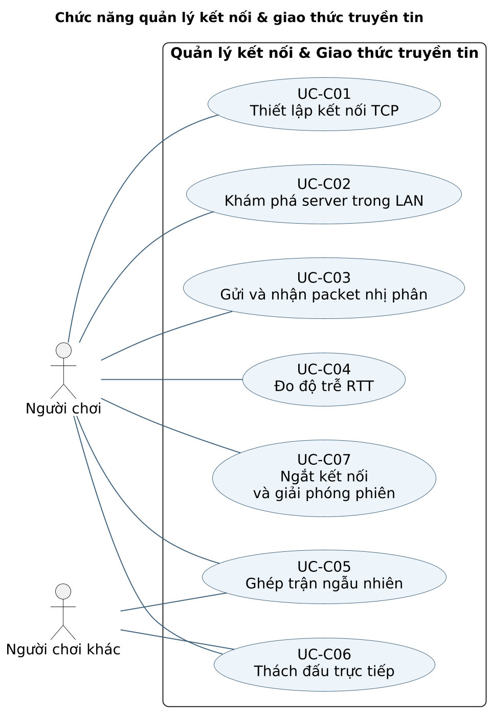

## B.2. Kết nối TCP và trao đổi PING

Loại sơ đồ: Sequence. Đối chiếu Phụ lục A: UC-C01, UC-C03, UC-C04.

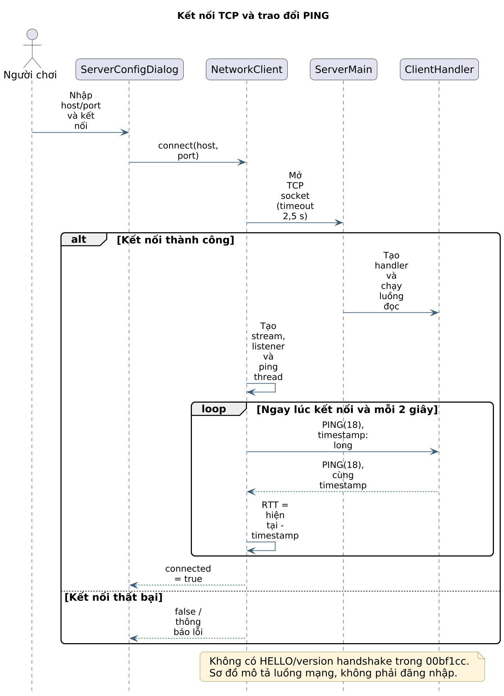

## B.3. Điều phối thách đấu trực tiếp

Loại sơ đồ: Activity. Đối chiếu Phụ lục A: UC-C06, UC-C07.

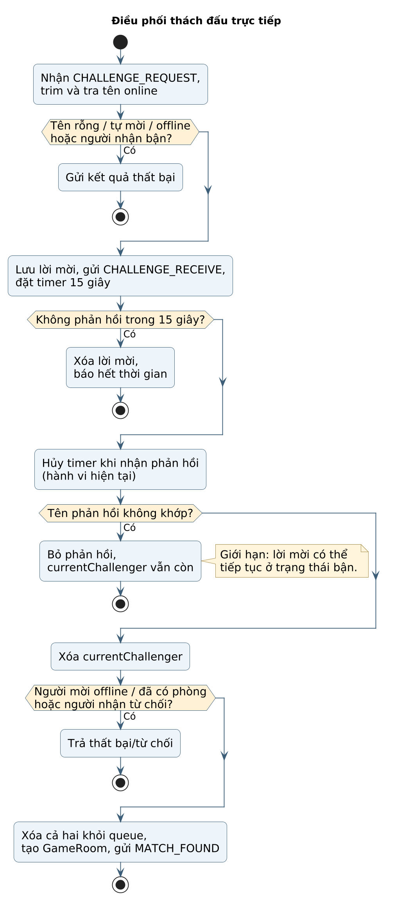

## B.4. Chức năng xác thực & quản lý dữ liệu

Loại sơ đồ: Use Case. Đối chiếu Phụ lục A: UC-D01, UC-D02, UC-D03, UC-D04, UC-D05, UC-D06, UC-D07.

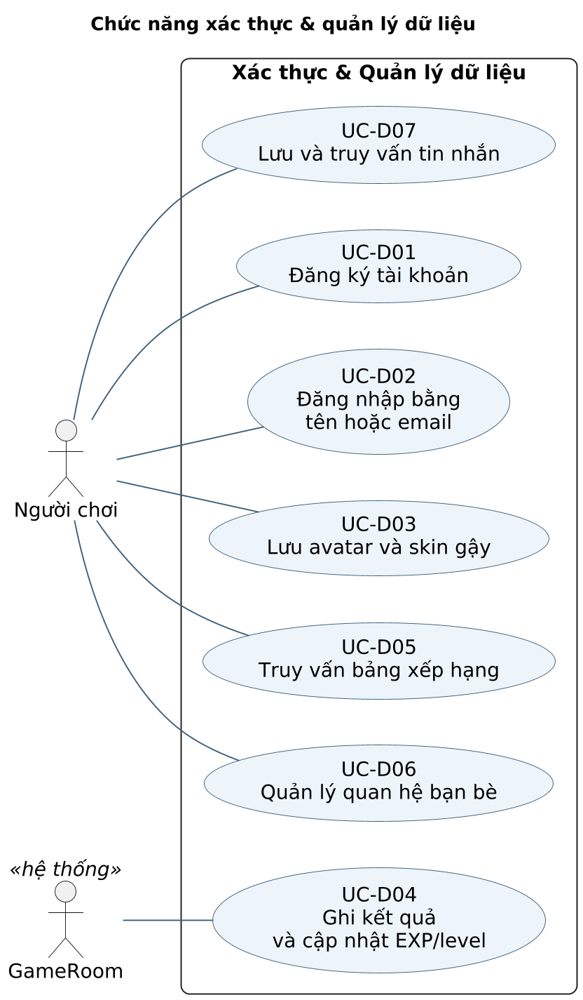

## B.5. Đăng ký và lưu tài khoản

Loại sơ đồ: Activity. Đối chiếu Phụ lục A: UC-D01.

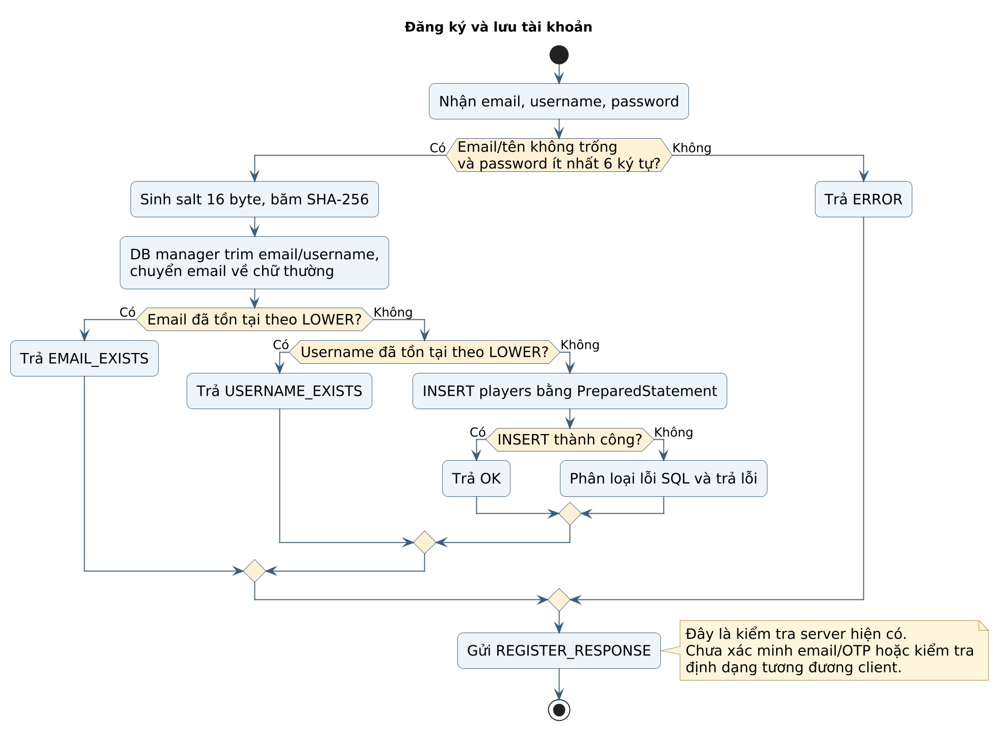

## B.6. Ghi kết quả, EXP và lịch sử

Loại sơ đồ: Activity. Đối chiếu Phụ lục A: UC-D04.

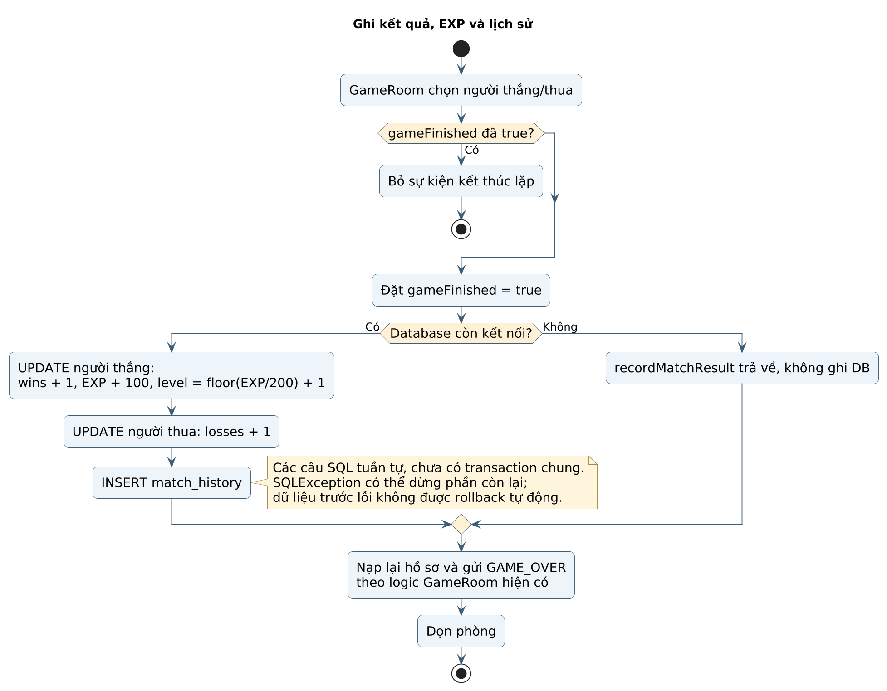

## B.7. Đăng nhập bằng username hoặc email

Loại sơ đồ: Sequence. Đối chiếu Phụ lục A: UC-D02.

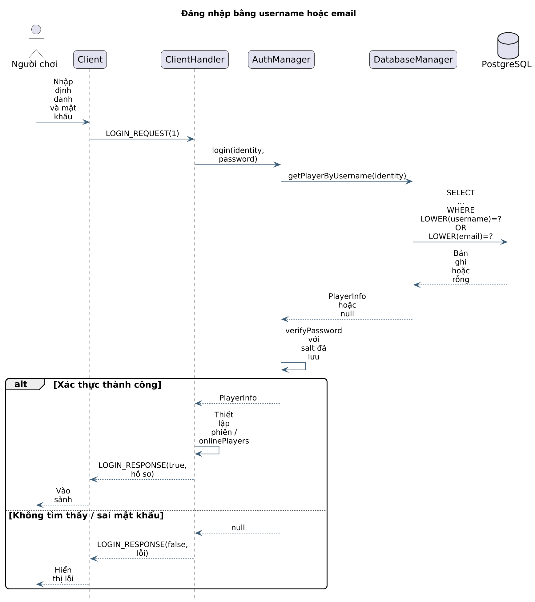

## B.8. Chức năng gameplay & engine vật lý

Loại sơ đồ: Use Case. Đối chiếu Phụ lục A: UC-G01, UC-G02, UC-G03, UC-G04, UC-G05, UC-G06, UC-G07, UC-G08.

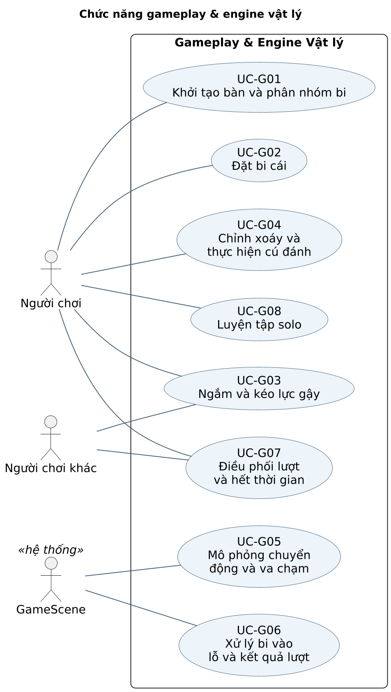

## B.9. Một cú đánh và xử lý cuối lượt

Loại sơ đồ: Activity. Đối chiếu Phụ lục A: UC-G02, UC-G03, UC-G04, UC-G05, UC-G06, UC-G07.

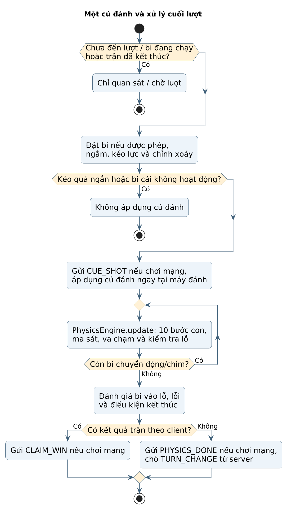

## B.10. Truyền cú đánh và đổi lượt hiện tại

Loại sơ đồ: Sequence. Đối chiếu Phụ lục A: UC-G03, UC-G04, UC-G07.

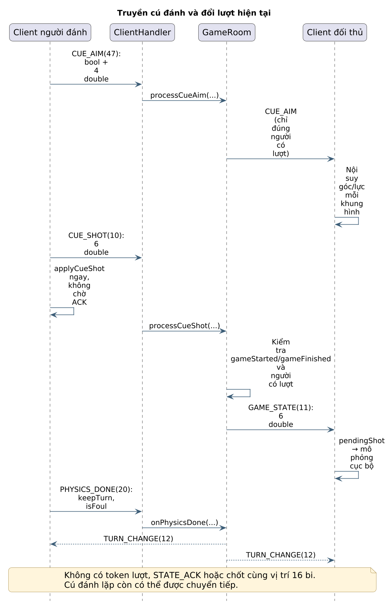

## B.11. Chức năng giao diện & cá nhân hóa

Loại sơ đồ: Use Case. Đối chiếu Phụ lục A: UC-UI01, UC-UI02, UC-UI03, UC-UI04, UC-UI05, UC-UI06, UC-UI07, UC-UI08, UC-UI09.

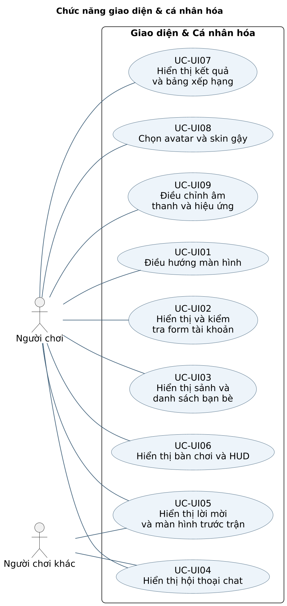

## B.12. Cá nhân hóa avatar, gậy và âm thanh

Loại sơ đồ: Activity. Đối chiếu Phụ lục A: UC-UI08, UC-UI09.

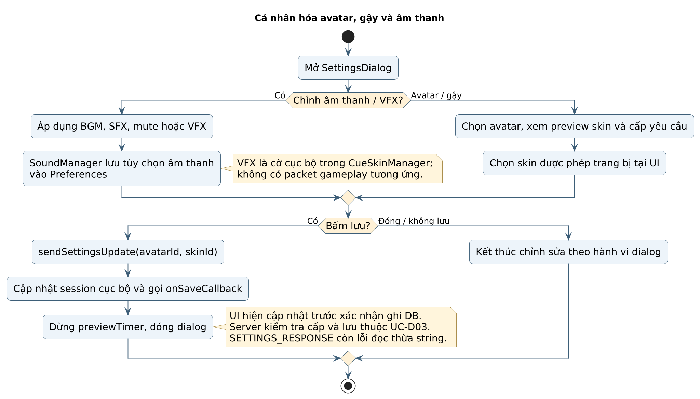

## B.13. Popup thách đấu, toast và chuyển cảnh

Loại sơ đồ: Sequence. Đối chiếu Phụ lục A: UC-UI01, UC-UI03, UC-UI05.

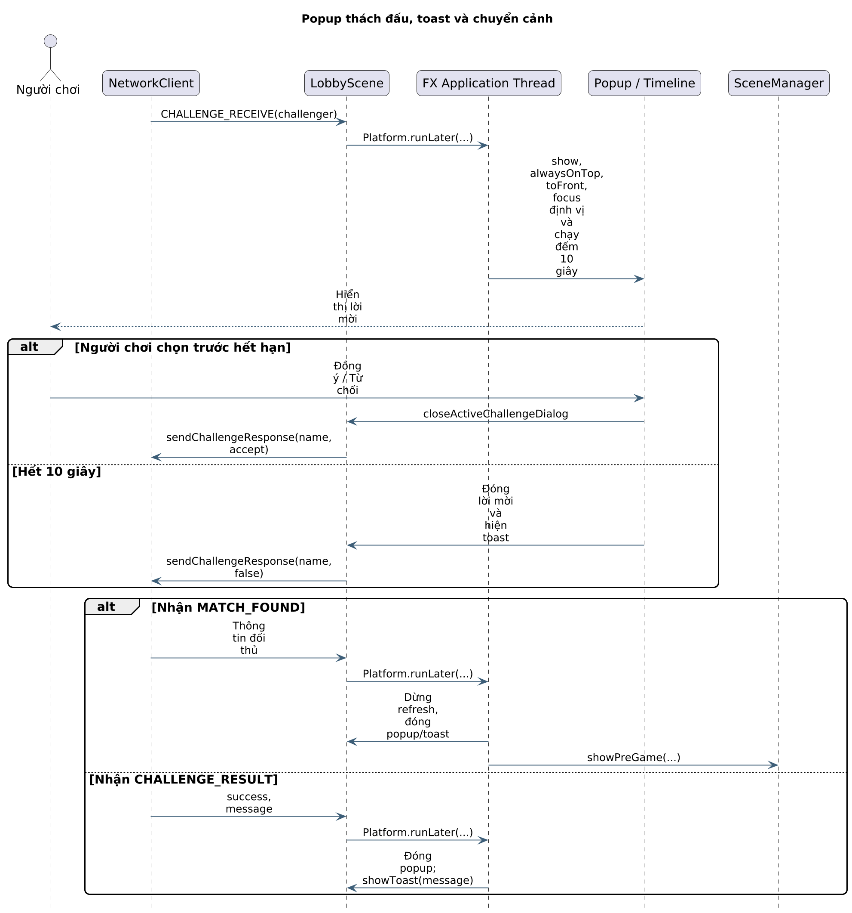

## B.14. Thành phần giao diện và cá nhân hóa

Loại sơ đồ: Component. Đối chiếu Phụ lục A: UC-UI01, UC-UI02, UC-UI03, UC-UI04, UC-UI05, UC-UI06, UC-UI07, UC-UI08, UC-UI09.

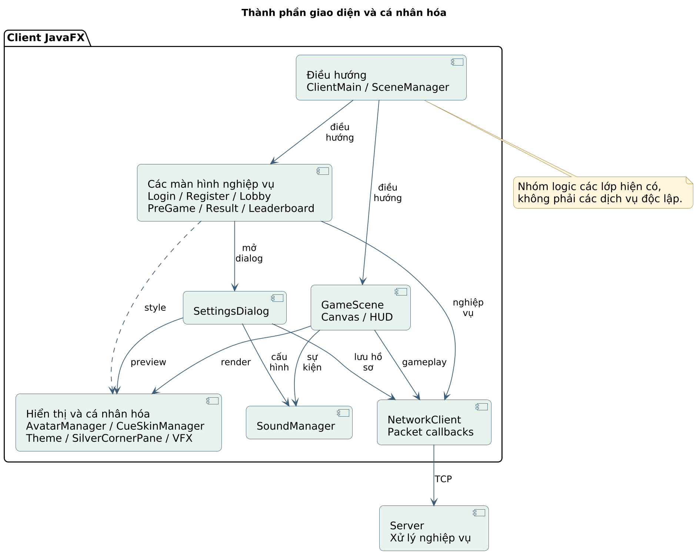


# TÀI LIỆU THAM KHẢO


[1] Hồ sơ yêu cầu của đồ án trò chơi bi-a hai người qua mạng: kết nối và giao thức, tài khoản và dữ liệu, gameplay và vật lý, giao diện và cá nhân hóa.

[2] Mã nguồn ứng dụng: https://github.com/LocMixi2-5/LTM/tree/00bf1ccaf8df2cdd54b79cb75ca188ae9c38627e . Lần kiểm tra main ngày 29/10/2026 không có thay đổi mã ứng dụng sau phiên bản này.

[3] Client: client/src/com/billiards/client/NetworkClient.java; scenes/{SceneManager, ServerConfigDialog, LoginScene, RegisterScene, LobbyScene, PreGameScene, GameScene, SettingsDialog, ResultScene, LeaderboardScene}.java; game/{Ball, PhysicsEngine, CueSkinManager}.java; AvatarManager.java; audio/SoundManager.java.

[4] Server: server/src/com/billiards/server/{ServerMain, ClientHandler, GameRoom, LobbyManager, AuthManager, DatabaseManager}.java; protocol/{Packet, PacketType, CueSkinConfig}.java; database/schema.sql.

[5] Đặc tả chức năng: reports/uml_spec.json. Biểu đồ dùng trong báo cáo: reports/uml_unified/manifest.json và các nguồn PlantUML, PNG, SVG cùng thư mục. Kết xuất bằng PlantUML 1.2025.2.

[6] Minh chứng thực thi: reports/evidence/00bf1cc/README.md cùng nhật ký và script ngày 26/10/2026. Bảy ảnh JavaFX của đợt kiểm tra này được dùng làm minh họa ở Chương 5, có ghi rõ điều kiện chụp và phạm vi áp dụng.

[7] Oracle. Java SE 17 API: Socket, ServerSocket, DataInputStream, DataOutputStream. Tài liệu nền về kết nối và đọc/ghi dữ liệu: https://docs.oracle.com/en/java/javase/17/docs/api/java.base/java/net/Socket.html và https://docs.oracle.com/en/java/javase/17/docs/api/java.base/java/io/DataInputStream.html .

[8] OpenJFX. JavaFX 17 API: Platform và AnimationTimer. https://openjfx.io/javadoc/17/javafx.graphics/javafx/application/Platform.html ; https://openjfx.io/javadoc/17/javafx.graphics/javafx/animation/AnimationTimer.html .

[9] PostgreSQL Global Development Group. PostgreSQL 17 Documentation: Transactions, Constraints và Indexes. https://www.postgresql.org/docs/17/tutorial-transactions.html ; https://www.postgresql.org/docs/17/ddl-constraints.html ; https://www.postgresql.org/docs/17/indexes.html .

[10] PostgreSQL JDBC Driver. Tài liệu JDBC và thao tác dữ liệu: https://jdbc.postgresql.org/documentation/ .

[11] PlantUML. Tài liệu Use Case, Activity, Sequence và Component: https://plantuml.com/use-case-diagram ; https://plantuml.com/activity-diagram-beta ; https://plantuml.com/sequence-diagram ; https://plantuml.com/component-diagram . Các tài liệu công nghệ dùng làm nguồn kiến thức nền; hiện trạng dự án được xác định từ mã nguồn [2–4] và minh chứng [6].
